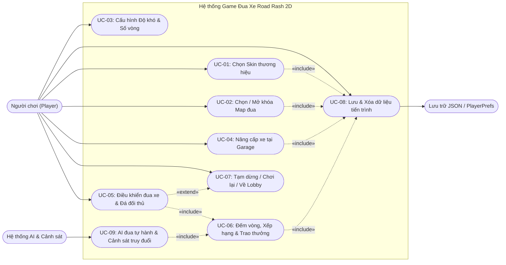
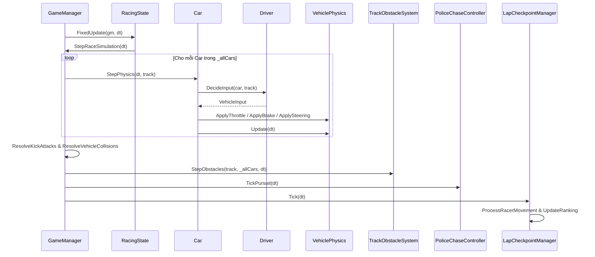
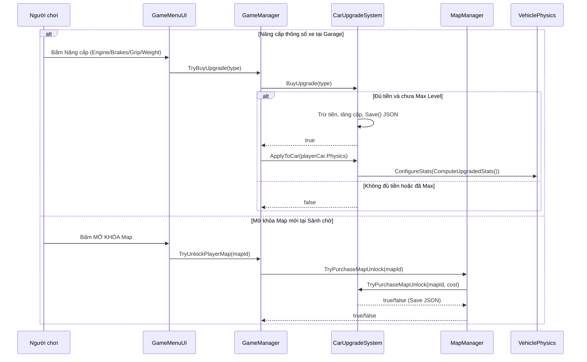
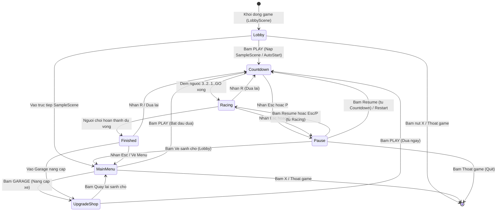
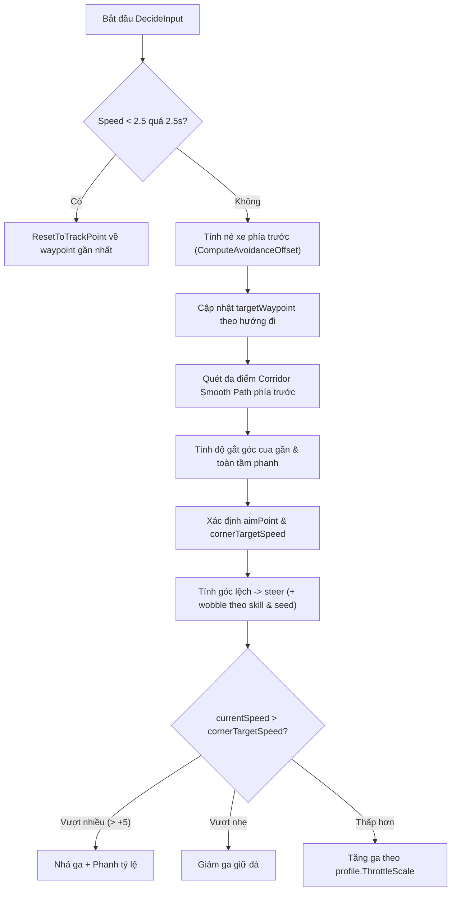
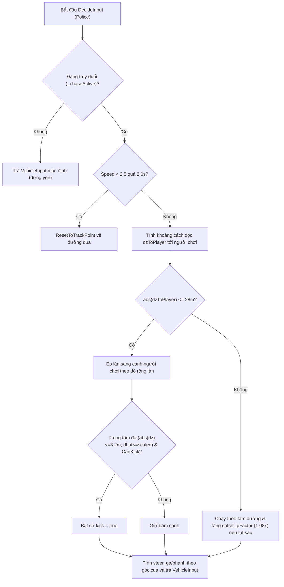
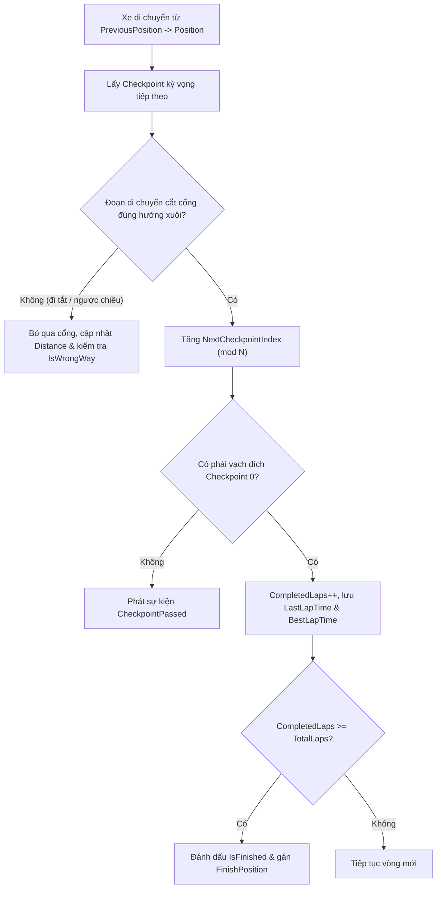

# Báo Cáo Kiến Trúc & Thiết Kế OOP — Game Đua Xe Road Rash 2D (Unity)

## 1. Giới thiệu & Phạm vi
- **Tên dự án:** *Road Rash 2D: Đại Chiến Shipper* (`newbie`)
- **Thể loại:** Đua xe mô tô 2D góc nhìn từ sau xe (Pseudo-3D kiểu *Road Rash*) dựng trên mô hình vật lý 2D phẳng `(x, y)` và đường đua vòng kín `WaypointTrack` (hỗ trợ 2–6 làn xe, địa hình nhấp nhô, cầu vượt, hầm chui và vạch qua đường).
- **Mục tiêu:** Điều khiển xe qua các góc cua, né chướng ngại vật (`TrackObstacleSystem`), cạnh tranh với tối đa 4 đối thủ AI tự hành (`AIRacerDriver`) và né đòn ép làn của Cảnh sát truy đuổi (`PoliceRacerDriver`), sử dụng đòn đá (`Kick`) để cản đối thủ, hoàn thành đủ số vòng qua đúng thứ tự checkpoint để giành thứ hạng cao, kiếm tiền thưởng nâng cấp xe trong Garage, mở khóa map mới và chọn skin thương hiệu shipper (`Xanh SM`, `Shopee Food`, `Grab`, `Ahamove`).
- **Công cụ & Công nghệ:** Unity 6 (`6000.6.9f1`), C#, Unity Input System (`1.20.1`), Universal Render Pipeline — URP (`17.6.0`), uGUI (`2.6.0`), Unity Test Framework (`1.8.0`), Git/GitHub.
- **Ngoài phạm vi:** Không chơi mạng online (multiplayer), không sử dụng mô hình 3D nặng hay vật lý 3D PhysX.

---

## 2. Sơ đồ Use Case & Danh sách Yêu cầu

### 2.1 Sơ đồ Use Case



### 2.2 Danh sách Yêu cầu Chức năng (Functional Requirements)

| Mã | Tên yêu cầu | Mô tả chi tiết | Thành phần cài đặt chính |
| :--- | :--- | :--- | :--- |
| **FR-01** | Sảnh chờ khởi động (Lobby) | Hiển thị backdrop Sài Gòn đêm, thống kê tiền/kỷ lục, modal chọn 4 skin thương hiệu (`Xanh SM`, `Shopee Food`, `Grab`, `Ahamove`), carousel chọn 4 map kèm banner ảnh và nút mở khóa, chọn độ khó và số vòng (đồng bộ `PlayerPrefs` giữa `LobbyScene` và `SampleScene`), bật/tắt CRT Scanline, nút `PLAY`, `GARAGE`, `X` thoát game. | `GameMenuUI`, `LobbyUiBuilder`, `SkinManager`, `MapManager` |
| **FR-02** | Hệ thống Skin thương hiệu & Palette Swap | Quản lý 4 `BikeSkinData` nhiều pose (Upright, LeanLeft1/2, LeanRight1/2, KickLeft, HitStagger), dùng `BikePaletteSwapper` ánh xạ màu HSV có cache (`Dictionary`) từ bộ sprite gốc sang 4 thương hiệu + Cảnh sát (0 alloc/frame), fallback procedural an toàn khi thiếu sprite. | `SkinManager`, `BikeSkinData`, `BikePaletteSwapper`, `RoadRashBikeSprites` |
| **FR-03** | Hệ thống Map đa dạng (2–6 làn) | Quản lý danh sách `TrackDefinition` & `MapTheme` (Phố Sáng Ban Mai, Đại Lộ Ven Biển, Cao Tốc Đêm Neon, Thành Phố Đêm Neon); hỗ trợ mở khóa bằng tiền thưởng, lưu kỷ lục từng map và cấu trúc đặc biệt (`Overpass`, `Tunnel`, `Crosswalk`). | `MapManager`, `TrackDefinition`, `MapTheme`, `WaypointTrack` |
| **FR-04** | Mô phỏng vật lý xe 2D | Mô phỏng lực kéo động cơ, phanh, lực cản khí động, lực ma sát lăn, độ bám ngang theo lốp, lái phụ thuộc tốc độ, phạt tốc độ ngoài đường (`IsOnTrack == false`) và rào chắn biên ngoài (`MaxOffRoadWidth`). | `VehiclePhysics`, `VehicleStats`, `VehicleStatsAsset`, `Car` |
| **FR-05** | Điều khiển người chơi & Chiến đấu | Đọc phím `W/A/S/D` hoặc phím mũi tên (ga, phanh, lái mượt) và `Space` (đá trái/phải tự động hướng về đối thủ gần nhất trong tầm, gây choáng và đẩy ngang kèm cooldown). | `InputHandler`, `PlayerDriver`, `GameManager` |
| **FR-06** | Đối thủ AI tự hành theo độ khó | Tối đa 4 xe AI sử dụng `AIProfile` (`Easy`, `Normal`, `Hard`), hỗ trợ 3 chế độ dẫn đường (`SmoothedSplinePath`, `SpeedAdaptiveWaypoint`, `LegacyFixed`), né xe phía trước, giữ làn, chống kẹt sau 2.5s và hỗ trợ seed cố định (deterministic). | `AIRacerDriver`, `AIProfile` |
| **FR-07** | Cảnh sát truy đuổi | Xe Cảnh sát (`PoliceCar_Unit01`) bám theo xe người chơi, tự tăng tốc bắt kịp khi tụt lại, ép làn ngang khi áp sát, tung đòn đá cản và bật đèn còi xanh-đỏ cảnh báo trên HUD khi vào tầm. | `PoliceChaseController`, `PoliceRacerDriver` |
| **FR-08** | Chướng ngại vật & Cảnh quan | Sinh chướng ngại vật ngẫu nhiên trên làn (`TrafficCone`, `OilBarrel`, `RoadBarrier`, `OilSlick`, `ParkedBus`), xử lý va chạm giảm tốc/đẩy ngang và hồi phục sau cooldown; sinh prop hai bên đường theo vùng của `MapTheme`. | `TrackObstacleSystem`, `EnvironmentDecorator`, `RoadRashPropSprites` |
| **FR-09** | Đếm vòng, Chống đi tắt & Xếp hạng | Kiểm tra cắt cổng `Checkpoint` theo đúng thứ tự và đúng chiều xuôi, phát hiện đi ngược chiều (`IsWrongWay`), tính thời gian từng vòng / kỷ lục và xếp hạng thời gian thực. | `LapCheckpointManager`, `Checkpoint`, `RacerProgress`, `RacerRankingComparer` |
| **FR-10** | Tạm dừng (Pause) & Hướng dẫn | Nhấn `Esc` hoặc `P` trong `Countdown` hoặc `Racing` để đóng băng thời gian (`Time.timeScale = 0`), mở Pause Overlay (`sortingOrder = 30`, uGUI + TMP) gồm telemetry, nút Resume/Restart/Lobby/Quit, bật/tắt CRT Scanline và modal Hướng dẫn phím đồng bộ 100% với phím thật. | `PauseMenuUI`, `GameManager`, `GameState`, `CrtScanlineController` |
| **FR-11** | Garage nâng cấp & Lưu tiến trình | Giao diện Workshop Tuning (`GarageUiBuilder`) hiển thị 4 thanh chỉ số (`MAX SPD`, `POWER`, `BRAKE`, `GRIP`), nâng cấp 4 hạng mục (`Engine`, `Brakes`, `Grip`, `WeightReduction`) tối đa 5 cấp kèm 5 LED pip; View kiểm tra qua `CanAfford`/`IsMaxLevel` và lưu JSON tự động. | `GarageUiBuilder`, `CarUpgradeSystem`, `PlayerSaveData`, `UpgradeType` |
| **FR-12** | Đồ họa Pseudo-3D, VFX, CRT & HUD | Dựng mặt đường phối cảnh theo lát cắt (`sliceCount = 104`), đồng bộ sprite 2D nhiều pose (`Assets/Art/`), hiệu ứng URP Bloom cân chỉnh cho đêm neon (`DefaultVolumeProfile.asset`), CRT Scanline shader bật/tắt (`CrtScanlineOverlay.shader`), HUD 4 góc Cyber Arcade (`RaceHUD`), và 11 SFX procedural (`M` tắt/bật). | `RoadRashRenderer2D`, `RaceVfxController`, `CrtScanlineController`, `RaceHUD`, `RaceAudioController` |

### 2.3 Danh sách Yêu cầu Phi chức năng (Non-Functional Requirements)

| Mã | Nhóm | Yêu cầu cụ thể | Cách đáp ứng trong hệ thống |
| :--- | :--- | :--- | :--- |
| **NFR-01** | Hiệu năng & Ổn định | Bước mô phỏng vật lý chạy ổn định ở tần số cố định (`FixedUpdate` ~50 Hz), không cấp phát rác thừa trong vòng lặp render/HUD. | Dùng object pool cho sprite đối thủ (`_opponentPool`), prop (`_propPool`), danh sách vertex/triangle tái sử dụng trong `RoadRashRenderer2D`. |
| **NFR-02** | Tính xác định (Determinism) | Hành vi AI với cùng `seed`, cấu hình và bản đồ phải tái lập chính xác tuyệt đối để phục vụ debug và benchmark. | `AIRacerDriver` dùng `_simulationTime` nội bộ và `System.Random(seed)` tách biệt khỏi `UnityEngine.Random` toàn cục. |
| **NFR-03** | Bảo trì & Mở rộng | Dễ dàng thêm map, theme, skin, chỉ số xe hoặc độ khó AI mới mà không sửa code lõi. | Tách dữ liệu thành `ScriptableObject` (`TrackDefinition`, `MapTheme`, `BikeSkinData`, `AIProfile`, `VehicleStatsAsset`) và phân chia `asmdef` (`RacingGame`, `RacingGame.Editor`, `RacingGame.Tests`). |
| **NFR-04** | An toàn & Chịu lỗi (Robustness) | Không crash khi thiếu asset gán tay hoặc khi file save JSON bị sửa sai biên. | Mọi thành phần đều có runtime fallback (`AIProfile.CreateDefault`, `BikeSkinData.CreateDefault`, `MapManager` preset mặc định, `VehicleStats.Sanitize()`, `ClampLoadedLevels()` trong `CarUpgradeSystem`). |
| **NFR-05** | Không phụ thuộc tài nguyên ngoài | Dự án phải chạy ngay sau khi clone mà không lỗi thiếu file hình ảnh/âm thanh rời. | Toàn bộ sprite xe, prop, UI, hiệu ứng hạt và AudioClip được sinh bằng thuật toán (procedural) khi không có override asset. |
| **NFR-06** | Khả năng kiểm thử (Testability) | Các module vật lý, AI, checkpoint, nâng cấp, map, skin, pause phải tách khỏi phụ thuộc scene phức tạp để kiểm thử tự động nhanh. | Toàn bộ logic lõi kiểm thử được qua NUnit EditMode Tests (`Assets/Tests/EditMode/`). |

---

## 3. Tuân thủ 4 tính chất Lập trình Hướng đối tượng (OOP)

| Tính chất OOP | Cách áp dụng thực tế trong code |
| :--- | :--- |
| **Trừu tượng hóa (Abstraction)** | Lớp cha trừu tượng `Driver` (`Assets/Scripts/Core/Driver.cs`) khai báo `abstract VehicleInput DecideInput(Car, WaypointTrack)`; lớp `RaceStateBase` (`Assets/Scripts/Core/GameState.cs`) trừu tượng hóa vòng đời trạng thái (`Enter`, `Update`, `FixedUpdate`, `Exit`); lớp `Checkpoint` ẩn toàn bộ phép toán giao cắt đoạn thẳng; struct `VehicleStats` gom chuẩn chỉ số vật lý dùng chung cho xe và nâng cấp. |
| **Kế thừa (Inheritance)** | `PlayerDriver : Driver`, `AIRacerDriver : Driver`, `PoliceRacerDriver : Driver`; 5 lớp trạng thái (`MainMenuState`, `CountdownState`, `RacingState`, `FinishedState`, `UpgradeShopState`) kế thừa `RaceStateBase`; các asset dữ liệu (`AIProfile`, `VehicleStatsAsset`, `TrackDefinition`, `MapTheme`, `BikeSkinData`) kế thừa `ScriptableObject`. |
| **Đa hình (Polymorphism)** | `Car` chỉ giữ tham chiếu kiểu lớp cha `Driver` và gọi `_driver.DecideInput(this, track)` — `VehiclePhysics` và `Car` không cần biết người chơi, AI thường hay Cảnh sát đang điều khiển. `GameManager` điều phối luồng game qua `_currentState.Update(...)` / `FixedUpdate(...)`. `RacerRankingComparer` cài đặt `IComparer<RacerProgress>` để hoán đổi quy tắc xếp hạng. |
| **Đóng gói (Encapsulation)** | Trạng thái nội bộ của `VehiclePhysics`, `Car`, `WaypointTrack`, `AIRacerDriver`, `PoliceRacerDriver`, `Checkpoint`, `RacerProgress`, `CarUpgradeSystem`, `SkinManager`, `MapManager`, `TrackObstacleSystem` được đặt `private` / `[SerializeField] private`, chỉ đọc qua property (`Position`, `IsOnTrack`, `Money`, `SelectedSkin`, `SelectedMap`, `Obstacles`...) và thay đổi qua phương thức kiểm soát có ràng buộc (`Sanitize`, `ClampValues`, `ClampLoadedLevels`, `BuyUpgrade`, `SelectMap`, `SelectSkin`, `StepPhysics`). |

---

## 4. Sơ đồ lớp (Class Diagram)

```mermaid
classDiagram
    class ScriptableObject {
        <<UnityEngine>>
    }

    class Driver {
        <<abstract>>
        -string driverName
        +string DriverName
        +SetDriverName(string) void
        +DecideInput(Car car, WaypointTrack track)* VehicleInput
        +OnReset() void
    }

    class PlayerDriver {
        -InputHandler inputHandler
        +SetInputHandler(InputHandler) void
        +DecideInput(Car car, WaypointTrack track) VehicleInput
        +OnReset() void
    }

    class AIRacerDriver {
        -AINavigationMode navigationMode
        -AIProfile profile
        -int targetWaypoint
        -float skillLevel
        -float preferredLateralOffset
        -float _mapCornerSpeedMultiplier
        +Configure(string, AIProfile, float, float) void
        +SetAllCars(IReadOnlyList~Car~) void
        +DecideInput(Car car, WaypointTrack track) VehicleInput
    }

    class PoliceRacerDriver {
        -Car _targetPlayer
        -int targetWaypoint
        -bool _chaseActive
        +ConfigurePolice(Car, string) void
        +SetTargetPlayer(Car) void
        +DecideInput(Car car, WaypointTrack track) VehicleInput
    }

    class AIProfile {
        -DifficultyLevel difficulty
        -float skillLevel
        -float topSpeedFactor
        -float minCornerSpeed
        -float cornerBrakeAggression
        -float throttleScale
        -float noiseAmplitude
        -float noiseFrequency
        +CreateDefault(DifficultyLevel)$ AIProfile
        +ConfigureValues(DifficultyLevel, float, float, float, float, float, float, float) void
    }

    class InputHandler {
        -float steerResponseSpeed
        -bool _kickQueued
        +ReadInput() VehicleInput
        +ResetState() void
    }

    class VehicleStats {
        <<struct>>
        +float mass
        +float enginePower
        +float brakePower
        +float grip
        +float drag
        +float rollingResistance
        +float maxSpeed
        +float maxReverseSpeed
        +float turnRate
        +Default()$ VehicleStats
        +Sanitize() VehicleStats
    }

    class VehicleStatsAsset {
        -VehicleStats stats
        +VehicleStats Stats
        +SetStats(VehicleStats) void
    }

    class VehiclePhysics {
        -Vector2 position
        -Vector2 velocity
        -float heading
        -VehicleStats stats
        +ConfigureStats(VehicleStats) void
        +ApplyThrottle(float) void
        +ApplyBrake(float) void
        +ApplySteering(float) void
        +Update(float dt) void
    }

    class Car {
        -VehicleStatsAsset baseStatsAsset
        -VehiclePhysics physics
        -Driver _driver
        -BikeSkinData activeSkin
        -bool _isOnTrack
        +Initialize(Driver, Vector2, float, WaypointTrack) void
        +ApplySkin(BikeSkinData) void
        +TryStartKick(int, float, float) bool
        +ReceiveKick(int, Vector2, float) void
        +StepPhysics(float dt, WaypointTrack) void
    }

    class BikeSkinData {
        -DriverBrandSkin skinId
        -string displayName
        -Color primaryColor
        -Color secondaryColor
        -Material customMaterial
        -Texture2D customTexture
        -Sprite customSprite
        +CreateDefault(DriverBrandSkin)$ BikeSkinData
        +GetOverrideSprite() Sprite
    }

    class SkinManager {
        -BikeSkinData[] skinAssets
        -DriverBrandSkin selectedBrand
        -List~BikeSkinData~ _resolvedSkins
        +EnsureInitialized() void
        +SelectSkin(DriverBrandSkin, Car) bool
        +ApplyToCar(Car) void
    }

    class MapTheme {
        -string themeId
        -string themeName
        -HorizonSilhouetteStyle horizonStyle
        -Color skyTop
        -Color asphaltLight
        -MapZonePropConfig[] zones
        +CreateValleyPreset()$ MapTheme
        +CreateCityDistrictPreset()$ MapTheme
        +CreateCoastalHighwayPreset()$ MapTheme
    }

    class TrackDefinition {
        -string mapId
        -string displayName
        -Vector2[] waypoints
        -int laneCount
        -float laneWidth
        -int obstacleCount
        -bool enablePoliceChase
        -float rewardMultiplier
        -MapTheme theme
        -TrackFeatureZone[] featureZones
        +CreateCityMorningPreset(MapTheme)$ TrackDefinition
        +CreateCityDistrictPreset(MapTheme)$ TrackDefinition
    }

    class MapManager {
        -TrackDefinition[] mapAssets
        -List~TrackDefinition~ _maps
        -CarUpgradeSystem _saveSystem
        -int _selectedIndex
        +BindSaveSystem(CarUpgradeSystem) void
        +SelectMap(string, WaypointTrack, EnvironmentDecorator) bool
        +TryPurchaseMapUnlock(string) bool
    }

    class WaypointTrack {
        -TrackDefinition trackDefinition
        -Vector2[] waypoints
        -int laneCount
        -float laneWidth
        -float trackWidth
        +ApplyTrackDefinition(TrackDefinition) void
        +GetLaneCenterOffset(int) float
        +ProjectPosition(Vector2) TrackProjection
        +SampleAtDistance(float) TrackSample
    }

    class TrackObstacleSystem {
        -bool enableObstacles
        -int obstacleCount
        -float minSpacingMeters
        -List~TrackObstacle~ _obstacles
        +ApplyMapSettings(TrackDefinition) void
        +SpawnObstacles(WaypointTrack, Nullable~int~) void
        +StepObstacles(WaypointTrack, IReadOnlyList~Car~, float) void
    }

    class EnvironmentDecorator {
        -float slotIntervalMeters
        -float propDensity
        -List~RoadsideDecoration~ _decorations
        +RebuildEnvironment(WaypointTrack, MapTheme, Nullable~int~) void
    }

    class PoliceChaseController {
        -bool enablePoliceChase
        -Car policeCar
        -PoliceRacerDriver policeDriver
        +ApplyMapSettings(TrackDefinition) void
        +EnsurePoliceUnit(Car, WaypointTrack, VehicleStatsAsset) Car
        +ResetPoliceOnGrid(Car, WaypointTrack) void
        +TickPursuit(float dt) void
    }

    class LapCheckpointManager {
        -List~Checkpoint~ _checkpoints
        -List~RacerProgress~ _racers
        -int totalLaps
        +Initialize(WaypointTrack, IReadOnlyList~Car~, int) void
        +Tick(float dt) void
        +GetRanking() IReadOnlyList~RacerProgress~
    }

    class CarUpgradeSystem {
        -PlayerSaveData _data
        -VehicleStats _baseStats
        +int Money
        +BuyUpgrade(UpgradeType) bool
        +TryPurchaseMapUnlock(string, int) bool
        +ApplyToCar(VehiclePhysics) void
        +Save() void
        +Load() bool
    }

    class RaceStateBase {
        <<abstract>>
        +GameFlowState StateType*
        +Enter(GameManager) void
        +Update(GameManager, float) void
        +FixedUpdate(GameManager, float) void
        +Exit(GameManager) void
    }

    class PauseMenuUI {
        -GameManager _gameManager
        -GameObject _pauseRoot
        +bool IsShowing
        +Bind(GameManager) void
        +RefreshState() void
    }

    class GameMenuUI {
        -GameManager _gameManager
        -SkinManager _skinManager
        -MapManager _mapManager
        +Bind(GameManager) void
        +InitializeStandaloneLobby() void
        +SelectSkinFromLobby(DriverBrandSkin) bool
    }

    class GameManager {
        -List~Car~ _allCars
        -CarUpgradeSystem _upgradeSystem
        -RaceStateBase _currentState
        -bool _isPaused
        +TransitionTo(GameFlowState) void
        +PauseGame() void
        +ResumeGame() void
        +StepRaceSimulation(float dt) void
    }

    ScriptableObject <|-- AIProfile
    ScriptableObject <|-- VehicleStatsAsset
    ScriptableObject <|-- BikeSkinData
    ScriptableObject <|-- MapTheme
    ScriptableObject <|-- TrackDefinition

    Driver <|-- PlayerDriver
    Driver <|-- AIRacerDriver
    Driver <|-- PoliceRacerDriver

    PlayerDriver --> InputHandler : uses
    AIRacerDriver o-- AIProfile : uses tuning
    PoliceChaseController o-- PoliceRacerDriver : controls
    PoliceChaseController o-- Car : manages policeCar

    VehicleStatsAsset *-- VehicleStats : wraps
    VehiclePhysics *-- VehicleStats : uses
    Car *-- VehiclePhysics : composition
    Car o-- VehicleStatsAsset : base stats
    Car o-- Driver : polymorphic driver
    Car o-- BikeSkinData : active skin

    SkinManager "1" o-- "*" BikeSkinData : manages
    TrackDefinition o-- MapTheme : theme
    MapManager "1" o-- "*" TrackDefinition : manages
    MapManager --> CarUpgradeSystem : syncs unlocks
    WaypointTrack o-- TrackDefinition : applies
    TrackObstacleSystem ..> TrackDefinition : reads settings
    TrackObstacleSystem ..> WaypointTrack : spawns on
    EnvironmentDecorator ..> MapTheme : reads zones

    GameManager *-- CarUpgradeSystem : owns
    GameManager o-- LapCheckpointManager : uses
    GameManager o-- WaypointTrack : uses
    GameManager o-- RaceStateBase : current state
    GameManager o-- SkinManager : uses
    GameManager o-- MapManager : uses
    GameManager o-- TrackObstacleSystem : uses
    GameManager o-- PoliceChaseController : uses
    GameManager o-- PauseMenuUI : toggles
    GameManager o-- GameMenuUI : binds
    GameManager "1" --> "*" Car : manages
```



---

## 5. Sơ đồ tuần tự (Sequence Diagrams)

### 5.1 Luồng mỗi bước vật lý (`FixedUpdate`)


### 5.2 Luồng nâng cấp xe & mở khóa Map


---

## 6. Sơ đồ trạng thái (State Diagram)

Sơ đồ trạng thái phản ánh đầy đủ cả luồng khởi động từ **Lobby** (`LobbyScene` độc lập hoặc `MainMenu` trong `SampleScene`) và trạng thái tạm dừng **Pause** (`_isPaused = true`, `Time.timeScale = 0f`, hiển thị `PauseMenuUI`) khi đang ở `Countdown` hoặc `Racing`.



---

## 7. Lưu đồ thuật toán AI, Cảnh sát & Đếm vòng

### 7.1 AI bám đường đua (`AIRacerDriver` — `SmoothedSplinePath`)


### 7.2 Cảnh sát truy đuổi (`PoliceRacerDriver`)


### 7.3 Đếm vòng chống gian lận (`LapCheckpointManager`)


---

## 8. Chương Cài đặt (Implementation)

### 8.1 Tổ chức Assembly, Thư mục Art và Module
Mã nguồn được tách rõ thành 3 Assembly Definition (`.asmdef`) gồm **40 script runtime** và **3 script Editor**, cùng thư mục tài nguyên đồ họa chuẩn hóa dưới `Assets/Art/`:
1. **`RacingGame`** (`Assets/Scripts/RacingGame.asmdef`): Toàn bộ logic gameplay, vật lý, AI, bản đồ, skin/palette swap, giao diện uGUI + TextMeshPro, đồ họa, VFX/CRT, âm thanh và lưu trữ dữ liệu; tham chiếu `Unity.InputSystem`, `Unity.RenderPipelines.Core.Runtime`, `Unity.RenderPipelines.Universal.Runtime`, `UnityEngine.UI`, `Unity.TextMeshPro`.
2. **`RacingGame.Editor`** (`Assets/Scripts/Editor/RacingGame.Editor.asmdef`): Gồm `RoadRashSceneSetup`, `ArtAssetImportPostprocessor` (tự cấu hình Sprite/PPU/Pivot/Compression cho `Assets/Art/`) và `Stage2ArtWiringEditor` (tự gắn sprite nhiều pose, prop override, banner map, preview skin vào các `.asset`).
3. **`RacingGame.Tests`** (`Assets/Tests/EditMode/RacingGame.Tests.asmdef`): Chứa **18 bộ test EditMode** tham chiếu `RacingGame`, `UnityEngine.TestRunner`, `UnityEditor.TestRunner`, `Unity.TextMeshPro` và `nunit.framework.dll`.

```text
Assets/
├── Art/
│   ├── Maps/                       # Banner_Map01_CityMorning .. Banner_Map04_CityNightDistrict (1376x768)
│   ├── Previews/                   # Preview_XanhSM, Preview_ShopeeFood, Preview_Grab, Preview_Ahamove (1376x768)
│   ├── Sprites/
│   │   ├── Bikes/                  # 6 pose rear-view XanhSM RGBA (Upright, LeanLeft/Right Light/Deep, KickLeft)
│   │   └── Props/                  # 10 sprite prop & vật cản RGBA (RoadBarrier, Cone, Barrel, ParkedBus, Palm, Tree, Lamp, NeonSign, HighwaySign)
│   └── UI/                         # Bg_Lobby_SaigonNight.png
├── Shaders/
│   └── CrtScanlineOverlay.shader   # Shader CRT scanline + vignette tương thích URP
└── Scripts/
    ├── Editor/                     # ArtAssetImportPostprocessor.cs, RoadRashSceneSetup.cs, Stage2ArtWiringEditor.cs
    ├── Rendering/                  # RoadRashRenderer2D.cs, RaceVfxController.cs, CrtScanlineController.cs, ...
    ├── Skins/                      # BikePaletteSwapper.cs, BikeSkinData.cs, SkinManager.cs
    └── UI/                         # GameMenuUI.cs, LobbyUiBuilder.cs, GarageUiBuilder.cs, RaceHUD.cs, PauseMenuUI.cs, RoadRashUiSprites.cs
```

### 8.2 Chi tiết cài đặt các phân hệ chính
- **Vật lý xe & Chỉ số chuẩn (`VehiclePhysics`, `VehicleStats`, `VehicleStatsAsset`, `Car`):**
  - `VehicleStats` là struct giá trị chuẩn (`mass = 220`, `enginePower = 4800`, `brakePower = 7800`, `grip = 9.2`, `drag = 0.48`, `rollingResistance = 0.8`, `maxSpeed = 48`, `maxReverseSpeed = 8`, `turnRate = 2.4`) kèm `Sanitize()` chặn ngưỡng tối thiểu an toàn.
  - `Car` kết hợp `VehiclePhysics` (composition) với `Driver` (polymorphism), xử lý trạng thái off-road (giảm tốc tối đa còn 58%, giữ lực kéo và hỗ trợ lực đẩy quay lại mặt đường khi đánh lái vào trong), giới hạn biên ngoài `MaxOffRoadWidth`, nghiêng thân xe (`_leanAngle`) và trạng thái chiến đấu (`TryStartKick`, `ReceiveKick`, stagger & cooldown).
- **Hệ thống Đường đua, Map & Theme (`WaypointTrack`, `TrackDefinition`, `MapTheme`, `MapManager`):**
  - `WaypointTrack` hỗ trợ 2–6 làn xe động (`LaneCount`, `LaneWidth`, `GetLaneCenterOffset`), nội suy Catmull-Rom (`SampleAtDistance`) tính độ cong, cao độ sóng sin và vùng đặc biệt (`Overpass` nâng cao độ cầu vượt, `Tunnel` ngắt prop ngoài trời, `Crosswalk` đặt đèn giao thông).
  - `MapManager` quản lý 4 map mặc định (`city_morning`, `coastal_highway`, `neon_night`, `city_district`), lưu map đang chọn (`RacingGame_SelectedMap_v1`), kỷ lục thời gian từng map trong `PlayerPrefs` và đồng bộ mở khóa map với `CarUpgradeSystem`.
- **AI & Cảnh sát truy đuổi (`AIProfile`, `AIRacerDriver`, `PoliceChaseController`, `PoliceRacerDriver`):**
  - `AIRacerDriver` hỗ trợ 3 thuật toán dẫn đường: `SmoothedSplinePath` (mặc định — quét đa điểm theo đường cong mượt tránh cắt góc 90°), `SpeedAdaptiveWaypoint` và `LegacyFixed`; có seed cố định (`SetSeed`) bảo đảm determinism.
  - `PoliceChaseController` khởi tạo đơn vị cảnh sát `PoliceCar_Unit01` gắn `PoliceRacerDriver`, tăng nhẹ `maxSpeed` theo `policeSpeedBonus` của map, điều khiển nháy đèn xanh-đỏ và cập nhật khoảng cách cảnh báo cho `RaceHUD`.
- **Chướng ngại vật & Cảnh quan (`TrackObstacleSystem`, `EnvironmentDecorator`):**
  - `TrackObstacleSystem` sinh ngẫu nhiên (hoặc theo seed) 5 loại vật cản (`TrafficCone`, `OilBarrel`, `RoadBarrier`, `OilSlick`, `ParkedBus`), đảm bảo `ParkedBus` chỉ đỗ ở làn ngoài cùng và không chắn trong `Tunnel` hoặc trên `Overpass`; va chạm đẩy ngang xe, giảm tốc và đưa vật cản vào thời gian hồi sinh (`respawnCooldownSeconds = 4.5f`).
  - `EnvironmentDecorator` đọc động danh sách `MapZonePropConfig[]` và hệ số mật độ `propDensityMultiplier` từ `MapTheme` để rải prop hai bên đường.
- **Skin, Palette Swap, VFX/CRT & Giao diện Cyber Arcade (`SkinManager`, `BikeSkinData`, `BikePaletteSwapper`, `RaceVfxController`, `CrtScanlineController`, `LobbyUiBuilder`, `GarageUiBuilder`, `GameMenuUI`, `RaceHUD`, `PauseMenuUI`):**
  - `BikeSkinData` mở rộng hỗ trợ bộ sprite 7 pose (`Upright`, `LeanLeft1/2`, `LeanRight1/2`, `KickLeft`, `HitStagger`) đồng thời giữ nguyên trường cũ (`customTexture`, `customMaterial`, `customSprite`); `BikePaletteSwapper` ánh xạ màu HSV từ bộ `Xanh SM` sang 4 thương hiệu + Cảnh sát và cache duy nhất 1 lần trong `Dictionary` (0 cấp phát rác trong `Update`/`FixedUpdate`, tự fallback procedural khi sprite nguồn null hoặc non-readable).
  - `RaceVfxController` giữ nguyên cơ chế hạt va chạm `EmitImpactSparks(...)` và tinh chỉnh URP Bloom trên `DefaultVolumeProfile.asset`; `CrtScanlineController` (độc lập, lưu trạng thái qua `PlayerPrefs`) điều khiển shader `Assets/Shaders/CrtScanlineOverlay.shader` qua API công khai `IsEnabled` / `ToggleCrt()` / `SetEnabled(bool)` và tự giải phóng Material trong `OnDestroy()`.
  - `LobbyUiBuilder` và `GarageUiBuilder` tách riêng phần dựng layout uGUI + TextMeshPro theo nguyên tắc SRP (`View != Logic`), áp dụng ảnh nền/preview/banner từ `Assets/Art/` và nạp font TMP tiếng Việt đầy đủ tổ hợp dấu qua `LobbyUiBuilder.GetTmpFont(...)`.
  - `GameMenuUI` hỗ trợ chọn 4 Skin, carousel 4 Map, Garage 4 thẻ × 5 pip kiểm tra thuần View qua `CanAfford`/`IsMaxLevel`, và đồng bộ số vòng (`1V/2V/3V/5V`) + độ khó qua `PlayerPrefs` giữa `LobbyScene` và `SampleScene`.
  - `RaceHUD` bố trí 4 góc thông thoáng (`Leaderboard + QuickButtons`, `RankShield + FlashBanner`, `Minimap`, `Tachometer + LCD km/h + 12-LED RPM`, `Lap + Stopwatch`), giữ trung tâm ẩn khi không kích hoạt Countdown/Wrong-way/Finished, và hủy đăng ký Observer đầy đủ trong `OnDisable()` / `OnDestroy()`. `PauseMenuUI` dựng `PauseMenuCanvas` (`sortingOrder = 30`) với đủ 4 nút `TC-44`, nút CRT Scanline và Controls Modal đồng bộ 100% phím thật (`W/↑`, `S/↓`, `A/D`, `SPACE`, `M`, `R`, `ESC/P`).
- **Lưu trữ tiến trình JSON (`CarUpgradeSystem`, `PlayerSaveData`):**
  Đường dẫn mặc định: `Application.persistentDataPath/racing2d_save.json`
  ```json
  {
    "money": 580,
    "engineLevel": 2,
    "brakesLevel": 1,
    "gripLevel": 1,
    "weightLevel": 0,
    "racesPlayed": 3,
    "racesWon": 2,
    "bestRaceTime": 48.72,
    "unlockedMapIds": ["city_morning", "coastal_highway", "neon_night", "city_district"],
    "selectedMapId": "city_morning"
  }
  ```

---

## 9. Chương Kiểm thử (Testing)

### 9.1 Chiến lược & Môi trường kiểm thử
- **Phương pháp:** Kiểm thử đơn vị (Unit Test) và kiểm thử tích hợp mô phỏng nhiều bước vật lý (Simulation Integration Test) trên **Unity EditMode Test Runner** (`NUnit`, `com.unity.test-framework` `1.8.0`).
- **Môi trường chạy:** Unity `6000.6.9f1` batchmode (`-batchmode -nographics -runTests -testPlatform EditMode`).

### 9.2 Tổng hợp các nhóm Test Suite (`Assets/Tests/EditMode/`)
*(Số liệu thực tế được đối chiếu trực tiếp với kết quả chạy Unity EditMode Test Runner tại phiên bản code hiện tại)*

| STT | File Test | Phạm vi kiểm thử | Số Test Case |
| :---: | :--- | :--- | :---: |
| 1 | `Phase1And2Tests.cs` | Vật lý tăng tốc/phanh/rẽ, `WaypointTrack` vòng kín, phạt off-road | 4 |
| 2 | `Loop4AITests.cs` | `AIRacerDriver`, `AIProfile` (Easy/Normal/Hard), fallback null, chống kẹt, né xe | 9 |
| 3 | `Loop5LapCheckpointTests.cs` | Cổng `Checkpoint` 1 chiều, đếm vòng, chống đi tắt, xếp hạng, về đích, ngược chiều | 9 |
| 4 | `Loop6And7Tests.cs` | Nâng cấp `CarUpgradeSystem`, `VehicleStatsAsset`, giới hạn cấp 5, JSON Save/Load/Clamp, đa hình `RaceStateBase` | 7 |
| 5 | `Loop8KickAndGraphicsTests.cs` | Đòn đá & cooldown, va chạm đá ngang, sinh sprite xe/prop/minimap, tự tái tạo sprite | 4 |
| 6 | `AIRacerDeterminismAndBenchmarkTests.cs` | Tính xác định theo `seed` của AI & benchmark 1 vòng theo mức skill | 4 |
| 7 | `LobbyAndSkinSystemTests.cs` | `SkinManager` 4 thương hiệu, `BikeSkinData` custom asset, `GameMenuUI` Sảnh chờ | 3 |
| 8 | `GameplayAndPauseTests.cs` | `EnvironmentDecorator`, `TrackObstacleSystem`, `PoliceChaseController`, `PauseMenuUI` & Pause/Resume | 4 |
| 9 | `MapSystemTests.cs` | `TrackDefinition` 2–6 làn, `MapManager`, `MapTheme_Valley`, mở khóa map & lưu JSON | 8 |
| 10 | `CityMapTests.cs` | `MapTheme_City`, `TrackDefinition_City` (26 waypoints, cầu vượt, hầm chui, ngã tư, `ParkedBus`) | 5 |
| 11 | `CityCornerNavigationComparisonTests.cs` | So sánh 3 chế độ dẫn đường AI (`LegacyFixed`, `SpeedAdaptiveWaypoint`, `SmoothedSplinePath`) trên phố góc 90° | 1 |
| 12 | `GameplayFeelAndOffRoadRecoveryTests.cs` | Cảm giác lái `VehicleStats.Default`, phục hồi off-road, rào chắn biên ngoài, độ rộng làn các map asset | 4 |
| 13 | `LaneLayoutTests.cs` | Bố cục đối xứng 2/4/6 làn trên `WaypointTrack`, `GameManager` grid/AI, `TrackObstacleSystem` và vạch kẻ đường `RoadRashRenderer2D` | 6 |
| 14 | `MapAIBenchmark3LapTests.cs` | Benchmark AI chạy 3 vòng liên tiếp (`seed=2026`, `STUCK=0`, đúng thứ tự checkpoint) trên Map Valley & City | 2 |
| 15 | `ArtAssetsIntegrityTests.cs` | Toàn vẹn 6 sprite xe rear-view, 10 prop/vật cản trong suốt, 4 preview, 4 banner map và backdrop Lobby | 3 |
| 16 | `BikePaletteSwapAndStage2GraphicsTests.cs` | Cache `BikePaletteSwapper` cho 5 bảng màu, fallback an toàn khi null/non-readable và gán dữ liệu Stage 2 | 3 |
| 17 | `VfxAndCrtScanlineTests.cs` | Lưu/nạp `CrtScanlineController` qua `PlayerPrefs` (không cần Camera/Canvas) & kiểm chuẩn URP Bloom | 2 |
| 18 | `LobbyRedesignAndLapSyncTests.cs` | Đồng bộ vòng/độ khó Lobby, Lobby uGUI+TMP, Garage thuần View, HUD 4 góc + hủy Observer, Bộ 3 Modal 4D & Font tiếng Việt + dọn dead code | 6 |
| **Tổng** | **18 files** | **Toàn bộ EditMode Test Suite** | **84** |

- **Kết quả chạy thực tế (Unity `6000.6.9f1` batchmode):** Tổng `84` test cases — **Passed: 84**, **Failed: 0**, **Skipped: 0**, **Inconclusive: 0**, thời gian chạy `4.270s` (`4.269528s`, Result = Passed) — chi tiết từng test case xem tại [TEST_CASES.md](TEST_CASES.md), kết quả benchmark 3 vòng xem tại [EXPERIMENT.md](EXPERIMENT.md), log lỗi/cảnh báo xem tại [BUG_LOG.md](BUG_LOG.md).

---

## 10. Chương Kết luận (Conclusion)

### 10.1 Kết quả đạt được
- Hoàn thiện kiến trúc hướng đối tượng (OOP) rõ ràng cho game đua xe *Road Rash 2D*, áp dụng triệt để 4 tính chất (Trừu tượng hóa, Kế thừa, Đa hình, Đóng gói) cùng State Pattern (`RaceStateBase`), Strategy/Polymorphism (`Driver`, `IComparer<RacerProgress>`) và Data-Driven `ScriptableObject` (`AIProfile`, `VehicleStatsAsset`, `TrackDefinition`, `MapTheme`, `BikeSkinData`).
- Xây dựng đầy đủ vòng đời chơi và bộ giao diện uGUI + TextMeshPro Cyber Arcade hoàn chỉnh từ Sảnh chờ (`LobbyScene` / `MainMenu`) -> Chọn Skin & Map -> Nâng cấp Garage -> Đếm ngược -> Đua xe (vật lý 2D, AI đa độ khó, Cảnh sát truy đuổi, Chướng ngại vật, Đòn đá, multi-pose palette swap, URP Bloom + CRT Scanline) -> Tạm dừng / Hướng dẫn phím (`PauseMenuUI`) -> Kết quả (`RaceHUD`) & Lưu tiến trình JSON; dọn sạch mã mẫu thừa `Assets/Welcome/`.
- Đảm bảo chất lượng bằng bộ **84 EditMode tests** bao phủ cả vật lý, AI determinism, benchmark 3 vòng trên nhiều bản đồ, bố cục 2–6 làn, tài nguyên art 2D, palette swap cache, URP Bloom/CRT, giao diện TMP tiếng Việt, hủy đăng ký Observer (`OnDisable`/`OnDestroy`) và an toàn lưu trữ.

### 10.2 Hạn chế hiện tại
- Bộ kiểm thử hiện tại tập trung ở **EditMode** (chưa có PlayMode UI automation tests mô phỏng thao tác chuột/bàn phím thực tế qua nhiều frame giữa `LobbyScene` và `SampleScene`).
- Hệ thống âm thanh và sprite mặc định được sinh procedural nên tính đa dạng thẩm mỹ phụ thuộc vào việc gắn thêm tài nguyên `Sprite` / `Texture2D` / `Material` tùy biến trong Inspector nếu muốn nâng cấp đồ họa thương mại.
- Chỉ hỗ trợ chế độ chơi đơn với AI trên máy cục bộ (single-player desktop).

### 10.3 Hướng phát triển tiếp theo
- Bổ sung **PlayMode Test Suite** kiểm thử chuyển cảnh `LobbyScene -> SampleScene`, điều khiển InputSystem thực tế và chu kỳ Pause/Resume ở runtime.
- Bổ sung bộ đếm combo chiến đấu, vũ khí cận chiến đặc trưng của *Road Rash* (gậy/xích), hệ thống nhiệm vụ theo chặng và bảng xếp hạng trực tuyến.
- Hỗ trợ điều khiển cảm ứng (Touch UI) và tối ưu hóa cấu hình cho nền tảng di động (Android/iOS) hoặc WebGL.
