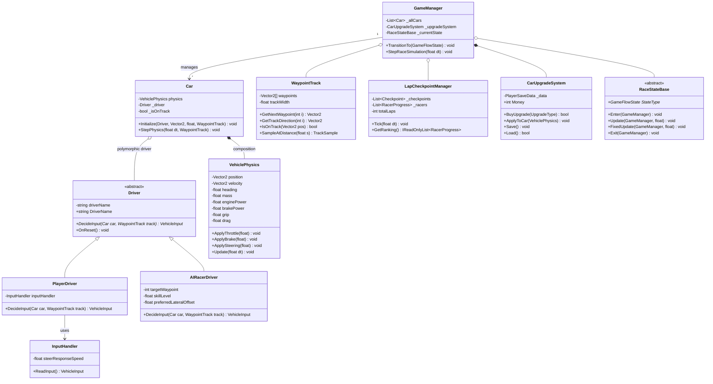
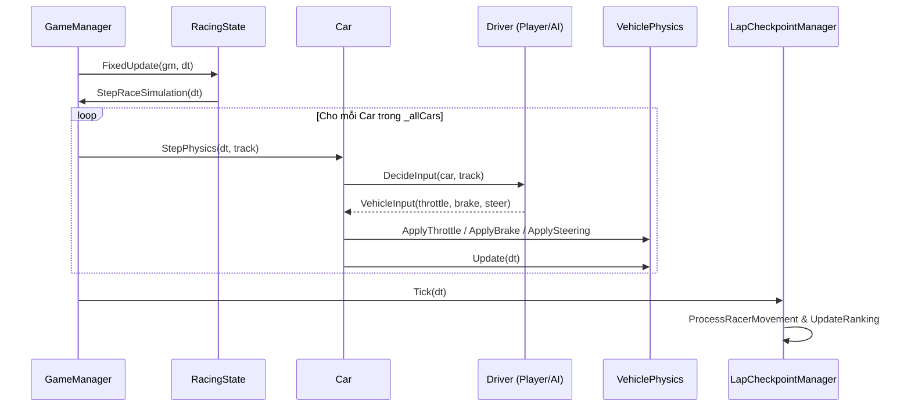
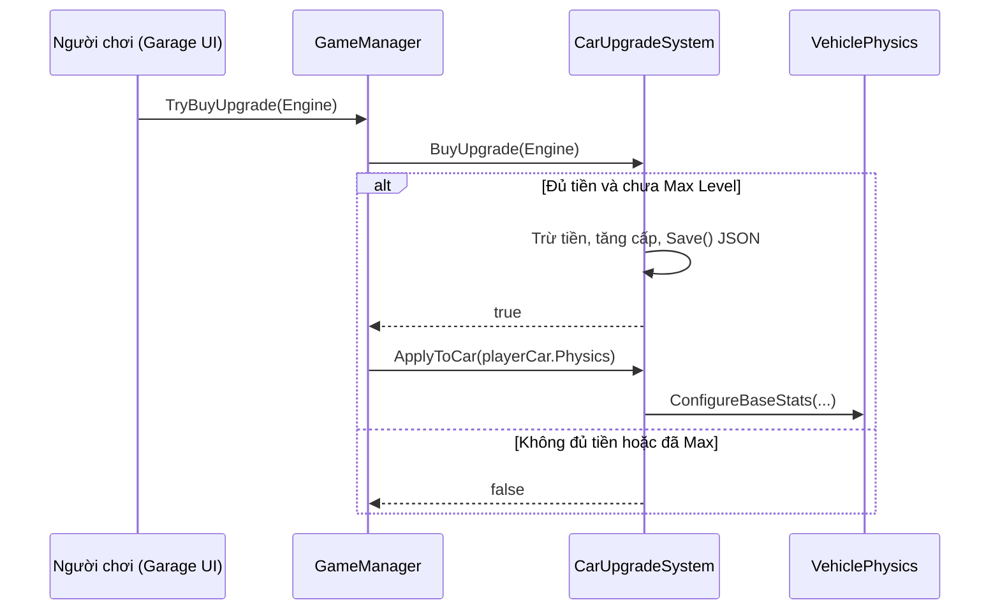
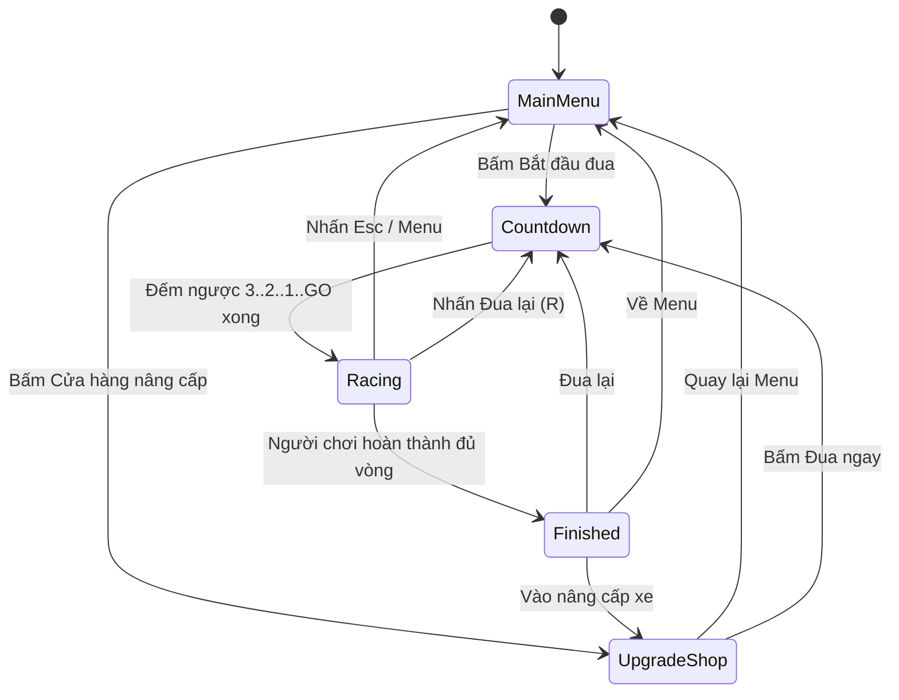
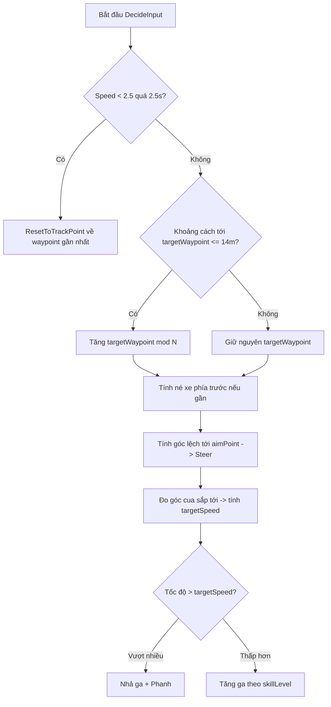
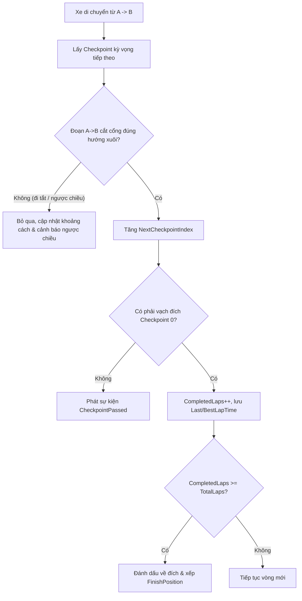

# Tài Liệu Kiến Trúc & Thiết Kế OOP — Game Đua Xe Road Rash 2D (Unity)

## 1. Giới thiệu & Phạm vi (Giai đoạn 1)
- **Thể loại:** Đua xe 2D góc nhìn từ sau xe (Pseudo-3D kiểu *Road Rash*) dựng trên mô hình vật lý 2D phẳng `(x, y)` và đường đua vòng kín `WaypointTrack`.
- **Mục tiêu:** Điều khiển xe vượt qua 4 đối thủ AI tự hành, hoàn thành đủ số vòng qua đúng thứ tự checkpoint để giành thứ hạng cao, kiếm tiền thưởng nâng cấp xe và lưu tiến trình bằng JSON.
- **Công cụ:** Unity 6 (`6000.6.9f1`), C#, Unity Input System, EditMode Test Framework, Git/GitHub.
- **Ngoài phạm vi:** Không chơi mạng online, không dùng mô hình 3D nặng.

---

## 2. Tuân thủ 4 tính chất Lập trình Hướng đối tượng (OOP)

| Tính chất OOP | Cách áp dụng thực tế trong code |
|---|---|
| **Trừu tượng hóa (Abstraction)** | Lớp cha trừu tượng `Driver` (`Assets/Scripts/Core/Driver.cs`) khai báo `abstract VehicleInput DecideInput(Car, WaypointTrack)`; lớp `RaceStateBase` (`Assets/Scripts/Core/GameState.cs`) trừu tượng hóa hành vi trạng thái game; `Checkpoint` ẩn toàn bộ phép toán giao cắt đoạn thẳng. |
| **Kế thừa (Inheritance)** | `PlayerDriver : Driver`, `AIRacerDriver : Driver`; 5 trạng thái game (`MainMenuState`, `CountdownState`, `RacingState`, `FinishedState`, `UpgradeShopState`) kế thừa `RaceStateBase`. |
| **Đa hình (Polymorphism)** | `Car` chỉ giữ tham chiếu kiểu lớp cha `Driver` và gọi `_driver.DecideInput(this, track)` — `VehiclePhysics` không biết người chơi hay AI đang lái. `GameManager` điều phối trạng thái qua `_currentState.Update(...)` / `FixedUpdate(...)`. `RacerRankingComparer` cài đặt `IComparer<RacerProgress>`. |
| **Đóng gói (Encapsulation)** | Trạng thái nội bộ của `VehiclePhysics`, `Car`, `WaypointTrack`, `AIRacerDriver`, `Checkpoint`, `RacerProgress`, `CarUpgradeSystem` được đặt `private` / `[SerializeField] private`, chỉ đọc qua property (`Position`, `IsOnTrack`, `Money`, `Waypoints`...) và thay đổi qua phương thức kiểm soát (`ApplyThrottle`, `BuyUpgrade`, `ProcessRacerMovement`...). |

---

## 3. Sơ đồ lớp (Class Diagram)



---

## 4. Sơ đồ tuần tự (Sequence Diagrams)

### 4.1 Luồng mỗi bước vật lý (FixedUpdate)


### 4.2 Luồng nâng cấp xe


---

## 5. Sơ đồ trạng thái (State Diagram)



---

## 6. Lưu đồ thuật toán AI & Đếm vòng

### 6.1 AI bám Waypoint (`AIRacerDriver`)


### 6.2 Đếm vòng chống gian lận (`LapCheckpointManager`)


---

## 7. Cấu trúc lưu file JSON (`CarUpgradeSystem`)
Đường dẫn mặc định: `Application.persistentDataPath/racing2d_save.json`
```json
{
  "money": 580,
  "engineLevel": 2,
  "brakesLevel": 1,
  "gripLevel": 1,
  "weightLevel": 0,
  "racesPlayed": 3,
  "racesWon": 2,
  "bestRaceTime": 48.72
}
```
