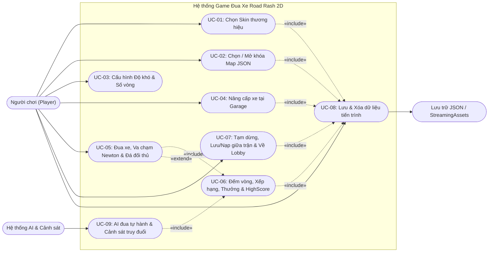
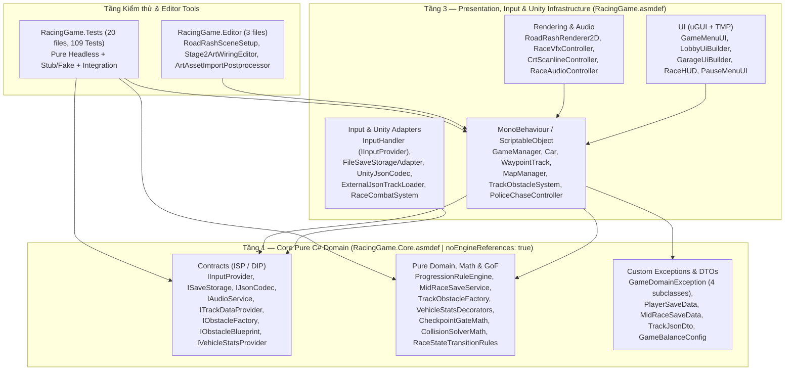
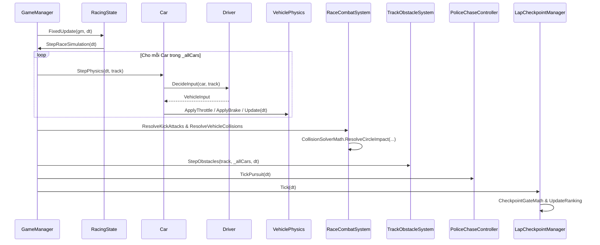
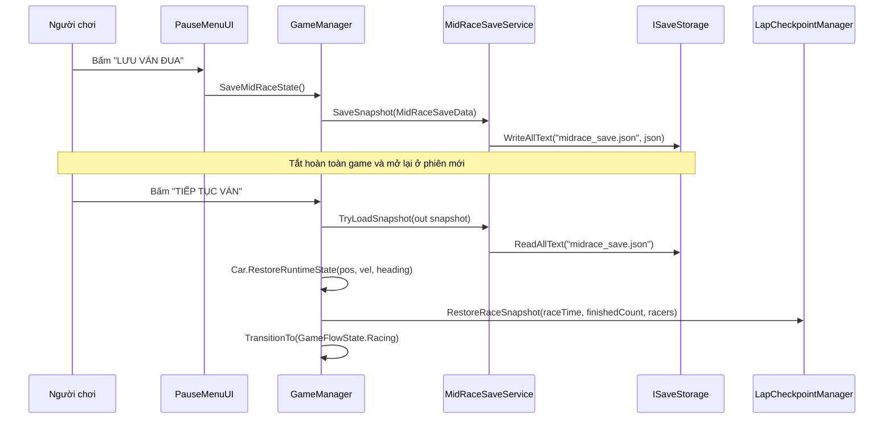
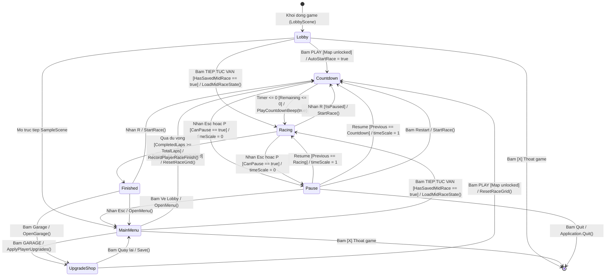

# Báo Cáo Kiến Trúc & Thiết Kế OOP — Game Đua Xe Road Rash 2D (Unity)

## 1. Giới thiệu & Phạm vi
- **Tên dự án:** *Road Rash 2D: Đại Chiến Shipper* (`newbie`)
- **Thể loại:** Đua xe mô tô 2D góc nhìn từ sau xe (Pseudo-3D kiểu *Road Rash*) dựng trên mô hình vật lý 2D phẳng `(x, y)` kết hợp va chạm đàn hồi Newton (`CollisionSolverMath`) và đường đua vòng kín `WaypointTrack` (2–6 làn xe, cầu vượt, hầm chui, vạch qua đường).
- **Mục tiêu:** Điều khiển xe qua các góc cua, né 5 loại chướng ngại vật (`TrackObstacleSystem` + `TrackObstacleFactory`), cạnh tranh với tối đa 4 đối thủ AI tự hành (`AIRacerDriver`) và né đòn ép làn của Cảnh sát truy đuổi (`PoliceRacerDriver`), tung đòn đá (`RaceCombatSystem`), hoàn thành đủ vòng qua đúng thứ tự `Checkpoint`, kiếm thưởng nâng cấp trong Garage, mở khóa map ngoài JSON, chọn 4 skin thương hiệu (`Xanh SM`, `Shopee Food`, `Grab`, `Ahamove`), lưu/nạp trạng thái giữa trận (`MidRaceSaveService`) và ghi bảng kỷ lục `HighScores`.
- **Công cụ & Công nghệ:** Unity 6 (`6000.6.9f1`), C#, Unity Input System (`1.20.1`), Universal Render Pipeline — URP (`17.6.0`), uGUI (`2.6.0`) + TextMeshPro, Unity Test Framework (`1.8.0`), Git/GitHub.
- **Ngoài phạm vi:** Không chơi mạng online (multiplayer), không sử dụng vật lý 3D PhysX.

---

## 2. Sơ đồ Use Case, Yêu cầu & Bảng Thông số Cân bằng

### 2.1 Sơ đồ Use Case

### 2.2 Danh sách Yêu cầu Chức năng (Functional Requirements)

| Mã | Tên yêu cầu | Mô tả chi tiết | Thành phần cài đặt chính |
| :--- | :--- | :--- | :--- |
| **FR-01** | Sảnh chờ khởi động (Lobby) | Hiển thị backdrop Sài Gòn đêm, thống kê tiền/kỷ lục, modal chọn 4 skin, carousel chọn 4 map JSON, chọn độ khó/số vòng (`PlayerPrefs`), bật/tắt CRT Scanline, nút `PLAY`, nút `TIẾP TỤC VÁN` (khi có save giữa trận), `GARAGE`, `X` thoát game. | `GameMenuUI`, `LobbyUiBuilder`, `SkinManager`, `MapManager` |
| **FR-02** | Hệ thống Skin thương hiệu & Palette Swap | Quản lý 4 `BikeSkinData` nhiều pose (Upright, LeanLeft1/2, LeanRight1/2, KickLeft, HitStagger), `BikePaletteSwapper` ánh xạ màu HSV có cache `Dictionary` (0 alloc/frame), fallback procedural khi thiếu sprite. | `SkinManager`, `BikeSkinData`, `BikePaletteSwapper`, `RoadRashBikeSprites` |
| **FR-03** | Hệ thống Map JSON ngoài (`StreamingAssets`) | Đọc động 4 bản đồ từ `Assets/StreamingAssets/Maps/*.json` qua `ITrackDataProvider` (`ExternalJsonTrackLoader`), kiểm tra ràng buộc bằng `TrackJsonDto.ValidateOrThrow()`, lưu kỷ lục từng map và hỗ trợ cầu vượt/hầm chui/ngã tư. | `ExternalJsonTrackLoader`, `TrackJsonDto`, `MapManager`, `TrackDefinition`, `WaypointTrack` |
| **FR-04** | Mô phỏng vật lý xe 2D & Va chạm Newton | Lực kéo, phanh, cản khí động, bám ngang, trượt tường (`wall-slide`) rào chắn biên ngoài `MaxOffRoadWidth`, nội suy render mượt và bộ giải va chạm cứng Newton 2D (`CollisionSolverMath`). | `VehiclePhysics`, `CollisionSolverMath`, `VehicleCollisionPhysics`, `Car` |
| **FR-05** | Điều khiển qua `IInputProvider` & Chiến đấu | Toàn bộ phím (`W/A/S/D`, mũi tên, `Space`, `F`, `Esc/P`, `R`, `M`) đi duy nhất qua `InputHandler : IInputProvider`; `RaceCombatSystem` xử lý đòn đá tự chọn bên đối thủ gần nhất. | `IInputProvider`, `InputHandler`, `PlayerDriver`, `RaceCombatSystem` |
| **FR-06** | Đối thủ AI tự hành theo độ khó | Tối đa 4 xe AI dùng `AIProfile` (`Easy`, `Normal`, `Hard`), dẫn đường `SmoothedSplinePath`, né xe phía trước, chống kẹt sau `2.5s` và tái lập theo `seed`. | `AIRacerDriver`, `AIProfile` |
| **FR-07** | Cảnh sát truy đuổi | Xe Cảnh sát (`PoliceCar_Unit01`) tăng tốc qua `PoliceInterceptorDecorator`, bám đuổi người chơi, ép làn, tung đòn đá và bật đèn còi xanh-đỏ cảnh báo HUD. | `PoliceChaseController`, `PoliceRacerDriver`, `PoliceInterceptorDecorator` |
| **FR-08** | Chướng ngại vật (`IObstacleFactory`) & Cảnh quan | `TrackObstacleFactory` tạo 5 spec (`TrafficCone`, `OilBarrel`, `RoadBarrier`, `OilSlick`, `ParkedBus`), `ParkedBus` chỉ ở làn ngoài & tránh hầm/cầu vượt; `EnvironmentDecorator` rải prop theo vùng `MapTheme`. | `TrackObstacleFactory`, `IObstacleBlueprint`, `TrackObstacleSystem`, `EnvironmentDecorator` |
| **FR-09** | Đếm vòng, Chống đi tắt, Xếp hạng & HighScores | `CheckpointGateMath` cắt cổng 1 chiều, chặn đi tắt, báo ngược chiều (`IsWrongWay`), xếp hạng qua `RacerRankingComparer` và lưu Top HighScores. | `CheckpointGateMath`, `LapCheckpointManager`, `Checkpoint`, `RacerProgress` |
| **FR-10** | Tạm dừng (Pause), Guard & Hướng dẫn | Guard `RaceStateTransitionRules.CanPause` chỉ cho Pause ở `Countdown`/`Racing`; Pause Overlay (`sortingOrder = 30`) có Telemetry, nút **`LƯU VÁN ĐUA`**, CRT Scanline và modal 7 phím thật. | `PauseMenuUI`, `RaceStateTransitionRules`, `GameManager`, `GameState` |
| **FR-11** | Garage nâng cấp, Save/Load giữa trận & JSON ngoài | Nâng cấp 4 hạng mục × 5 cấp áp bằng chuỗi Decorator (`VehicleStatsDecorator`), cấu hình ngoài `game_balance.json`, lưu tiến trình `racing2d_save.json` và lưu/khôi phục giữa trận `midrace_save.json` (`MidRaceSaveService`). | `GarageUiBuilder`, `ProgressionRuleEngine`, `CarUpgradeSystem`, `MidRaceSaveService`, `ExternalBalanceConfigLoader` |
| **FR-12** | Đồ họa Pseudo-3D, VFX, CRT & BGM + SFX | Mặt đường phối cảnh `104` lát cắt, URP Bloom, `CrtScanlineOverlay.shader`, HUD 4 góc Cyber Arcade (`RaceHUD`), và `RaceAudioController : IAudioService` phát **BGM Synthwave procedural (120 BPM)** + 11 SFX lưu âm lượng bền vững. | `RoadRashRenderer2D`, `RaceVfxController`, `CrtScanlineController`, `RaceHUD`, `RaceAudioController` |

### 2.3 Danh sách Yêu cầu Phi chức năng (Non-Functional Requirements)

| Mã | Nhóm | Yêu cầu cụ thể | Cách đáp ứng trong hệ thống |
| :--- | :--- | :--- | :--- |
| **NFR-01** | Hiệu năng & Ổn định | Bước vật lý cố định `50 Hz` (`FixedUpdate`), render nội suy 60 FPS ổn định, 0 cấp phát rác trong vòng lặp render/HUD. | Object pool (`_opponentPool`, `_propPool`), tái sử dụng vertex/triangle, dirty-check HUD, `BikePaletteSwapper` cache `Dictionary`. |
| **NFR-02** | Kiến trúc phân tầng | Lõi Pure OOP tách khỏi Unity Engine để chạy Unit Test không cần Scene/Form và dễ bảo trì. | Assembly **`RacingGame.Core`** đặt `"noEngineReferences": true` (`25` tệp C# thuần, **`0 using UnityEngine`**), giao tiếp qua 8 Interface DIP. |
| **NFR-03** | Dữ liệu hóa & Mở rộng | Thay đổi đường đua và thông số cân bằng mà không biên dịch lại code; thêm biến thể không sửa lớp cũ (OCP). | 4 Map JSON + `game_balance.json` trong `StreamingAssets/`, mở rộng bằng `IObstacleBlueprint` (Factory) & `VehicleStatsDecorator` (Decorator). |
| **NFR-04** | An toàn & Ngoại lệ | Không crash khi tệp Save/Config hỏng hoặc ngoài biên; cây ngoại lệ rõ ràng. | Cây `GameDomainException` (`SaveDataCorruptedException`, `InvalidTrackConfigurationException`, `InvalidUpgradeTransactionException`, `InvalidRaceStateTransitionException`), 0 `catch {}` rỗng, chế độ safe-load tự kẹp biên & fallback. |
| **NFR-05** | Đóng gói Clean-room | Không phụ thuộc tài nguyên ngoài hệ thống, chạy ngay bản build độc lập `≤ 3 phút`. | Xuất bản sạch `Builds/RoadRash2D/RoadRash2D.exe` kèm toàn bộ `StreamingAssets/`; audio & sprite đều có procedural generator dự phòng. |

### 2.4 Bảng Thông Số Cân Bằng (Balancing Table — Đồng bộ 1-1 `game_balance.json` & `Maps/*.json`)

#### A. Bảng Cân bằng Nâng cấp Xe & Kinh tế (`Assets/StreamingAssets/Config/game_balance.json`)
- **Thông số xe gốc (`defaultVehicleStats`):** `mass = 220 kg`, `enginePower = 4800`, `brakePower = 7800`, `grip = 9.2`, `drag = 0.48`, `rollingResistance = 0.8`, `maxSpeed = 48 m/s (~172.8 km/h)`, `maxReverseSpeed = 8 m/s`, `turnRate = 2.4 rad/s`.
- **Công thức giá cấp $L \in \{0..4\}$:** $\text{Cost}(L) = \text{RoundToInt}(\text{BaseCost} \times 1.5^L)$, trần `maxUpgradeLevel = 5`.

| Hạng mục (`UpgradeType`) | Giá gốc (`Lv0→1`) | `Lv1→2` | `Lv2→3` | `Lv3→4` | `Lv4→5` | Tác động mỗi cấp (qua `VehicleStatsDecorator`) |
| :--- | :---: | :---: | :---: | :---: | :---: | :--- |
| **Engine** | `150` | `225` | `338` | `506` | `759` | `+750` EnginePower, `+3.5 m/s` MaxSpeed |
| **Brakes** | `120` | `180` | `270` | `405` | `608` | `+1400` BrakePower |
| **Grip** | `130` | `195` | `293` | `439` | `658` | `+1.3` Tire Grip |
| **WeightReduction** | `140` | `210` | `315` | `473` | `709` | `-14 kg` Mass (giảm quán tính khi tăng tốc & va chạm) |

#### B. Bảng Thưởng Thứ Hạng & Đường Cong Độ Khó 4 Bản Đồ (`Assets/StreamingAssets/Maps/*.json`)
- **Thưởng gốc (`x1.0`):** Hạng 1 = `500`, Hạng 2 = `320`, Hạng 3 = `200`, Hạng 4 = `120`, Hạng 5+ = `75`. Tổng thưởng nhận = $\text{RoundToInt}(\text{BasePrize} \times \text{rewardMultiplier})$.

| Map JSON (`StreamingAssets/Maps/`) | Độ khó | Làn × Rộng | Chiều dài / Vật cản | Cảnh sát Speed Bonus | Hệ số AI cua | Hệ số thưởng | Khả thắng (3 vòng) |
| :--- | :---: | :---: | :---: | :---: | :---: | :---: | :---: |
| `01_city_morning.json` (*Phố Sáng Ban Mai*) | `2★` | `4 × 6.0 m` (`24.0 m`) | `~1530 m` / `10` | `+3.8 m/s` | `0.96` | `x1.0` (H1: `500`) | `100%` |
| `02_coastal_highway.json` (*Đại Lộ Ven Biển*) | `3★` | `6 × 5.4 m` (`32.4 m`) | `~2020 m` / `14` | `+4.8 m/s` | `1.05` | `x1.3` (H1: `650`) | `100%` |
| `04_city_district.json` (*Thành Phố Đêm Neon*) | `4★` | `4 × 6.0 m` (`24.0 m`) | `~1836 m` / `18` | `+5.4 m/s` | `1.04` | `x1.7` (H1: `850`) | `100%` |
| `03_neon_night.json` (*Cao Tốc Đêm Neon*) | `5★` | `5 × 5.6 m` (`28.0 m`) | `~1680 m` / `20` | `+6.2 m/s` | `1.12` | `x2.0` (H1: `1000`) | `100%` |

#### C. Bảng Cân bằng 3 Mức AI (`AIProfile`) & 5 Loại Vật Cản (`TrackObstacleFactory`)
- **`AIProfile` (`Easy` / `Normal` / `Hard`):** `skillLevel` = `0.62 / 0.82 / 0.96`; `topSpeedFactor` = `0.78 / 0.90 / 0.99`; `minCornerSpeed` = `16 / 22 / 28 m/s`; `cornerBrakeAggression` = `1.15 / 0.92 / 0.75`; `throttleScale` = `0.82 / 0.94 / 1.00`.
- **5 Spec Vật cản (`defaultHitRadius=1.65`, `defaultSpeedPenalty=0.62`, `defaultLateralImpulse=8.5`):**
  - `TrafficCone`: bán kính `0.90x`, giữ tốc độ `0.76x`, đẩy ngang `0.65x`.
  - `OilBarrel`: bán kính `1.05x`, giữ tốc độ `0.62x`, đẩy ngang `1.15x`.
  - `RoadBarrier`: bán kính `1.25x`, giữ tốc độ `0.54x`, đẩy ngang `1.25x`.
  - `OilSlick`: bán kính `1.15x`, giữ tốc độ `0.70x`, đẩy ngang `1.30x`.
  - `ParkedBus`: bán kính `1.32x`, giữ tốc độ `0.44x`, đẩy ngang `1.35x`, `OuterLaneOnly = true`, `AvoidTunnelAndOverpass = true`.

---

## 3. Tuân thủ 4 tính chất OOP, SOLID & Cây CustomException

| Tính chất / Nguyên lý | Cách áp dụng thực tế trong code |
| :--- | :--- |
| **Trừu tượng hóa (Abstraction)** | Lớp trừu tượng `Driver`, `RaceStateBase`, `VehicleStatsDecorator`, `GameDomainException` và 8 Interface gọn (`IInputProvider`, `ISaveStorage`, `IJsonCodec`, `IAudioService`, `ITrackDataProvider`, `IObstacleFactory`, `IObstacleBlueprint`, `IVehicleStatsProvider`, `IRaceCombatService`). |
| **Kế thừa (Inheritance)** | `PlayerDriver / AIRacerDriver / PoliceRacerDriver : Driver`; 5 state con kế thừa `RaceStateBase`; 5 Decorator nâng cấp/cảnh sát kế thừa `VehicleStatsDecorator`; 4 lớp ngoại lệ miền kế thừa `GameDomainException`. |
| **Đa hình (Polymorphism)** | `Car` gọi `_driver.DecideInput(...)` và `_driver.UsesArcadeAssist`; `GameManager` ủy thác `_currentState.Update/FixedUpdate` & `_currentState.RemainingCountdown` (**0 `is/as` downcast**); `TrackObstacleFactory` gọi `blueprint.BuildSpec(...)`; `RacerRankingComparer : IComparer<RacerProgress>`. |
| **Đóng gói & Bất biến (Encapsulation)** | Mọi trạng thái lõi đặt `private` / `readonly` (`VehicleStats.Sanitize()`, `PureVehicleStats.Sanitize()`, `ProgressionRuleEngine.ClampLoadedLevels()`, `TrackJsonDto.ValidateOrThrow()`, `RaceStateTransitionRules.ValidateTransitionOrThrow()`). |
| **SOLID (SRP, OCP, LSP, ISP, DIP)** | **SRP:** tách `RaceCombatSystem`, `ProgressionRuleEngine`, `MidRaceSaveService`, `LobbyUiBuilder`, `GarageUiBuilder` khỏi `GameManager`. **OCP:** đăng ký `IObstacleBlueprint` mới vào `TrackObstacleFactory` hoặc bọc thêm `VehicleStatsDecorator` mà không sửa lớp cũ. **ISP/DIP:** `GameManager.ConfigureServices(...)`, `ProgressionRuleEngine(...)`, `MidRaceSaveService(...)` nhận interface qua Constructor Injection. |

---

## 4. Kiến trúc UML, Package 3 Tầng & Design Patterns GoF

### 4.1 Sơ đồ Lớp Tổng Thể (UML Class Diagram — Đủ 6/6 Quan Hệ UML)

```mermaid
classDiagram
    class IInputProvider {
        <<interface>>
        +ReadInput() VehicleInput
        +WasPausePressed() bool
        +WasRestartPressed() bool
        +WasRecoverPressed() bool
        +WasMutePressed() bool
        +ResetState() void
    }
    class ISaveStorage {
        <<interface>>
        +Exists(string) bool
        +ReadAllText(string) string
        +WriteAllText(string, string) void
        +Delete(string) void
    }
    class IJsonCodec {
        <<interface>>
        +Serialize~T~(T, bool) string
        +Deserialize~T~(string) T
    }
    class IAudioService {
        <<interface>>
        +bool IsMuted
        +ToggleMute() void
        +SetBgmActive(bool) void
        +PlayKick(bool) void
    }
    class ITrackDataProvider {
        <<interface>>
        +LoadTracks(string) IReadOnlyList~TrackJsonDto~
        +LoadTrackFile(string) TrackJsonDto
    }
    class IObstacleBlueprint {
        <<interface>>
        +ObstacleKind Kind
        +BuildSpec(float, float, float) ObstacleSpec
    }
    class IObstacleFactory {
        <<interface>>
        +Register(IObstacleBlueprint) void
        +CreateSpec(ObstacleKind, float, float, float) ObstacleSpec
    }
    class IVehicleStatsProvider {
        <<interface>>
        +GetStats() PureVehicleStats
    }
    class IRaceCombatService {
        <<interface>>
        +ResolveVehicleCollisions(...) void
        +ResolveKickAttacks(...) void
    }
    class IComparer~RacerProgress~ {
        <<interface>>
        +Compare(RacerProgress, RacerProgress) int
    }

    class GameDomainException {
        <<abstract>>
        +string ErrorCode
    }
    class SaveDataCorruptedException {
        +string FilePath
    }
    class InvalidTrackConfigurationException {
        +string ConfigIdentifier
    }
    class InvalidUpgradeTransactionException {
        +UpgradeType Upgrade
    }
    class InvalidRaceStateTransitionException {
        +GameFlowState FromState
        +GameFlowState TargetState
    }

    class Driver {
        <<abstract>>
        -string driverName
        +bool UsesArcadeAssist
        +DecideInput(Car, WaypointTrack)* VehicleInput
        +OnReset() void
    }
    class PlayerDriver {
        -IInputProvider _inputProvider
        +bool UsesArcadeAssist
        +SetInputProvider(IInputProvider) void
        +DecideInput(Car, WaypointTrack) VehicleInput
    }
    class AIRacerDriver {
        -AIProfile profile
        -int targetWaypoint
        +Configure(string, AIProfile, float, float) void
        +DecideInput(Car, WaypointTrack) VehicleInput
    }
    class PoliceRacerDriver {
        -Car _targetPlayer
        +ConfigurePolice(Car, string) void
        +DecideInput(Car, WaypointTrack) VehicleInput
    }

    class InputHandler {
        -float steerResponseSpeed
        +ReadInput() VehicleInput
        +WasPausePressed() bool
    }
    class RaceAudioController {
        -AudioSource _bgmSource
        -AudioSource _sfxSource
        +SetBgmActive(bool) void
        +ToggleMute() void
    }
    class FileSaveStorageAdapter
    class UnityJsonCodec
    class ExternalJsonTrackLoader {
        -ISaveStorage _storage
        -IJsonCodec _jsonCodec
        +LoadTracks(string) IReadOnlyList~TrackJsonDto~
    }
    class RaceCombatSystem {
        +ResolveVehicleCollisions(...) void
        +ResolveKickAttacks(...) void
    }

    class VehicleStatsDecorator {
        <<abstract>>
        #IVehicleStatsProvider Inner
        +GetStats() PureVehicleStats
        #ModifyStats(PureVehicleStats)* PureVehicleStats
    }
    class BaseVehicleStatsProvider {
        -PureVehicleStats _baseStats
        +GetStats() PureVehicleStats
    }
    class EngineUpgradeDecorator
    class PoliceInterceptorDecorator

    class TrackObstacleFactory {
        -Dictionary~ObstacleKind, IObstacleBlueprint~ _blueprints
        +Register(IObstacleBlueprint) void
        +CreateSpec(...) ObstacleSpec
    }
    class TrackObstacleSystem {
        -IObstacleFactory _obstacleFactory
        -List~TrackObstacle~ _obstacles
        +SetObstacleFactory(IObstacleFactory) void
        +SpawnObstacles(WaypointTrack, Nullable~int~) void
    }

    class ProgressionRuleEngine {
        -ISaveStorage _storage
        -IJsonCodec _jsonCodec
        -PlayerSaveData _data
        +BuyUpgrade(UpgradeType) bool
        +BuyUpgradeStrict(UpgradeType) void
        +BuildStatsProviderChain() IVehicleStatsProvider
        +LoadStrict() bool
    }
    class CarUpgradeSystem {
        -ProgressionRuleEngine _engine
        +BuyUpgrade(UpgradeType) bool
        +ComputeUpgradedStats() VehicleStats
    }
    class MidRaceSaveService {
        -ISaveStorage _storage
        -IJsonCodec _jsonCodec
        +SaveSnapshot(MidRaceSaveData) void
        +LoadSnapshotStrict() MidRaceSaveData
    }

    class VehiclePhysics {
        -Vector2 position
        -Vector2 velocity
        -VehicleStats stats
        +Update(float dt) void
    }
    class VehicleCollisionPhysics {
        +Resolve(...)$ VehicleCollisionResult
    }
    class Car {
        -VehiclePhysics physics
        -Driver _driver
        +StepPhysics(float dt, WaypointTrack) void
        +RestoreRuntimeState(Vector2, Vector2, float, WaypointTrack) void
    }

    class Checkpoint {
        -Vector2 _position
        -Vector2 _forward
        +IsCrossedForward(Vector2, Vector2) bool
    }
    class RacerProgress {
        +int CompletedLaps
        +int NextCheckpointIndex
        +bool IsFinished
    }
    class RacerRankingComparer {
        +Compare(RacerProgress, RacerProgress) int
    }
    class LapCheckpointManager {
        -List~Checkpoint~ _checkpoints
        -List~RacerProgress~ _racers
        -IComparer~RacerProgress~ _rankingComparer
        +Tick(float dt) void
        +RestoreRaceSnapshot(float, int, IReadOnlyList~RacerMidRaceSnapshot~) void
    }

    class RaceStateBase {
        <<abstract>>
        +GameFlowState StateType*
        +float RemainingCountdown
        +Enter(GameManager) void
        +Update(GameManager, float) void
        +FixedUpdate(GameManager, float) void
    }
    class MainMenuState
    class CountdownState
    class RacingState
    class FinishedState
    class UpgradeShopState

    class MapManager {
        -ITrackDataProvider _trackDataProvider
        -List~TrackDefinition~ _maps
        +LoadMapsFromJsonDirectory(string) int
        +SelectMap(string, WaypointTrack, EnvironmentDecorator) bool
    }

    class GameManager {
        -Dictionary~GameFlowState, RaceStateBase~ _states
        -IRaceCombatService _combatService
        -CarUpgradeSystem _upgradeSystem
        -MidRaceSaveService _midRaceSaveService
        -List~Car~ _allCars
        +ConfigureServices(...) void
        +TransitionTo(GameFlowState) void
        +SaveMidRaceState() bool
        +LoadMidRaceState() bool
    }

    GameDomainException <|-- SaveDataCorruptedException
    GameDomainException <|-- InvalidTrackConfigurationException
    GameDomainException <|-- InvalidUpgradeTransactionException
    GameDomainException <|-- InvalidRaceStateTransitionException

    IInputProvider <|.. InputHandler
    ISaveStorage <|.. FileSaveStorageAdapter
    IJsonCodec <|.. UnityJsonCodec
    IAudioService <|.. RaceAudioController
    ITrackDataProvider <|.. ExternalJsonTrackLoader
    IObstacleFactory <|.. TrackObstacleFactory
    IVehicleStatsProvider <|.. BaseVehicleStatsProvider
    IVehicleStatsProvider <|.. VehicleStatsDecorator
    IRaceCombatService <|.. RaceCombatSystem
    IComparer~RacerProgress~ <|.. RacerRankingComparer

    VehicleStatsDecorator <|-- EngineUpgradeDecorator
    VehicleStatsDecorator <|-- PoliceInterceptorDecorator
    VehicleStatsDecorator o-- IVehicleStatsProvider : wraps

    Driver <|-- PlayerDriver
    Driver <|-- AIRacerDriver
    Driver <|-- PoliceRacerDriver
    PlayerDriver o-- IInputProvider : reads

    RaceStateBase <|-- MainMenuState
    RaceStateBase <|-- CountdownState
    RaceStateBase <|-- RacingState
    RaceStateBase <|-- FinishedState
    RaceStateBase <|-- UpgradeShopState

    Car *-- VehiclePhysics : composition
    Car o-- Driver : polymorphic
    LapCheckpointManager *-- "*" Checkpoint : owns
    LapCheckpointManager *-- "*" RacerProgress : owns
    LapCheckpointManager o-- IComparer~RacerProgress~ : ranking strategy

    CarUpgradeSystem *-- ProgressionRuleEngine : delegates
    ProgressionRuleEngine o-- ISaveStorage : injects
    ProgressionRuleEngine o-- IJsonCodec : injects
    ProgressionRuleEngine ..> VehicleStatsDecorators : builds chain
    MidRaceSaveService o-- ISaveStorage : injects
    MidRaceSaveService o-- IJsonCodec : injects

    TrackObstacleSystem o-- IObstacleFactory : creates specs
    MapManager o-- ITrackDataProvider : loads JSON
    RaceCombatSystem ..> VehicleCollisionPhysics : resolves Newton impact

    GameManager *-- "*" RaceStateBase : owns states
    GameManager *-- CarUpgradeSystem : owns
    GameManager *-- MidRaceSaveService : owns
    GameManager o-- IRaceCombatService : delegates combat
    GameManager o-- IInputProvider : reads input
    GameManager o-- IAudioService : plays audio
    GameManager "1" --> "*" Car : manages
```

### 4.2 Sơ đồ Kiến trúc Phân tầng (Package Diagram 3 Tầng)

- **Kiểm chứng tách lõi (`4.3`):** Toàn bộ `25` tệp trong `Assets/Scripts/Core/Pure/` biên dịch dưới `"noEngineReferences": true` với **`0` lệnh `using UnityEngine`**, **`0` Circular Dependency**, kiểm thử bởi `TC-91`.

### 4.3 Tổng hợp 6 Mẫu GoF (Đủ 3/3 Nhóm) & Phân tích Đánh đổi Thiết kế (W)

| Nhóm GoF | Mẫu Pattern | Role chuẩn GoF trong mã nguồn | Chỗ gọi thật qua Call Stack | Kịch bản mở rộng Live OCP (0 sửa lớp cũ) |
| :--- | :--- | :--- | :--- | :--- |
| **Creational** | **Factory** (`Registry Factory Method`) | Product: `ObstacleSpec`; Creator Interface: `IObstacleFactory`; ConcreteCreator: `TrackObstacleFactory`; ConcreteBlueprints: `IObstacleBlueprint` (5 lớp) | `TrackObstacleSystem.SpawnObstacles` → `_obstacleFactory.CreateSpec(...)` | Tạo lớp mới `SpikeStripBlueprint : IObstacleBlueprint` và gọi `factory.Register(...)` (`TC-96`). |
| **Structural** | **Decorator** | Component: `IVehicleStatsProvider`; ConcreteComponent: `BaseVehicleStatsProvider`; Decorator: `VehicleStatsDecorator`; ConcreteDecorators: `Engine/Brakes/Grip/WeightReduction/PoliceInterceptorDecorator` | `ProgressionRuleEngine.BuildStatsProviderChain` & `PoliceChaseController.EnsurePoliceUnit` | Tạo lớp `NitroUpgradeDecorator : VehicleStatsDecorator` bọc thêm vào chuỗi (`TC-95`). |
| **Structural** | **Adapter** | Target: `ISaveStorage`, `IJsonCodec`, `IInputProvider`; Adapters: `FileSaveStorageAdapter`, `UnityJsonCodec`, `InputHandler` | `CarUpgradeSystem` / `MidRaceSaveService` / `PlayerDriver` / `RacingState` | Tráo `InMemorySaveStorage` hoặc `FakeInputProvider` tại `GameManager.ConfigureServices(...)`. |
| **Behavioral** | **State** | Context: `GameManager`; State: `RaceStateBase`; ConcreteStates: `MainMenu`, `Countdown`, `Racing`, `Finished`, `UpgradeShop` | `GameManager.Update` / `FixedUpdate` → `_currentState.Update/FixedUpdate` | Tạo `TimeTrialState : RaceStateBase` đăng ký vào `_states`. |
| **Behavioral** | **Strategy** | Context: `Car` / `LapCheckpointManager`; Strategy: `Driver` / `IComparer<RacerProgress>`; ConcreteStrategies: `PlayerDriver`, `AIRacerDriver`, `PoliceRacerDriver`, `RacerRankingComparer` | `Car.StepPhysics` → `_driver.DecideInput`; `LapCheckpointManager.UpdateRanking` | Tạo `AggressiveAiDriver : Driver` hoặc `TimeAttackRankingComparer : IComparer<RacerProgress>`. |
| **Behavioral** | **Observer** | Subject: `LapCheckpointManager`, `TrackObstacleSystem`, `GameManager`, `PoliceChaseController`, `SkinManager`; Observer: `RaceHUD`, `GameManager` | `ObstacleHit += HandleObstacleHit`; `OnDisable/OnDestroy` gọi `-=` (`TC-82`, `TC-109`) | Đăng ký thêm `TelemetryLogger` vào sự kiện `RacerKicked`. |

**Phản biện Đánh đổi Thiết kế (W):**
1. *Nếu viết thẳng luật vào `MonoBehaviour.Update()`:* Các phép tính tiền thưởng, nâng cấp, kẹp biên JSON, va chạm Newton (`CollisionSolverMath`), cắt cổng (`CheckpointGateMath`) và guard chuyển trạng thái sẽ phụ thuộc `Time.deltaTime`, `MonoBehaviour`, `Scene` → không thể chạy Unit Test độc lập hay hoán đổi `InMemorySaveStorage`/`FakeInputProvider`.
2. *3 nhược điểm thực tế của Pattern đang dùng:* (a) Tăng số lượng file/interface (`8` interface + `5` decorator) làm tăng độ phức tạp điều hướng với dự án nhỏ; (b) Chuỗi Decorator nếu tạo mới mỗi frame trong `FixedUpdate` sẽ gây rác GC, nên chỉ dựng khi nâng cấp/setup xe; (c) Observer bằng C# `event` dễ gây memory leak hoặc `MissingReferenceException` nếu quên cặp `-=` trong `OnDisable()`/`OnDestroy()`.

---

## 5. Sơ đồ Tuần tự (Sequence Diagrams)

### 5.1 Luồng mỗi bước vật lý (`FixedUpdate`)

### 5.2 Luồng Lưu & Khôi phục Trạng thái Giữa Trận (`MidRaceSaveService`)

---

## 6. Sơ đồ Trạng thái có Guard (State Diagram)

---

## 7. Phân Tích Độ Phức Tạp `O(·)` & Ca Biên Các Thuật Toán Lõi

| TT | Thuật toán & Vị trí cài đặt | Độ phức tạp Thời gian / Không gian | Ca biên cực đoan & Dòng chặn an toàn |
| :-: | :--- | :--- | :--- |
| 1 | **Vật lý xe 2D & Trượt tường** (`VehiclePhysics.Update`, `Car.EnforceOuterBarrier`) | `O(1)` mỗi xe / bước (`FixedUpdate 50 Hz`); `O(N)` theo số waypoint khi chiếu `ProjectPosition` (`N <= 26`) | Tốc độ bằng `0` không cho phép quay hướng; kẹp tốc độ tối thiểu & chống `NaN` bằng `VehicleStats.Sanitize()`; va vào biên ngoài ở góc `70°` kích hoạt wall-slide giữ đà tiến (`TC-85`). |
| 2 | **Va chạm cứng Newton 2D** (`CollisionSolverMath.ResolveCircleImpact`) | `O(1)` mỗi cặp xe; toàn bộ vòng lặp `O(K^2)` với `K <= 6` xe | Khi `dist <= 0.0001f` fallback vector pháp tuyến `(1, 0)` tránh chia cho 0; `vn >= 0` bỏ qua xung lực khi hai xe đang tách rời; kẹp `jt` trong nón ma sát Coulomb `[-mu*jn, mu*jn]` (`TC-89`, `TC-99`). |
| 3 | **AI bám spline & né xe** (`AIRacerDriver.DecideInput`) | `O(M + K)` mỗi tick với `M` điểm lấy mẫu spline nhìn trước (`M <= 8`) và `K` xe | Đứng yên `Speed < 2.5 m/s` quá `2.5s` tự phục hồi về waypoint gần nhất đúng chiều; bỏ qua xe ngoài tầm nhìn dọc `> 20m` hoặc ngang `> 3.5m`; dùng `System.Random(seed)` tách biệt (`TC-09..13`, `TC-34`). |
| 4 | **Cảnh sát truy đuổi & ép làn** (`PoliceRacerDriver.DecideInput`) | `O(1)` mỗi tick (`SignedTrackDelta` + góc cua) | Khi chưa `_chaseActive` trả `default`; kẹt `> 2.0s` tự phục hồi về đường; kiểm tra `trackLength <= 0.01f` trước phép modulo quãng đường. |
| 5 | **Cắt cổng 1 chiều & Xếp hạng** (`CheckpointGateMath`, `LapCheckpointManager`) | Cắt cổng `O(1)` mỗi xe; xếp hạng `O(K log K)` (`K <= 6`) | Kiểm tra `move.sqrMagnitude < 1e-6`, `dotForward <= 0` (chặn đi lùi) và `abs(denom) < 1e-6` (chặn chạy song song); bỏ qua cổng không đúng `NextCheckpointIndex` chống đi tắt (`TC-14..18`, `TC-98`). |

---

## 8. Chương Cài Đặt & Tổ Chức Assembly

Mã nguồn được tổ chức thành **4 Assembly Definition (`.asmdef`)** gồm **`71` tệp runtime** (`25` Pure Core + `46` `RacingGame`) và **`3` tệp Editor**:

1. **`RacingGame.Core`** (`Assets/Scripts/Core/Pure/RacingGame.Core.asmdef`, **`noEngineReferences: true`**): `25` tệp C# thuần (Contracts, Custom Exceptions, Pure Math/Domain, GoF Factory/Decorator, DTOs, `ProgressionRuleEngine`, `MidRaceSaveService`).
2. **`RacingGame`** (`Assets/Scripts/RacingGame.asmdef`): `46` tệp Adapters (`Core/Adapters/`), `GameManager`, `GameState`, Vật lý, AI, Cảnh sát, Map, Skin/Palette Swap, Renderer Pseudo-3D, VFX/CRT, Audio BGM/SFX và uGUI + TMP.
3. **`RacingGame.Editor`** (`Assets/Scripts/Editor/RacingGame.Editor.asmdef`): `3` tệp Editor (`RoadRashSceneSetup` có menu `Build Windows Standalone`, `ArtAssetImportPostprocessor`, `Stage2ArtWiringEditor`).
4. **`RacingGame.Tests`** (`Assets/Tests/EditMode/RacingGame.Tests.asmdef`): `20` bộ test EditMode (`109` test cases).

---

## 9. Chương Kiểm Thử & Đóng Gói Clean-Room

- **Môi trường kiểm thử:** Unity `6000.6.9f1` batchmode (`-batchmode -nographics -runTests -testPlatform EditMode`).
- **Kết quả chạy thực tế (`Logs/EditModeResults.xml` & `Logs/editmode_test.log`):**
  - Tổng số test cases: **`109`** trên **`20` files**
  - **Passed: `109`** | **Failed: `0`** | **Skipped: `0`** | **Inconclusive: `0`**
  - Thời gian thực thi: **`4.342s`** (`4.3415978s`, Result = `Passed`)
  - Biên dịch: **`0` lỗi**, **`0` cảnh báo (`CS` & `UAC1001`)**
- **Bản phát hành Clean-Room:** `Builds/RoadRash2D/RoadRash2D.exe` đã biên dịch thành công (`BUILD_EXIT_CODE=0`), đóng gói kèm `RoadRash2D_Data/StreamingAssets/Maps/01..04.json` và `Config/game_balance.json`.
- **Tài liệu kiểm thử liên quan:** [TEST_CASES.md](TEST_CASES.md), [BUG_LOG.md](BUG_LOG.md) (gồm Bug Log 6 cột + Playtest 10 kịch bản + Fault-Injection), [EXPERIMENT.md](EXPERIMENT.md).

---

## 10. Kết luận & Hướng Phát Triển

- Hoàn thiện kiến trúc phân tầng 3 tầng với **`RacingGame.Core`** thuần C# (`0 using UnityEngine`, `noEngineReferences: true`), **6 Design Patterns GoF thuộc đủ 3/3 nhóm**, cây **`CustomException`**, **8 Interface DIP/ISP**, dữ liệu hóa bản đồ & cân bằng bằng **JSON ngoài (`StreamingAssets`)**, lưu/nạp trạng thái giữa ván đua, nhạc nền **BGM procedural** và **`109/109` EditMode Tests PASS**.
- Hướng phát triển tiếp theo: Bổ sung bảng xếp hạng trực tuyến, vũ khí cận chiến đặc trưng của *Road Rash* (gậy/xích) qua `IObstacleBlueprint` / `IRaceCombatService`, và PlayMode UI automation tests cho thiết bị di động.
