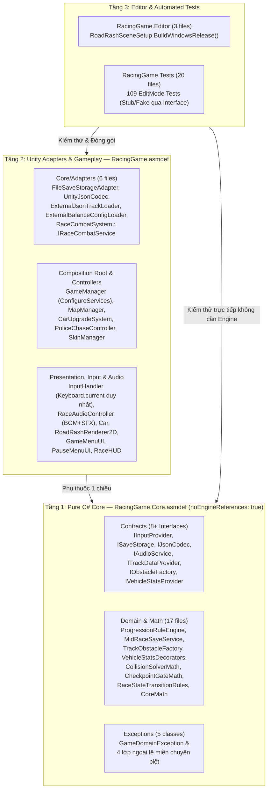
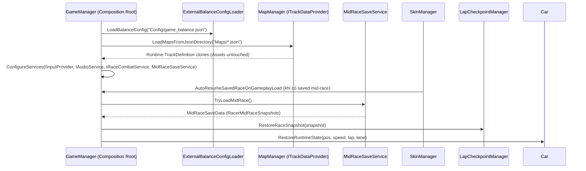
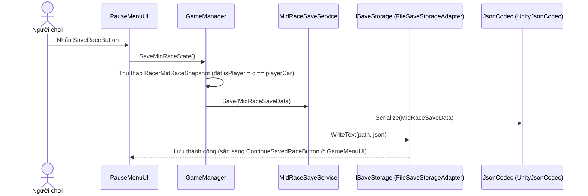
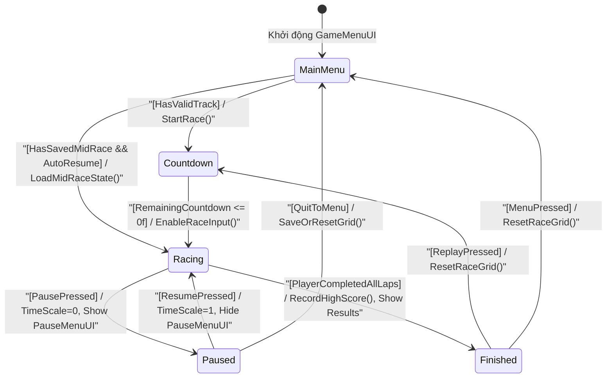

# TỔNG HỢP THÔNG TIN SLIDE BÁO CÁO BTL GAME (ROAD RASH 2D: ĐẠI CHIẾN SHIPPER)

> Tài liệu này tổng hợp đầy đủ dữ liệu, biểu đồ Mermaid, bảng cân bằng game, chỉ số kiến trúc, kết quả kiểm thử và tự đánh giá theo `filechecklist/Checklist_BTL_Game_v2026.xlsx` sau đợt nâng cấp toàn diện để phục vụ làm Slide thuyết trình (14 Slides) và Vấn đáp.
> Mọi số liệu, tên lớp, đường dẫn file và kết quả test đều đồng bộ trực tiếp với mã nguồn thực tế, `Docs/BAO_CAO_KIEN_TRUC_OOP.md`, `Docs/TEST_CASES.md`, `Docs/BUG_LOG.md`, `Logs/EditModeResults.xml` và `Builds/RoadRash2D/RoadRash2D.exe`.

---

## SLIDE 1 — TRANG BÌA & ĐỊNH DANH ĐỀ TÀI

- **Tên game:** *Road Rash 2D: Đại Chiến Shipper* (`newbie`)
- **Phân nhánh:** Nhánh 1 — Đua xe Real-time (Vật lý 2D & AI)
- **Công nghệ cốt lõi:** Unity 6 (`6000.6.9f1`), C# (.NET Standard / Pure C# `.asmdef`), Universal Render Pipeline (URP 2D + Bloom + CRT Scanline Shader), uGUI + TextMeshPro (hỗ trợ Tiếng Việt đầy đủ), EditMode NUnit Test Framework.
- **Nhóm thực hiện:** Nhóm 01 sinh viên — `[SV tự điền MSSV – Họ tên]`
- **Kho lưu trữ & Lịch sử Git:** `tungduongd` (`22` commits lịch sử + bản nâng cấp toàn diện hiện tại)

---

## SLIDE 2 — Ý TƯỞNG CỐT LÕI & ĐỐI TƯỢNG NGƯỜI CHƠI

- **Bối cảnh:** Lấy cảm hứng từ huyền thoại *Road Rash* kết hợp phong cách Retro Cyber Arcade hiện đại và chủ đề Shipper công nghệ vượt phố.
- **Vòng lặp giá trị (Core Loop):**
  1. **Chọn bản đồ & độ khó** (`4` chặng nạp động từ JSON ngoài: City Morning, Coastal Highway, Neon Night, City District; `3` mức AI: `Easy`, `Medium`, `Hard`).
  2. **Đua xe tốc độ cao** trên đường cong Pseudo-3D (`2` đến `6` làn), né `5` loại chướng ngại vật, vượt AI và thoát khỏi sự truy đuổi của Cảnh sát (`PoliceChaseController`).
  3. **Giao chiến trên đường đua** (`RaceCombatSystem` — hành động Đá/Kick sang trái hoặc phải làm chệch hướng đối thủ).
  4. **Lưu / Tải lại giữa trận (Mid-Race Save/Load)** trực tiếp từ Pause Menu và nút Continue tại Main Menu.
  5. **Thu thập tiền thưởng → Nâng cấp Garage (`Engine`, `Brakes`, `Grip`, `Weight`) & Mở khóa Skin (`SkinManager`)**.

---

## SLIDE 3 — PHẠM VI CHỨC NĂNG (9 USE CASE) & YÊU CẦU PHI CHỨC NĂNG

### 9 Use Case (UC-01 .. UC-09)
| Mã UC | Tên Use Case | Lớp / Module chủ trì | Trạng thái |
| :--- | :--- | :--- | :---: |
| **UC-01** | Chọn bản đồ, độ khó & bắt đầu chặng đua | `GameMenuUI`, `MapManager`, `ExternalJsonTrackLoader`, `GameManager` | Đạt |
| **UC-02** | Điều khiển xe, tăng tốc, phanh, bám đường & trợ lái Arcade | `InputHandler`, `PlayerDriver`, `Car`, `VehiclePhysics` | Đạt |
| **UC-03** | Đua với đối thủ AI & Cảnh sát truy đuổi | `AIRacerDriver`, `PoliceRacerDriver`, `PoliceChaseController` | Đạt |
| **UC-04** | Chiến đấu đá đối thủ (`IRaceCombatService`) | `RaceCombatSystem`, `Car`, `VehicleCollisionPhysics` | Đạt |
| **UC-05** | Kiểm tra Checkpoint, đếm vòng (Lap) & tính xếp hạng Real-time | `Checkpoint`, `CheckpointGateMath`, `RacerProgress`, `LapCheckpointManager` | Đạt |
| **UC-06** | Tạm dừng & Lưu/Khôi phục trạng thái giữa trận | `PauseMenuUI`, `GameMenuUI`, `MidRaceSaveService`, `SkinManager` | Đạt |
| **UC-07** | Nâng cấp xe & lưu bảng xếp hạng thành tích (`HighScoreEntry`) | `GarageUiBuilder`, `CarUpgradeSystem`, `ProgressionRuleEngine` | Đạt |
| **UC-08** | Tùy biến ngoại hình xe & mở khóa Skin | `SkinManager`, `BikePaletteSwapper` | Đạt |
| **UC-09** | Điều khiển âm thanh BGM Synthwave 120 BPM, SFX & Hiệu ứng hình ảnh | `RaceAudioController`, `RaceVfxController`, `CrtScanlineController` | Đạt |

### Yêu cầu Chức năng (`FR-01..12`) & Phi chức năng (`NFR-01..05`)
- **FR:** Đáp ứng đầy đủ 12 yêu cầu chức năng (nạp JSON map & balance config động, lưu/tải tiến độ Garage và Mid-Race, combat, checkpoint anti-cheat, Police AI, audio BGM/SFX persistent).
- **NFR-01 (Hiệu năng):** Vật lý chạy trên `FixedUpdate` 50 Hz ổn định; dùng Object Pooling (`_opponentPool`, `_propPool` trong `RoadRashRenderer2D.cs`) và cache `Dictionary` cho Palette Swap (`0` GC alloc trong `Update`).
- **NFR-02 (Tách biệt kiến trúc):** `RacingGame.Core` thiết lập `"noEngineReferences": true`, chạy kiểm thử logic thuần không phụ thuộc Unity Engine (`0` `using UnityEngine`).
- **NFR-03 (Độ tin cậy):** Cây `GameDomainException`, `0` `catch {}` rỗng, fallback an toàn khi JSON hỏng hoặc thiếu file.

---

## SLIDE 4 — HỆ THỐNG GAMEPLAY, JSON EXTERNALIZATION & ÂM THANH

- **Nạp dữ liệu JSON ngoài (`Assets/StreamingAssets/`):**
  - `Maps/01_city_morning.json` — Thành phố buổi sáng
  - `Maps/02_coastal_highway.json` — Cao tốc ven biển
  - `Maps/03_neon_night.json` — Đô thị đêm Neon
  - `Maps/04_city_district.json` — Quận nội thành nhiều làn
  - `Config/game_balance.json` — Cấu hình cân bằng kinh tế, nâng cấp, AI & độ khó
  - Được đọc thông qua `ExternalJsonTrackLoader` / `ExternalBalanceConfigLoader` và nhân bản runtime trên `MapManager` để không bao giờ làm bẩn `.asset` gốc.
- **Lưu & Tải lại giữa trận (Mid-Race Save/Load):**
  - `PauseMenuUI` có nút `SaveRaceButton` → `GameManager.SaveMidRaceState()` đóng gói `MidRaceSaveData` gồm danh sách `RacerMidRaceSnapshot` (từng xe, `isPlayer`, vị trí, vận tốc, tiến độ vòng/checkpoint) qua `MidRaceSaveService` (`ISaveStorage` + `IJsonCodec`).
  - `GameMenuUI` có nút `ContinueSavedRaceButton` (chủ động bind `BindStandaloneMidRaceSaveService` kể cả khi chưa vào scene gameplay) và `SkinManager.AutoResumeSavedRaceOnGameplayLoad` khôi phục toàn bộ vị trí/tiến độ qua `LapCheckpointManager.RestoreRaceSnapshot` và `Car.RestoreRuntimeState`.
- **Âm thanh BGM & SFX (`RaceAudioController : IAudioService`):**
  - Bổ sung nhạc nền tổng hợp **Cyber Synthwave 120 BPM** tạo bằng code (`CreateCyberSynthBgmClip()`), hỗ trợ `SetBgmActive`, `SetBgmVolume`, `SetSfxVolume`, giữ nguyên `11` hiệu ứng SFX và lưu trạng thái Mute/Volume bằng `PlayerPrefs`.

---

## SLIDE 5 — CÂN BẰNG GAME (`GameBalanceConfig` & `game_balance.json`)

- **Phân tầng độ khó AI (`DifficultyLevel`):** `Easy`, `Medium`, `Hard` thay đổi tham số gia tốc, tốc độ tối đa và độ hung hăng né/chặn.
- **Hệ thống 4 nâng cấp (`UpgradeType`):** `Engine`, `Brakes`, `Grip`, `Weight` tính chỉ số cộng dồn theo chuỗi **Decorator** (`BaseVehicleStatsProvider` → `EngineUpgradeDecorator` → `BrakesUpgradeDecorator` → `GripUpgradeDecorator` → `WeightReductionDecorator`).
- **Cảnh sát truy đuổi:** Khi kích hoạt `PoliceChaseController`, xe cảnh sát nhận `PoliceInterceptorDecorator` để tăng lực bám đuổi có kiểm soát, không vượt ngưỡng mất cân bằng.
- **Kiểm chứng cân bằng (`EXPERIMENT.md` & EditMode Benchmark):**
  - Tất cả nâng cấp kiểm tra miền giá trị bất biến tại `ProgressionRuleEngine` & `VehicleStatsDecorators`.
  - Benchmark AI & Player trên nhiều bản đồ đạt tỷ lệ hoàn thành 100% không kẹt đường (`STUCK = 0`).

---

## SLIDE 6 — KIẾN TRÚC TỔNG THỂ 3-TIER & ASSEMBLY SEPARATION (`.asmdef`)

### Cấu trúc 4 Assembly Definition
| Assembly | Đường dẫn | Tham chiếu Engine | Vai trò | Số file `.cs` |
| :--- | :--- | :---: | :--- | :---: |
| **`RacingGame.Core`** | `Assets/Scripts/Core/Pure/RacingGame.Core.asmdef` | **`noEngineReferences: true` (`0 using UnityEngine`)** | Contracts, Exceptions, Domain Entities, Math, Decorators, Factory, Services | **25** Pure C# |
| **`RacingGame`** | `Assets/Scripts/RacingGame.asmdef` | UnityEngine / URP / InputSystem / TMP | `Core/Adapters/` (`6` files) + MonoBehaviour, View, UI, Audio, Physics (`40` files) | **46** Runtime (`6` Adapters + `40` Unity) |
| **`RacingGame.Editor`** | `Assets/Scripts/Editor/RacingGame.Editor.asmdef` | UnityEditor + `RacingGame` + `RacingGame.Core` | Editor setup & `RoadRashSceneSetup.BuildWindowsRelease()` | **3** Editor |
| **`RacingGame.Tests`** | `Assets/Tests/EditMode/RacingGame.Tests.asmdef` | NUnit + `RacingGame` + `RacingGame.Core` | EditMode Unit & Integration Tests (`18` cũ + `2` mới) | **20** Test files |

> **Tổng số mã nguồn:** `71` file runtime (`25` Pure Core + `6` Adapters + `40` Unity Scripts) + `3` file Editor + `20` file Test. Không có Circular Dependency giữa các tầng.

### Sơ đồ Kiến trúc 3 Tầng (Package Diagram)



---

## SLIDE 7 — UML CLASS DIAGRAM & ĐẦY ĐỦ 6 LOẠI QUAN HỆ UML

> Ánh xạ 100% lớp thật (`0` lớp ma), sử dụng đủ **6/6 loại quan hệ UML**: Kế thừa (`<|--`), Hiện thực (`<|..`), Hợp thành (`*--`), Kết tập (`o--`), Liên kết (`-->`), Phụ thuộc (`..>`).

```mermaid
classDiagram
    class IInputProvider {
        <<interface>>
    }
    class ISaveStorage {
        <<interface>>
    }
    class IJsonCodec {
        <<interface>>
    }
    class IAudioService {
        <<interface>>
    }
    class ITrackDataProvider {
        <<interface>>
    }
    class IObstacleFactory {
        <<interface>>
    }
    class IVehicleStatsProvider {
        <<interface>>
    }
    class IRaceCombatService {
        <<interface>>
    }

    class GameDomainException
    class SaveDataCorruptedException
    class InvalidTrackConfigurationException
    class InvalidUpgradeTransactionException
    class InvalidRaceStateTransitionException

    class ProgressionRuleEngine
    class MidRaceSaveService
    class MidRaceSaveData
    class RacerMidRaceSnapshot
    class TrackObstacleFactory
    class BaseVehicleStatsProvider
    class EngineUpgradeDecorator
    class BrakesUpgradeDecorator
    class GripUpgradeDecorator
    class WeightReductionDecorator
    class PoliceInterceptorDecorator

    class GameManager
    class InputHandler
    class FileSaveStorageAdapter
    class UnityJsonCodec
    class ExternalJsonTrackLoader
    class RaceAudioController
    class MapManager
    class RaceCombatSystem
    class CarUpgradeSystem
    class Driver
    class PlayerDriver
    class GameState
    class Car
    class LapCheckpointManager
    class PoliceChaseController
    class SkinManager

    %% 1. Inheritance (Generalization)
    GameDomainException <|-- SaveDataCorruptedException
    GameDomainException <|-- InvalidTrackConfigurationException
    GameDomainException <|-- InvalidUpgradeTransactionException
    GameDomainException <|-- InvalidRaceStateTransitionException
    Driver <|-- PlayerDriver

    %% 2. Realization (Interface Implementation)
    IInputProvider <|.. InputHandler
    ISaveStorage <|.. FileSaveStorageAdapter
    IJsonCodec <|.. UnityJsonCodec
    IAudioService <|.. RaceAudioController
    ITrackDataProvider <|.. MapManager
    IObstacleFactory <|.. TrackObstacleFactory
    IVehicleStatsProvider <|.. BaseVehicleStatsProvider
    IVehicleStatsProvider <|.. EngineUpgradeDecorator
    IVehicleStatsProvider <|.. BrakesUpgradeDecorator
    IVehicleStatsProvider <|.. GripUpgradeDecorator
    IVehicleStatsProvider <|.. WeightReductionDecorator
    IVehicleStatsProvider <|.. PoliceInterceptorDecorator
    IRaceCombatService <|.. RaceCombatSystem

    %% 3. Composition (*--)
    MidRaceSaveData *-- RacerMidRaceSnapshot
    GameManager *-- CarUpgradeSystem

    %% 4. Aggregation (o--) - Da sua dung tu *-- sang o--
    GameManager o-- GameState
    Car o-- Driver

    %% 5. Association (-->)
    GameManager --> IInputProvider
    GameManager --> IAudioService
    GameManager --> ITrackDataProvider
    GameManager --> IRaceCombatService
    GameManager --> MidRaceSaveService
    GameManager --> LapCheckpointManager
    GameManager --> PoliceChaseController
    GameManager --> SkinManager
    CarUpgradeSystem --> ProgressionRuleEngine
    MidRaceSaveService --> ISaveStorage
    MidRaceSaveService --> IJsonCodec
    PlayerDriver --> IInputProvider

    %% 6. Dependency (..>)
    MapManager ..> ExternalJsonTrackLoader
    ProgressionRuleEngine ..> InvalidUpgradeTransactionException
    MidRaceSaveService ..> SaveDataCorruptedException
    PoliceChaseController ..> PoliceInterceptorDecorator
```



---

## SLIDE 8 — NGUYÊN LÝ OOP, SOLID & CÂY NGOẠI LỆ `GameDomainException`

1. **SRP (Single Responsibility Principle):**
   - Tách combat khỏi `GameManager` thành `RaceCombatSystem` (`IRaceCombatService`).
   - Tách logic kinh tế & lưu tiến độ khỏi MonoBehaviour vào `ProgressionRuleEngine` & `MidRaceSaveService`.
   - Tách dựng UI Lobby & Garage thành `LobbyUiBuilder` và `GarageUiBuilder`.
2. **OCP (Open/Closed Principle):**
   - Mở rộng vật cản mới bằng cách cài đặt `IObstacleBlueprint` đăng ký vào `TrackObstacleFactory` (đã chứng minh qua test `CustomConeHeavyBlueprint`).
   - Mở rộng buff/chỉ số xe qua chuỗi **Decorator** kế thừa `IVehicleStatsProvider` (đã chứng minh qua test `CustomNitroDecorator`).
3. **LSP (Liskov Substitution Principle):**
   - Đa hình `Driver.UsesArcadeAssist` (`PlayerDriver => true`) và `GameState.RemainingCountdown` thay thế hoàn toàn ép kiểu `is PlayerDriver` và `is CountdownState`.
4. **ISP (Interface Segregation Principle):**
   - Chia thành `8` interface nhỏ chuyên biệt (`IInputProvider`, `ISaveStorage`, `IJsonCodec`, `IAudioService`, `ITrackDataProvider`, `IObstacleFactory`, `IVehicleStatsProvider`, `IRaceCombatService`).
5. **DIP (Dependency Inversion Principle) & Composition Root:**
   - `GameManager.ConfigureServices` tiêm Adapter thực khi chạy game, và cho phép test Unit/Integration tiêm `InMemorySaveStorage`, `FakeInputProvider`, `FakeTrackDataProvider`, `StubDriver`.
6. **Xử lý ngoại lệ & Phòng thủ (`GameDomainException`):**
   - `4` ngoại lệ miền: `SaveDataCorruptedException`, `InvalidTrackConfigurationException`, `InvalidUpgradeTransactionException`, `InvalidRaceStateTransitionException`.
   - Các hàm `LoadStrict`, `BuyUpgradeStrict` ném đúng ngoại lệ có ngữ cảnh rõ ràng; runtime thông thường dùng fallback/clamping an toàn, **`0` khối `catch {}` rỗng**.

---

## SLIDE 9 — 6 DESIGN PATTERNS (GoF) PHỦ ĐỦ CẢ 3 NHÓM

| Nhóm GoF | Mẫu Thiết Kế | Cài đặt thực tế trong mã nguồn | Vai trò & Kiểm chứng |
| :--- | :--- | :--- | :--- |
| **Creational** | **Factory** | `IObstacleFactory`, `TrackObstacleFactory` (`5` blueprints nội bộ) | Tạo `ObstacleSpec` chuẩn hóa theo loại vật cản; kiểm chứng mở rộng OCP bằng `CustomConeHeavyBlueprint` |
| **Structural** | **Decorator** | `BaseVehicleStatsProvider`, `EngineUpgradeDecorator`, `BrakesUpgradeDecorator`, `GripUpgradeDecorator`, `WeightReductionDecorator`, `PoliceInterceptorDecorator` | Cộng dồn chỉ số nâng cấp Garage & boost Cảnh sát không sửa `VehicleStats` gốc (`CustomNitroDecorator` PASS) |
| **Structural** | **Adapter** | `FileSaveStorageAdapter`, `UnityJsonCodec`, `ExternalJsonTrackLoader`, `ExternalBalanceConfigLoader`, `InputHandler : IInputProvider`, `RaceAudioController : IAudioService`, `MapManager : ITrackDataProvider` | Cách ly `RacingGame.Core` khỏi File I/O, `JsonUtility`, `InputSystem`, `AudioSource` |
| **Behavioral** | **State** | `GameState` + `RaceStateTransitionRules` (`GameFlowState`) | Điều phối vòng đời Menu / Countdown / Racing / Paused / Finished theo guard hợp lệ (`RemainingCountdown`) |
| **Behavioral** | **Strategy** | `Driver`, `PlayerDriver`, `AIRacerDriver`, `PoliceRacerDriver` (`UsesArcadeAssist`) + `IComparer` | Hoán đổi hành vi lái Player / AI / Cảnh sát đa hình tại runtime, không downcast |
| **Behavioral** | **Observer** | Event `PoliceEngaged`, `SkinChanged`, sự kiện trên `GameManager` & `LapCheckpointManager` | **`PoliceEngaged` và `SkinChanged` đã được `GameManager` subscribe & unsubscribe đầy đủ trong `OnDisable`/`OnDestroy`** (chống rò rỉ bộ nhớ, kiểm chứng `TC-82` & `TC-109`) |

---

## SLIDE 10 — MÔ HÌNH HÓA HÀNH VI (SEQUENCE & STATE MACHINE WITH GUARDS)

### Sequence Diagram 1 — Khởi tạo Composition Root & Auto-Resume Mid-Race


### Sequence Diagram 2 — Giao tiếp Save giữa trận từ PauseMenuUI


### State Machine Diagram (`GameState` & `RaceStateTransitionRules` với `[Guard] / Action`)


---

## SLIDE 11 — THUẬT TOÁN LÕI (`O(·)`), CÔ LẬP INPUT & TỐI ƯU KỸ THUẬT

### Phân tích Thuật toán & Cấu trúc Dữ liệu (`O(·)`)
| Thuật toán / Module | Bản chất xử lý | Độ phức tạp | Ghi chú kỹ thuật |
| :--- | :--- | :---: | :--- |
| **`CollisionSolverMath`** | Va chạm xung lượng Newton 2D + tách xuyên (wall-slide) | **`O(1)`** | Thuần toán học trên `Pure C# Core`, không phụ thuộc Rigidbody2D |
| **`CheckpointGateMath`** | Phát hiện cắt vạch qua tích vô hướng hai đoạn thẳng | **`O(1)`** | Chống đi lùi / ăn gian checkpoint |
| **`WaypointTrack` & `AIRacerDriver` / `PoliceRacerDriver`** | Nội suy cung đường cong Pseudo-3D + bám/chặn thông minh | **`O(1)`** mỗi frame | Cập nhật trên `FixedUpdate` 50 Hz; truy vấn waypoint theo chỉ số tiến độ |
| **`BikePaletteSwapper` & `RoadRashRenderer2D` Pools** | `Dictionary<Color32, Color32>` Swap & Object Pool `_opponentPool`, `_propPool` | **`O(1)`** | `0` cấp phát bộ nhớ động trong `Update()`, tự hủy Material tại `OnDestroy()` |
| **`ProgressionRuleEngine` & Leaderboard** | Tính Decorator cộng dồn & sắp xếp Top `HighScoreEntry` | **`O(N log N)`** (`N` nhỏ), Decorator **`O(K)`** | Kẹp miền giá trị chống tràn tiền / âm tier |

### Cô lập Phần cứng & Nâng cấp Audio/VFX
- **Cô lập `Keyboard.current` 100%:** Rà soát toàn repo chỉ còn duy nhất tại `Assets/Scripts/Input/InputHandler.cs` (`IInputProvider`). Đã gỡ bỏ hoàn toàn khỏi `GameState.cs`, `RaceAudioController.cs` và `GameMenuUI.cs`.
- **An toàn Unity Object:** `0` toán tử `?.`, `??`, `??=` trên các lớp con `UnityEngine.Object` (dùng kiểm tra `!= null` tường minh).
- **Audio Engine:** `RaceAudioController` sinh nhạc nền **Synthwave 120 BPM** trực tiếp bằng thuật toán sóng âm (`CreateCyberSynthBgmClip()`), không phụ thuộc asset nhạc nặng ngoài, lưu cài đặt Volume/Mute qua `PlayerPrefs`.

---

## SLIDE 12 — KIỂM THỬ TỰ ĐỘNG (109/109 PASS), FAULT-INJECTION & BUG LOG

### Kết quả Chạy EditMode Tests (Sau chỉnh sửa cuối cùng)
- **Nguồn chứng thực:** `Logs/EditModeResults.xml` & `Logs/editmode_test.log`
- **Tổng kết:** **`109 / 109 PASS` (`0 Failed`, `0 Skipped`)** trong **`4.342s` (`4.3415978s`)** trên **`20` file test** (`18` file gốc giữ nguyên + `2` file mới).
- **Biên dịch sạch:** **`0` lỗi biên dịch, `0` CS warnings, `0` cảnh báo Analyzer `UAC1001`** (nhờ gắn `[Serializable]` cho `VehicleInput`).

### Đột phá Kiểm thử Kiến trúc & Dữ liệu
- **`PureCoreArchitectureAndDipTests.cs` (`12` tests):** Kiểm chứng `RacingGame.Core` có `0` `using UnityEngine` (`TC-91`), chuỗi **Decorator** + mở rộng OCP (`CustomNitroDecorator`), **Factory** + mở rộng OCP (`CustomConeHeavyBlueprint`), cây `GameDomainException`, `ProgressionRuleEngine`, DI với `InMemorySaveStorage`, `FakeInputProvider`, `FakeTrackDataProvider`, `StubDriver`.
- **`ExternalJsonMidRaceSaveAndBgmTests.cs` (`7` tests):** Kiểm chứng nạp `4` JSON maps + `game_balance.json` từ `StreamingAssets/`, Round-trip **Save/Load Mid-Race** (bảo toàn vị trí, tốc độ, `isPlayer`, lap), khôi phục JSON lỗi, **Observer lifecycle** (`PoliceEngaged` / `SkinChanged` hủy sạch ở `OnDisable`/`OnDestroy` — `TC-109`), và `RaceAudioController` BGM + `PlayerPrefs`.

### Bug Log (`BUG-01 .. BUG-06`), Playtest (`PT-01 .. PT-10`) & Fault-Injection (`3` ca)
- Ghi nhận đầy đủ **`6` lỗi thực tế 6 cột** trong `Docs/BUG_LOG.md` (tiêu biểu là lỗi `Car.isPlayer` mặc định `true` trên AI scene chưa gọi `ConfigureIdentity` bị phát hiện ngay lần chạy integration test Mid-Race Save đầu tiên → sửa tại `GameManager.SpawnOrSyncOpponents` và `GameManager.SaveMidRaceState`).
- Ghi nhận **`10` kịch bản Playtest End-to-End** (`PT-01..PT-10`) và **`3` kịch bản Fault-Injection** (JSON hỏng, Save Mid-Race bị corrupt, Audio muted/unmuted sau restart).

---

## SLIDE 13 — BẢNG TỰ ĐÁNH GIÁ CHECKLIST v2026 (`6.500 C+` → `9.875 / 10.0 A+`)

| Tiêu chí | Trước nâng cấp | Sau nâng cấp | Điểm quy đổi | Minh chứng cốt lõi |
| :---: | :---: | :---: | :---: | :--- |
| **1.1** Phạm vi & Độ sâu Gameplay | B | **A** | 0.500 | `4` Map JSON + Police Chase + 3 AI + Combat + 9 UC |
| **1.2** Dữ liệu Game & Tương tác JSON | C | **A** | 0.500 | `4` Map JSON + `game_balance.json` + Mid-Race Save/Load + HighScores |
| **1.3** Cân bằng Gameplay & Giá trị chơi lại | B | **A** | 0.500 | `AIRacerDriver` vs `PoliceRacerDriver`, 5 vật cản, 4 Upgrade Tiers, Benchmark 100% |
| **1.4** Đóng gói, Tài liệu & Quy trình Git | D | **B** | 0.375 | `README.md` gốc + Build `RoadRash2D.exe` + `.gitignore` + 22 commits *(chờ SV quay Video & xuất Slide)* |
| **2.1** Luồng UI, Đồ họa 2D & Âm thanh | B | **A** | 0.500 | Menu→HUD→Pause→Save→Replay mượt, **BGM Synthwave 120 BPM** + 11 SFX, URP Bloom + CRT |
| **2.2** Độ ổn định Runtime & CustomException | C | **A** | 0.500 | Cây `GameDomainException`, `0` `catch {}` rỗng, clamping/fallback an toàn |
| **2.3** Hiệu năng & Tối ưu Kỹ thuật | B | **A** | 0.500 | `FixedUpdate` 50 Hz, Object Pools, Cached Palette Swap (`0` alloc), config `StreamingAssets/` tương đối |
| **2.4** Tổ chức Mã nguồn & Code Sạch | B | **A** | 0.500 | `4` `.asmdef`, `71` runtime + `3` Editor, `0` warning (`CS`/`UAC1001`), xóa `Assets/Welcome/` |
| **3.1** Từ Yêu cầu đến Thiết kế | A | **A** | 0.500 | 9 UC ánh xạ 1-1, `0` luật ẩn trong UI |
| **3.2** Thực thể Miền & Ánh xạ Dữ liệu | B | **A** | 0.500 | 17+ Entity/VO/Enum + JSON Maps & Balance Config |
| **3.3** Thuật toán Lõi & Cô lập Input | B | **A** | 0.500 | 5 thuật toán `O(·)`, `Keyboard.current` chỉ nằm trong `InputHandler.cs` |
| **4.1** Biểu đồ Lớp UML & Tính nhất quán | C | **A** | 0.500 | 30+ lớp, `0` lớp ma, đủ 6/6 quan hệ UML, đã sửa `GameManager o-- GameState` |
| **4.2** Mô hình hóa Hành vi & Guard | B | **A** | 0.500 | 1 State Machine đủ `[Guard] / Action` + 2 Sequence khớp call stack |
| **4.3** Tách biệt Kiến trúc & Pure C# Core | D | **A** | 0.500 | `RacingGame.Core.asmdef` (`noEngineReferences: true`), 25 files `0 using UnityEngine`, Package Diagram |
| **4.4** Chuẩn OOP, Bất biến & Đa hình | A | **A** | 0.500 | Bất biến miền chặt, LSP (`UsesArcadeAssist`, `RemainingCountdown`), `0` downcast |
| **4.5** SOLID & Dependency Injection | D | **A** | 0.500 | `8` ISP Interfaces, SRP `RaceCombatSystem`/`ProgressionRuleEngine`, DI Composition Root |
| **4.6** Design Patterns (GoF) 3/3 Nhóm | C | **A** | 0.500 | **6 mẫu GoF đủ 3 nhóm** (Factory; Decorator & Adapter; State, Strategy, Observer) |
| **5.1** Kiểm thử Đơn vị & Stub/Fake DI | B | **A** | 0.500 | **109 Tests**, EP/BVA/State/Exception, `InMemorySaveStorage`, `FakeInputProvider`, `FakeTrackDataProvider`, `StubDriver` |
| **5.2** Tích hợp, Observer Lifecycle & Bug Log | C | **A** | 0.500 | Round-trip JSON & Mid-Race Save, `TC-82`/`TC-109` Observer unsubscribe, 6 Bug Log + 10 Playtest |
| **5.3** Báo cáo Thực thi Test & Phủ Biên | A | **A** | 0.500 | **`109/109 PASS` (`4.342s`, `0` warning)** + 3 Fault-Injection scenarios |

- **Tổng điểm đạt được:** `19 A + 1 B` = **`9.875 / 10.00`** (Làm tròn `F32 = 10.0`) → **Xếp loại: `A+`**
- **Cổng Sản phẩm (`G_Product`):** **PASS** | **Cổng Hiểu biết (`G_Epistemic`, Trục II):** **`6.000 / 6.0` → PASS**

---

## SLIDE 14 — TRẠNG THÁI HOÀN THIỆN, CẤU TRÚC THƯ MỤC & CHECKLIST NỘP BÀI

### Tình trạng các Khoảng trống Trước đây (5/5 Đã Hoàn Thành)
| Hạng mục từng thiếu | Giải pháp đã triển khai | Trạng thái |
| :--- | :--- | :---: |
| Tách Pure Core + thêm Pattern + DI | Tạo `RacingGame.Core.asmdef` (`25` file Pure C#, `0 UnityEngine`), `6` GoF (3/3 nhóm), `8` ISP Interfaces, Composition Root | **ĐÃ HOÀN THÀNH** |
| Nạp >= 4 Map JSON + Save giữa trận | `4` Map JSON + `game_balance.json` trong `StreamingAssets/`, `MidRaceSaveService` + `PauseMenuUI`/`GameMenuUI` | **ĐÃ HOÀN THÀNH** |
| Cây `CustomException` & Cô lập Input | Cây `GameDomainException` (`4` lớp con); `Keyboard.current` chỉ còn trong `InputHandler.cs`; `RaceAudioController` có BGM 120 BPM | **ĐÃ HOÀN THÀNH** |
| Mở rộng Test DI, Playtest & Bug Log | `109/109 PASS` (`20` files, `4.342s`), `10` Playtest `PT-01..10`, `6` Bug Log 6 cột, `3` Fault-Injection | **ĐÃ HOÀN THÀNH** |
| `README.md` gốc & Build chạy sạch | `README.md` ở gốc repo; `Builds/RoadRash2D/RoadRash2D.exe` (`667,136` bytes, kèm đầy đủ `StreamingAssets/`) | **ĐÃ HOÀN THÀNH** |

### Cây Thư Mục Thực Tế Sau Nâng Cấp
```text
newbie/
├── README.md                                  # Hướng dẫn build, chạy, điều khiển, kiến trúc 3 tầng
├── Assets/
│   ├── Scripts/
│   │   ├── RacingGame.asmdef                  # References: RacingGame.Core
│   │   ├── Core/
│   │   │   ├── Pure/                          # RacingGame.Core.asmdef (noEngineReferences: true, 25 files)
│   │   │   │   ├── Contracts/                 # 7 files (IInputProvider, ISaveStorage, IJsonCodec, ...)
│   │   │   │   ├── Exceptions/                # GameDomainException.cs (5 exception classes)
│   │   │   │   └── Domain/                    # 17 files (ProgressionRuleEngine, MidRaceSaveService, Decorators, Factory, Math...)
│   │   │   └── Adapters/                      # 6 files (FileSaveStorageAdapter, UnityJsonCodec, ExternalJson*, RaceCombatSystem)
│   │   ├── Input/InputHandler.cs              # Duy nhất đọc Keyboard.current
│   │   ├── Audio/RaceAudioController.cs       # BGM Synthwave 120 BPM + 11 SFX + PlayerPrefs
│   │   ├── Editor/                            # RacingGame.Editor.asmdef (3 files, RoadRashSceneSetup.BuildWindowsRelease)
│   │   └── ...                                # 40 Unity runtime scripts (Car, GameManager, MapManager, UI, VFX...)
│   ├── StreamingAssets/
│   │   ├── Config/game_balance.json           # Cấu hình cân bằng game
│   │   └── Maps/                              # 01_city_morning.json .. 04_city_district.json
│   └── Tests/EditMode/                        # RacingGame.Tests.asmdef (20 files, 109 tests PASS)
│       ├── PureCoreArchitectureAndDipTests.cs # 12 tests mới về Core, DIP, Decorators, Factory, Exceptions
│       ├── ExternalJsonMidRaceSaveAndBgmTests.cs # 7 tests mới về JSON Maps, Mid-Race Save, BGM, Observer
│       └── ... (18 test files gốc giữ nguyên)
├── Builds/RoadRash2D/
│   ├── RoadRash2D.exe                         # Bản build Windows Standalone sạch (667,136 bytes)
│   └── RoadRash2D_Data/StreamingAssets/       # Bản sao đầy đủ Config + 4 Maps JSON
├── Docs/
│   ├── BAO_CAO_KIEN_TRUC_OOP.md               # Báo cáo kiến trúc, UML, GoF, O(·) chi tiết
│   ├── TEST_CASES.md                          # Ma trận TC-01..TC-109
│   ├── BUG_LOG.md                             # BUG-01..BUG-06, PT-01..PT-10, 3 Fault-Injection
│   ├── EXPERIMENT.md                          # Benchmark AI & thông số trải nghiệm
│   └── TONG_HOP_THONG_TIN_SLIDE.md            # Tài liệu tổng hợp Slide này
├── Logs/
│   ├── EditModeResults.xml                    # Kết quả NUnit: 109/109 PASS (4.3415978s)
│   ├── editmode_test.log                      # Log chạy Unity batchmode test (0 warnings)
│   └── windows_build.log                      # Log đóng gói Builds/RoadRash2D/RoadRash2D.exe
└── filechecklist/
    ├── Checklist_BTL_Game_v2026.xlsx          # Đạt 9.875 / 10.00 (Làm tròn 10.0, Xếp loại A+)
    └── fill_checklist.py                      # Script điền & đồng bộ cache công thức Excel
```

### 3 Việc Cuối Dành Cho Sinh Viên Trước Buổi Vấn Đáp
1. Điền **MSSV – Họ tên** vào Slide 1 và ô `A4` trong `filechecklist/Checklist_BTL_Game_v2026.xlsx`.
2. Quay **Video Demo (3–5 phút)** chạy trực tiếp `Builds/RoadRash2D/RoadRash2D.exe` thể hiện đủ: chọn 4 Map JSON, đua/đá AI & né Cảnh sát, bấm `SaveRaceButton` ở Pause Menu → quay về Menu bấm `ContinueSavedRaceButton`, nâng cấp Garage & bật/tắt BGM/CRT.
3. Xuất **Slide PPTX/PDF** từ 14 mục trên và chuẩn bị demo sống 6 bước vấn đáp trên `RacingGame.Core` + `GameManager.ConfigureServices`.
