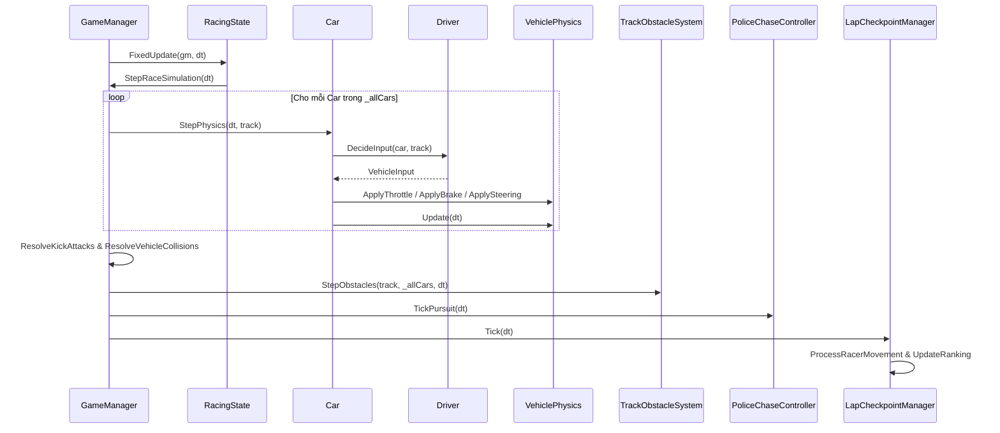
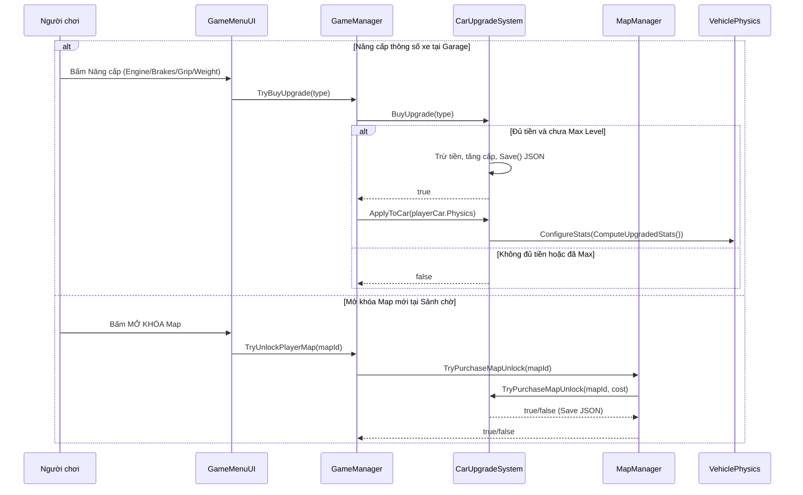
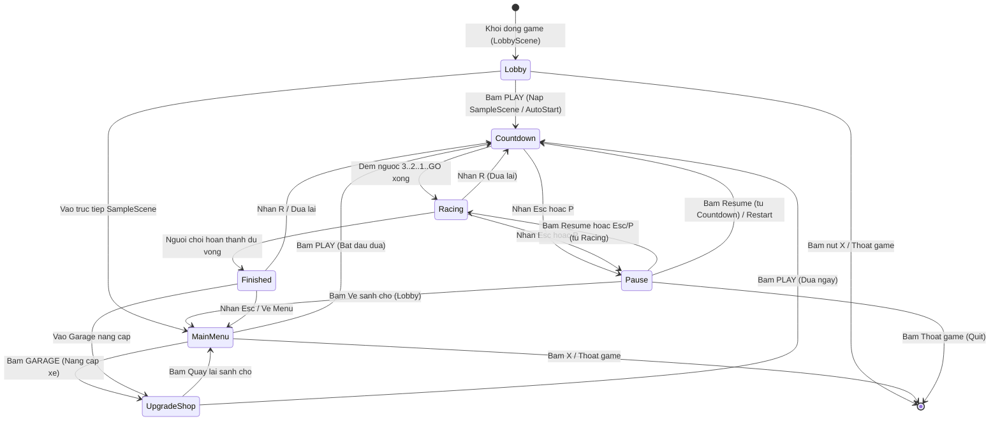

# Tổng Hợp Dữ Liệu & Đối Chiếu Mã Nguồn Phục Vụ Làm Slide Báo Cáo

> **Dự án:** *Road Rash 2D: Đại Chiến Shipper* (`newbie`) — Unity `6000.6.9f1` (C#, URP, uGUI, Input System, NUnit EditMode)  
> **Nguồn đối chiếu:** Thư mục `Docs/` và mã nguồn thực tế trong `Assets/Scripts/`, `Assets/ScriptableObjects/`, `Assets/Tests/EditMode/`.

---

## 1. Thông tin định danh & Lộ trình (Slide 1, Slide 14)

### 1.1 Thông tin nhóm (01 SV) — Slide 1
> **Lưu ý:** Trong repository hiện không lưu file thông tin cá nhân sinh viên (chỉ có thông tin tác giả commit git là `tungduongd <funkybun2006@gmail.com>`). Sinh viên tự điền các mục dưới đây vào Slide 1:
- **Họ và tên SV:** `[Cần SV tự điền]`
- **Mã sinh viên (MSSV):** `[Cần SV tự điền]`
- **Lớp / Nhóm:** `[Cần SV tự điền — Nhóm 01 SV]`
- **Giảng viên hướng dẫn:** `[Cần SV tự điền]`
- **Tên đề tài:** *Road Rash 2D: Đại Chiến Shipper* (`newbie`)

### 1.2 Số lượng Use Case chính thức
Theo [Docs/BAO_CAO_KIEN_TRUC_OOP.md](BAO_CAO_KIEN_TRUC_OOP.md) (Mục 2.1 — Sơ đồ Use Case), sơ đồ Use Case hiện có chính thức **09 Use Case** (`UC-01` đến `UC-09`) với 3 tác nhân (`Người chơi (Player)`, `Hệ thống AI & Cảnh sát`, `Lưu trữ JSON / PlayerPrefs`):

| Mã UC | Tên Use Case | Tác nhân chính |
| :---: | :--- | :--- |
| **UC-01** | Chọn Skin thương hiệu | Người chơi (Player) |
| **UC-02** | Chọn / Mở khóa Map đua | Người chơi (Player) |
| **UC-03** | Cấu hình Độ khó & Số vòng | Người chơi (Player) |
| **UC-04** | Nâng cấp xe tại Garage | Người chơi (Player) |
| **UC-05** | Điều khiển đua xe & Đá đối thủ | Người chơi (Player) |
| **UC-06** | Đếm vòng, Xếp hạng & Trao thưởng | Include từ UC-05, UC-09 |
| **UC-07** | Tạm dừng / Chơi lại / Về Lobby | Người chơi (Player), Extend từ UC-05 |
| **UC-08** | Lưu & Xóa dữ liệu tiến trình | Người chơi (Player) -> Lưu trữ JSON / PlayerPrefs |
| **UC-09** | AI đua tự hành & Cảnh sát truy đuổi | Hệ thống AI & Cảnh sát |

### 1.3 Mốc thời gian dự kiến khắc phục khoảng trống — Slide 14
> **Lưu ý:** Repository chưa có kế hoạch ngày hoàn thành cụ thể cho 5 đầu việc này. Bảng dưới đây ghi nhận **hiện trạng thực tế trong code** để bạn đối chiếu và tự điền cột **Ngày hoàn thành mục tiêu**:

| STT | Đầu việc khắc phục khoảng trống | Hiện trạng thực tế trong repo | Ngày hoàn thành mục tiêu |
| :-: | :--- | :--- | :---: |
| 1 | **Tách Core + thêm Pattern** | Hiện các lớp logic (`VehiclePhysics`, `CarUpgradeSystem`, `Checkpoint`, `RacerProgress`, `RaceStateBase`) là C# thuần nhưng vẫn `using UnityEngine;` (dùng `Vector2`, `Mathf`, `JsonUtility`) và nằm chung assembly `RacingGame`. Đã có State Pattern, Strategy (`Driver`, `IComparer`), Observer (C# `event`); cần tách thêm tầng Core thuần / bổ sung Pattern khác (ví dụ Factory/Command) nếu yêu cầu. | `[SV tự điền ngày]` |
| 2 | **Nạp >= 4 map JSON** | Hiện đã có **4 map** (`city_morning`, `coastal_highway`, `neon_night`, `city_district`) dưới dạng `ScriptableObject` (`Assets/ScriptableObjects/Maps/Map_01..04.asset`), chưa nạp định nghĩa đường đua từ file `.json` rời. | `[SV tự điền ngày]` |
| 3 | **CustomException + Object Pool** | Đã có Object Pool cho sprite đối thủ (`_opponentPool`) và sprite prop/vật cản (`_propPool`) trong `RoadRashRenderer2D.cs`; **chưa có** lớp `CustomException` (ví dụ `InvalidTrackDataException`, `SaveDataCorruptedException`...). | `[SV tự điền ngày]` |
| 4 | **Playtest + Bug Log** | Đã có `Docs/BUG_LOG.md` ghi nhận xác minh 70/70 EditMode tests và 3 cảnh báo analyzer `UAC1001`, cùng `Docs/EXPERIMENT.md` (benchmark AI 3 vòng); chưa có biên bản Playtest người chơi thực tế (PlayMode / FPS / trải nghiệm). | `[SV tự điền ngày]` |
| 5 | **README.md + Build sạch** | Đã có `Docs/README.md` (chưa có `README.md` ở thư mục gốc repo) và chưa có bản build thực thi sạch (`.exe` / thư mục `Builds/`). | `[SV tự điền ngày]` |

---

## 2. Dữ liệu từ thư mục `Docs/` & File Excel (Slide 6, 7, 12, 13)

### 2.1 Trích xuất từ `Docs/BAO_CAO_KIEN_TRUC_OOP.md`

#### A. Bảng ánh xạ Minh chứng `[Trang BC | Tệp/Lớp | Chỉ số]`
> **Lưu ý về số trang:** `Docs/BAO_CAO_KIEN_TRUC_OOP.md` là tệp Markdown (651 dòng), chưa xuất ra Word/PDF nên chưa có số trang cố định. Cột `[Trang BC]` bên dưới ghi vị trí **Mục & Dòng** trong file `.md` kèm ô `[Tr. ...]` để bạn điền số trang ngay sau khi export PDF/DOCX.

| Nội dung / Hạng mục | Minh chứng `[Trang BC \| Tệp/Lớp \| Chỉ số]` |
| :--- | :--- |
| Giới thiệu & Phạm vi | `[Tr. __ (Mục 1, L3-8) \| Docs/BAO_CAO_KIEN_TRUC_OOP.md \| Unity 6000.6.9f1, URP 17.6.0, uGUI 2.6.0]` |
| Sơ đồ Use Case & Yêu cầu | `[Tr. __ (Mục 2, L12-79) \| Docs/BAO_CAO_KIEN_TRUC_OOP.md \| 9 UC (UC-01..09), 12 FR (FR-01..12), 6 NFR (NFR-01..06)]` |
| 4 tính chất OOP | `[Tr. __ (Mục 3, L83-90) \| Driver, RaceStateBase, Car, VehiclePhysics, RacerRankingComparer \| 4/4 tính chất OOP]` |
| Sơ đồ lớp (Class Diagram) | `[Tr. __ (Mục 4, L94-401) \| Assets/Scripts/ (35 runtime classes) \| 26 lớp/struct cốt lõi trong sơ đồ Mermaid]` |
| Sơ đồ tuần tự (Sequence Diagrams) | `[Tr. __ (Mục 5, L405-465) \| GameManager, RacingState, Car, GameMenuUI, CarUpgradeSystem, MapManager \| 2 luồng chính (FixedUpdate & Upgrade/Unlock)]` |
| Sơ đồ trạng thái (State Diagram) | `[Tr. __ (Mục 6, L469-502) \| GameState.cs, GameManager.cs, PauseMenuUI.cs \| 5 RaceStateBase + Lobby + Pause overlay]` |
| Lưu đồ AI, Cảnh sát & Đếm vòng | `[Tr. __ (Mục 7, L506-557) \| AIRacerDriver, PoliceRacerDriver, LapCheckpointManager \| 3 lưu đồ thuật toán]` |
| Cài đặt Assembly & Module | `[Tr. __ (Mục 8, L561-601) \| RacingGame / RacingGame.Editor / RacingGame.Tests (.asmdef) \| 3 asmdef, 4 map, 4 skin, JSON save]` |
| Kiểm thử (Testing) | `[Tr. __ (Mục 9, L605-632) \| Assets/Tests/EditMode/ & Docs/TEST_CASES.md \| 14 file test, 70/70 PASS (100%), 7.726s]` |
| Benchmark thực nghiệm AI | `[Tr. __ (Mục 9.2) \| Docs/EXPERIMENT.md & MapAIBenchmark3LapTests.cs \| 2 map x 3 skill x 3 lap, seed=2026, STUCK=0, 18/18 CP]` |
| Kết luận & Hướng phát triển | `[Tr. __ (Mục 10, L636-651) \| Docs/BAO_CAO_KIEN_TRUC_OOP.md \| 3 kết quả chính, 3 hạn chế, 3 hướng phát triển]` |

#### B. Nội dung nguyên văn phần Sơ đồ lớp (Class Diagram — Mục 4, dòng 96–401)

```mermaid
classDiagram
    class ScriptableObject {
        <<UnityEngine>>
    }

    class Driver {
        <<abstract>>
        -string driverName
        +string DriverName
        +SetDriverName(string) void
        +DecideInput(Car car, WaypointTrack track)* VehicleInput
        +OnReset() void
    }

    class PlayerDriver {
        -InputHandler inputHandler
        +SetInputHandler(InputHandler) void
        +DecideInput(Car car, WaypointTrack track) VehicleInput
        +OnReset() void
    }

    class AIRacerDriver {
        -AINavigationMode navigationMode
        -AIProfile profile
        -int targetWaypoint
        -float skillLevel
        -float preferredLateralOffset
        -float _mapCornerSpeedMultiplier
        +Configure(string, AIProfile, float, float) void
        +SetAllCars(IReadOnlyList~Car~) void
        +DecideInput(Car car, WaypointTrack track) VehicleInput
    }

    class PoliceRacerDriver {
        -Car _targetPlayer
        -int targetWaypoint
        -bool _chaseActive
        +ConfigurePolice(Car, string) void
        +SetTargetPlayer(Car) void
        +DecideInput(Car car, WaypointTrack track) VehicleInput
    }

    class AIProfile {
        -DifficultyLevel difficulty
        -float skillLevel
        -float topSpeedFactor
        -float minCornerSpeed
        -float cornerBrakeAggression
        -float throttleScale
        -float noiseAmplitude
        -float noiseFrequency
        +CreateDefault(DifficultyLevel)$ AIProfile
        +ConfigureValues(DifficultyLevel, float, float, float, float, float, float, float) void
    }

    class InputHandler {
        -float steerResponseSpeed
        -bool _kickQueued
        +ReadInput() VehicleInput
        +ResetState() void
    }

    class VehicleStats {
        <<struct>>
        +float mass
        +float enginePower
        +float brakePower
        +float grip
        +float drag
        +float rollingResistance
        +float maxSpeed
        +float maxReverseSpeed
        +float turnRate
        +Default()$ VehicleStats
        +Sanitize() VehicleStats
    }

    class VehicleStatsAsset {
        -VehicleStats stats
        +VehicleStats Stats
        +SetStats(VehicleStats) void
    }

    class VehiclePhysics {
        -Vector2 position
        -Vector2 velocity
        -float heading
        -VehicleStats stats
        +ConfigureStats(VehicleStats) void
        +ApplyThrottle(float) void
        +ApplyBrake(float) void
        +ApplySteering(float) void
        +Update(float dt) void
    }

    class Car {
        -VehicleStatsAsset baseStatsAsset
        -VehiclePhysics physics
        -Driver _driver
        -BikeSkinData activeSkin
        -bool _isOnTrack
        +Initialize(Driver, Vector2, float, WaypointTrack) void
        +ApplySkin(BikeSkinData) void
        +TryStartKick(int, float, float) bool
        +ReceiveKick(int, Vector2, float) void
        +StepPhysics(float dt, WaypointTrack) void
    }

    class BikeSkinData {
        -DriverBrandSkin skinId
        -string displayName
        -Color primaryColor
        -Color secondaryColor
        -Material customMaterial
        -Texture2D customTexture
        -Sprite customSprite
        +CreateDefault(DriverBrandSkin)$ BikeSkinData
        +GetOverrideSprite() Sprite
    }

    class SkinManager {
        -BikeSkinData[] skinAssets
        -DriverBrandSkin selectedBrand
        -List~BikeSkinData~ _resolvedSkins
        +EnsureInitialized() void
        +SelectSkin(DriverBrandSkin, Car) bool
        +ApplyToCar(Car) void
    }

    class MapTheme {
        -string themeId
        -string themeName
        -HorizonSilhouetteStyle horizonStyle
        -Color skyTop
        -Color asphaltLight
        -MapZonePropConfig[] zones
        +CreateValleyPreset()$ MapTheme
        +CreateCityDistrictPreset()$ MapTheme
        +CreateCoastalHighwayPreset()$ MapTheme
    }

    class TrackDefinition {
        -string mapId
        -string displayName
        -Vector2[] waypoints
        -int laneCount
        -float laneWidth
        -int obstacleCount
        -bool enablePoliceChase
        -float rewardMultiplier
        -MapTheme theme
        -TrackFeatureZone[] featureZones
        +CreateCityMorningPreset(MapTheme)$ TrackDefinition
        +CreateCityDistrictPreset(MapTheme)$ TrackDefinition
    }

    class MapManager {
        -TrackDefinition[] mapAssets
        -List~TrackDefinition~ _maps
        -CarUpgradeSystem _saveSystem
        -int _selectedIndex
        +BindSaveSystem(CarUpgradeSystem) void
        +SelectMap(string, WaypointTrack, EnvironmentDecorator) bool
        +TryPurchaseMapUnlock(string) bool
    }

    class WaypointTrack {
        -TrackDefinition trackDefinition
        -Vector2[] waypoints
        -int laneCount
        -float laneWidth
        -float trackWidth
        +ApplyTrackDefinition(TrackDefinition) void
        +GetLaneCenterOffset(int) float
        +ProjectPosition(Vector2) TrackProjection
        +SampleAtDistance(float) TrackSample
    }

    class TrackObstacleSystem {
        -bool enableObstacles
        -int obstacleCount
        -float minSpacingMeters
        -List~TrackObstacle~ _obstacles
        +ApplyMapSettings(TrackDefinition) void
        +SpawnObstacles(WaypointTrack, Nullable~int~) void
        +StepObstacles(WaypointTrack, IReadOnlyList~Car~, float) void
    }

    class EnvironmentDecorator {
        -float slotIntervalMeters
        -float propDensity
        -List~RoadsideDecoration~ _decorations
        +RebuildEnvironment(WaypointTrack, MapTheme, Nullable~int~) void
    }

    class PoliceChaseController {
        -bool enablePoliceChase
        -Car policeCar
        -PoliceRacerDriver policeDriver
        +ApplyMapSettings(TrackDefinition) void
        +EnsurePoliceUnit(Car, WaypointTrack, VehicleStatsAsset) Car
        +ResetPoliceOnGrid(Car, WaypointTrack) void
        +TickPursuit(float dt) void
    }

    class LapCheckpointManager {
        -List~Checkpoint~ _checkpoints
        -List~RacerProgress~ _racers
        -int totalLaps
        +Initialize(WaypointTrack, IReadOnlyList~Car~, int) void
        +Tick(float dt) void
        +GetRanking() IReadOnlyList~RacerProgress~
    }

    class CarUpgradeSystem {
        -PlayerSaveData _data
        -VehicleStats _baseStats
        +int Money
        +BuyUpgrade(UpgradeType) bool
        +TryPurchaseMapUnlock(string, int) bool
        +ApplyToCar(VehiclePhysics) void
        +Save() void
        +Load() bool
    }

    class RaceStateBase {
        <<abstract>>
        +GameFlowState StateType*
        +Enter(GameManager) void
        +Update(GameManager, float) void
        +FixedUpdate(GameManager, float) void
        +Exit(GameManager) void
    }

    class PauseMenuUI {
        -GameManager _gameManager
        -GameObject _pauseRoot
        +bool IsShowing
        +Bind(GameManager) void
        +RefreshState() void
    }

    class GameMenuUI {
        -GameManager _gameManager
        -SkinManager _skinManager
        -MapManager _mapManager
        +Bind(GameManager) void
        +InitializeStandaloneLobby() void
        +SelectSkinFromLobby(DriverBrandSkin) bool
    }

    class GameManager {
        -List~Car~ _allCars
        -CarUpgradeSystem _upgradeSystem
        -RaceStateBase _currentState
        -bool _isPaused
        +TransitionTo(GameFlowState) void
        +PauseGame() void
        +ResumeGame() void
        +StepRaceSimulation(float dt) void
    }

    ScriptableObject <|-- AIProfile
    ScriptableObject <|-- VehicleStatsAsset
    ScriptableObject <|-- BikeSkinData
    ScriptableObject <|-- MapTheme
    ScriptableObject <|-- TrackDefinition

    Driver <|-- PlayerDriver
    Driver <|-- AIRacerDriver
    Driver <|-- PoliceRacerDriver

    PlayerDriver --> InputHandler : uses
    AIRacerDriver o-- AIProfile : uses tuning
    PoliceChaseController o-- PoliceRacerDriver : controls
    PoliceChaseController o-- Car : manages policeCar

    VehicleStatsAsset *-- VehicleStats : wraps
    VehiclePhysics *-- VehicleStats : uses
    Car *-- VehiclePhysics : composition
    Car o-- VehicleStatsAsset : base stats
    Car o-- Driver : polymorphic driver
    Car o-- BikeSkinData : active skin

    SkinManager "1" o-- "*" BikeSkinData : manages
    TrackDefinition o-- MapTheme : theme
    MapManager "1" o-- "*" TrackDefinition : manages
    MapManager --> CarUpgradeSystem : syncs unlocks
    WaypointTrack o-- TrackDefinition : applies
    TrackObstacleSystem ..> TrackDefinition : reads settings
    TrackObstacleSystem ..> WaypointTrack : spawns on
    EnvironmentDecorator ..> MapTheme : reads zones

    GameManager *-- CarUpgradeSystem : owns
    GameManager o-- LapCheckpointManager : uses
    GameManager o-- WaypointTrack : uses
    GameManager o-- RaceStateBase : current state
    GameManager o-- SkinManager : uses
    GameManager o-- MapManager : uses
    GameManager o-- TrackObstacleSystem : uses
    GameManager o-- PoliceChaseController : uses
    GameManager o-- PauseMenuUI : toggles
    GameManager o-- GameMenuUI : binds
    GameManager "1" --> "*" Car : manages
```



#### C. Nội dung nguyên văn phần Sơ đồ tuần tự (Sequence Diagrams — Mục 5, dòng 407–465)

**5.1 Luồng mỗi bước vật lý (`FixedUpdate`):**


**5.2 Luồng nâng cấp xe & mở khóa Map:**


#### D. Nội dung nguyên văn phần Sơ đồ trạng thái (State Diagram — Mục 6, dòng 473–502)



---

### 2.2 Bảng danh sách Test Case hiện có từ `Docs/TEST_CASES.md` (Slide 12)
- **Tổng số:** `70` test case EditMode (trên `14` file test) — **Passed: 70/70**, **Failed: 0**, **Duration: `7.726s`** (Unity `6000.6.9f1` batchmode).
- **Đối chiếu 1-1 mã nguồn (`Assets/Tests/EditMode/*.cs` vs `Docs/TEST_CASES.md`):** Khớp **70/70** phương thức `[Test]` (`0` hàm thiếu trong tài liệu, `0` hàm dư).
  - Phân bổ theo 14 file: `Phase1And2Tests` (`4`), `Loop4AITests` (`9`), `Loop5LapCheckpointTests` (`9`), `Loop6And7Tests` (`7`), `Loop8KickAndGraphicsTests` (`4`), `AIRacerDeterminismAndBenchmarkTests` (`4`), `LobbyAndSkinSystemTests` (`3`), `GameplayAndPauseTests` (`4`), `MapSystemTests` (`8`), `CityMapTests` (`5`), `CityCornerNavigationComparisonTests` (`1`), `GameplayFeelAndOffRoadRecoveryTests` (`4`), `LaneLayoutTests` (`6`), `MapAIBenchmark3LapTests` (`2`).

| TC-ID | Tên luật / Chức năng | Dữ liệu đầu vào | Kết quả mong đợi | Hàm test EditMode tương ứng | Kết quả |
| :---: | :--- | :--- | :--- | :--- | :---: |
| TC-01 | Tăng tốc bằng ga và giảm tốc do lực cản khi thả ga | `VehiclePhysics` tại `(0,0)`, heading `0f`; `ApplyThrottle(1f)` 60 bước (`1/60s`), rồi `ApplyThrottle(0f)` 120 bước. | Sau 1s ga: `ForwardSpeed > 15f`, `Position.x > 5f`. Sau 2s thả ga: `ForwardSpeed < speedAfterAccel`. | `Phase1And2Tests.VehiclePhysics_ThrottleAcceleratesAndDragSlowsWhenCoasting` | PASS |
| TC-02 | Đứng yên không rẽ được, phanh giảm tốc và rẽ phải khi di chuyển | Rẽ phải lúc đứng yên `0.1s`; tăng tốc 60 bước; phanh `1f` + rẽ phải `1f` 20 bước. | Đứng yên: `Heading ≈ 0f` (`±0.001f`). Sau chạy + phanh + rẽ phải: `ForwardSpeed < speedBeforeBrake`, `Heading < 0f`. | `Phase1And2Tests.VehiclePhysics_BrakeDeceleratesAndSteeringTurnsWhenMoving` | PASS |
| TC-03 | Đường đua vòng khép kín, vector hướng và `IsOnTrack` | `WaypointTrack.BuildDefaultCircuit()`; kiểm tra waypoint cuối nối 0, `GetTrackDirection(0)`, `IsOnTrack` trong/ngoài lề. | `15 <= WaypointCount <= 30`; `GetNextWaypoint(last) == GetWaypoint(0)`; tâm đường `true`, ngoài lề `false`. | `Phase1And2Tests.WaypointTrack_ClosedLoopQueriesAndIsOnTrack` | PASS |
| TC-04 | Phát hiện off-road và áp dụng phạt/giới hạn tốc độ | `Car` + `StubDriver` giữ ga `1f` tại ngoài lề `+TrackWidth*0.5f+4f`, chạy `180` bước (`3s`). | `car.IsOnTrack == false` và `ForwardSpeed <= MaxSpeed * 0.6f`. | `Phase1And2Tests.Car_OffRoadAppliesSpeedPenalty` | PASS |
| TC-05 | `AIRacerDriver` kế thừa `Driver`, hoàn thành 1 vòng không kẹt | `AIRacerDriver.Configure("Viper", 0.90f, 0f)` tại waypoint 0, chạy tối đa `2250` bước (`45s`). | Là instance của `Driver`; qua tối thiểu `WaypointCount - 1` đoạn và quay lại `0` sau `step > 250`. | `Loop4AITests.AIRacerDriver_InheritsDriverAndCompletesFullLapWithoutGettingStuck` | PASS |
| TC-06 | AI kỹ năng cao chạy xa hơn AI kỹ năng thấp | 2 xe AI `"Pro"` (`skill=0.98f`) và `"Rookie"` (`skill=0.50f`), chạy `600` bước (`12s`). | Tổng quãng đường `fastAccum > slowAccum`. | `Loop4AITests.AIRacerDriver_HigherSkillCoversMoreDistanceThanLowerSkill` | PASS |
| TC-07 | Thứ tự hiệu năng theo `AIProfile`: Hard > Normal > Easy | 3 xe AI dùng `AIProfile.CreateDefault` (`Easy`, `Normal`, `Hard`), chạy `600` bước (`12s`). | `hardDist > normalDist > easyDist`. | `Loop4AITests.AIRacerDriver_AIProfileDifficulties_OrderPerformanceHardGreaterThanNormalGreaterThanEasy` | PASS |
| TC-08 | AI fallback an toàn khi `AIProfile == null` | `ai.Configure("Fallback", (AIProfile)null, 0f)`, chạy `60` bước. | Không lỗi, xe chạy về phía trước cách xuất phát `> 5f`. | `Loop4AITests.AIRacerDriver_NullProfileFallback_StillDrivesWithoutError` | PASS |
| TC-09 | Chống kẹt AI sau `stuckTimeout` (2.5s) và reset bộ đếm | Xe đứng yên off-track đoạn 3 quay ngược, gọi `DecideInput` tới `>= 2.5s`; thử lại ở đoạn 6 trong `0.2s`. | Trước `2.5s` không phục hồi; khi `>= 2.5s` phục hồi về waypoint 3 đúng hướng, `TargetWaypointIndex == 4`, `throttle > 0f`. | `Loop4AITests.AIRacerDriver_StuckRecovery_RecoversOntoTrackAlignedAndAdvancesWaypointAfterTimeout` | PASS |
| TC-10 | Giảm tốc ngắn hơn `stuckTimeout` có nhịp tăng tốc không kích hoạt sớm | Đứng yên `2.0s`, tăng tốc tạm `4f`, rồi đứng yên thêm `2.0s`. | Không phục hồi; vị trí giữ nguyên `< 0.01f` và `TargetWaypointIndex == 1`. | `Loop4AITests.AIRacerDriver_BriefSlowDownShorterThanTimeout_DoesNotTriggerPrematureRecovery` | PASS |
| TC-11 | AI né xe chắn bên phải bằng cách lái sang trái | AI tại `(55,0)`, xe chắn tại `(67,-1.5)`, chạy 25 bước so với đường trống. | `testSteer < clearSteer - 0.05f` và `testLateral < clearLateral - 0.05f`. | `Loop4AITests.AIRacerDriver_VehicleAvoidance_SteersLeftAwayFromRightSideBlocker` | PASS |
| TC-12 | AI né xe chắn bên trái bằng cách lái sang phải | AI tại `(55,0)`, xe chắn tại `(67,1.5)`, chạy 25 bước so với đường trống. | `testSteer > clearSteer + 0.05f` và `testLateral > clearLateral + 0.05f`. | `Loop4AITests.AIRacerDriver_VehicleAvoidance_SteersRightAwayFromLeftSideBlocker` | PASS |
| TC-13 | AI bỏ qua xe ngoài tầm nhìn dọc (`> 20f`) hoặc ngang (`> 3.5f`) | Xe tại `(82,0)` (`dz=27f`) và `(67,-4.5)` (`|dLat|=4.5f`), chạy 25 bước. | `testSteer ≈ clearSteer` và `testLateral ≈ clearLateral` (`<= 0.001f`). | `Loop4AITests.AIRacerDriver_VehicleAvoidance_IgnoresCarsBeyondLookAheadOrLateralRange` | PASS |
| TC-14 | Cổng `Checkpoint` chỉ tính cắt chiều thuận trong bề rộng cổng | 4 đoạn: thuận trong cổng, ngược chiều, ngoài bề rộng, chưa chạm cổng. | Chỉ `(-1,0)->(1,0)` trả `true`; 3 trường hợp còn lại `false`. | `Loop5LapCheckpointTests.Checkpoint_CountsOnlyForwardCrossingInsideGate` | PASS |
| TC-15 | Chỉ tính hoàn thành vòng khi qua đủ checkpoint đúng thứ tự | Qua cổng 0 đầu trận, rồi `DriveFullLap` qua `1..N-1 -> 0`. | Qua cổng 0 đầu trận giữ `CompletedLaps == 0`; sau đủ vòng `CompletedLaps == 1`, `NextCheckpointIndex == 1`. | `Loop5LapCheckpointTests.Lap_IsCountedOnlyWhenAllCheckpointsPassedInOrder` | PASS |
| TC-16 | Đi tắt bỏ qua checkpoint không được tính vòng | Qua cổng 1, bỏ cổng 2, qua `3..N-1` rồi cổng 0. | `CompletedLaps == 0`, `NextCheckpointIndex == 2`. | `Loop5LapCheckpointTests.Shortcut_SkippingCheckpointsDoesNotCountLap` | PASS |
| TC-17 | Xếp hạng theo số checkpoint đã qua, sau đó khoảng cách tới cổng kế | 3 xe `Leader` (qua cổng 1), `Closer` (`+40m`), `Behind` (`+20m`). | Thứ tự `[Leader, Closer, Behind]`; `GetPosition(Leader) == 1`. | `Loop5LapCheckpointTests.Ranking_UsesCheckpointsThenDistanceToNextCheckpoint` | PASS |
| TC-18 | Về đích sau đủ số vòng, giữ thứ tự và không cộng thêm vòng | 2 xe đua 2 vòng; `First` xong trước, `Second` xong sau; `First` chạy thêm 1 vòng. | `First.FinishPosition == 1`, `Second.FinishPosition == 2`, `finishedEvents == 2`, `First.CompletedLaps == 2`. | `Loop5LapCheckpointTests.Finish_RacerFinishesAfterTotalLapsAndKeepsFinishOrder` | PASS |
| TC-19 | Phát hiện đi ngược chiều khi tốc độ `> 4f` | Xe quay ngược hướng đường, tốc độ `8f`, gọi `Tick(1/60f)`. | `p.IsWrongWay == true`. | `Loop5LapCheckpointTests.WrongWay_MovingOppositeAboveMinSpeedSetsIsWrongWay` | PASS |
| TC-20 | Không báo ngược chiều khi đứng yên hoặc tốc độ `<= 4f` | Xe quay ngược với tốc độ `0f`, `3f`, `4f`. | `p.IsWrongWay == false` ở cả 3 mức. | `Loop5LapCheckpointTests.WrongWay_StationaryOrAtOrBelowMinSpeedDoesNotFlag` | PASS |
| TC-21 | Tự xóa cờ ngược chiều khi quay lại đúng hướng | Chạy ngược `8f` -> quay thuận `8f`. | `IsWrongWay` từ `true` chuyển về `false`. | `Loop5LapCheckpointTests.WrongWay_TurningBackToForwardDirectionClearsIsWrongWay` | PASS |
| TC-22 | Tay đua đã về đích không bị báo ngược chiều | Xe đã `IsFinished == true`, quay ngược tốc độ `10f`. | `p.IsWrongWay == false`. | `Loop5LapCheckpointTests.WrongWay_FinishedRacerIsNotFlaggedEvenWhenFacingBackwardAtSpeed` | PASS |
| TC-23 | Mua nâng cấp trừ tiền, tăng giá cấp sau, chặn thiếu tiền & max cấp | Tiền gốc `200`, mua `Engine` lv 0 (`150`), mua tiếp lúc còn `50`; nạp `10000` mua lên Max. | Lần 1 `Money=50`, lv 1, giá kế `225`; thiếu tiền trả `false`; max cấp `GetUpgradeCost==0`, mua trả `false`. | `Loop6And7Tests.UpgradeSystem_BuyUpgradeDeductsMoneyIncreasesCostAndRejectsInvalidPurchase` | PASS |
| TC-24 | Áp dụng nâng cấp làm xe nhanh hơn và có tính lũy đẳng (idempotent) | Mua `Engine` x2, `Weight` x1, `Grip` x1; gọi `ApplyToCar` 2 lần; chạy ga `3s` so xe gốc. | Lần 2 không cộng dồn (`EnginePower` không đổi); xe nâng cấp nhanh hơn và đi xa hơn. | `Loop6And7Tests.UpgradeSystem_ApplyToCarMakesVehicleMeasurablyFasterAndIsIdempotent` | PASS |
| TC-25 | Lưu/nạp JSON bảo toàn tiền, cấp nâng cấp và thành tích | `AwardRaceResult(1, 52.34f)`, mua `Brakes`, nạp lại qua instance mới. | File JSON tồn tại; `Load()==true`, `Money==580`, `Brakes==1`, `RacesWon==1`, `BestRaceTime≈52.34f`. | `Loop6And7Tests.UpgradeSystem_SaveAndLoadJsonPersistsMoneyUpgradesAndRecords` | PASS |
| TC-26 | Tính đa hình `StateType` của 5 lớp trạng thái | Mảng `RaceStateBase[]` gồm 5 lớp con. | Trả đúng `MainMenu`, `Countdown`, `Racing`, `Finished`, `UpgradeShop`. | `Loop6And7Tests.GameStates_PolymorphicStateTypesMatchExpectedFlow` | PASS |
| TC-27 | Dùng chỉ số gốc `VehicleStatsAsset`, giữ nguyên trường không nâng | `VehicleStatsAsset` tùy biến + mua 1 `Engine`, 1 `WeightReduction`. | `Mass==186f`, `EnginePower==6550f`, `MaxSpeed==base+3.5f`; `Drag`, `TurnRate`... giữ nguyên. | `Loop6And7Tests.UpgradeSystem_UsesSharedVehicleStatsAndPreservesNonUpgradedFields` | PASS |
| TC-28 | Cả 4 loại nâng cấp chặn tại cấp 5 và không trừ tiền khi vượt cấp | `AddMoney(100000)`, mua 4 loại lên lv 5 rồi mua thêm 1 lần. | Cả 4 đạt cấp 5, lần mua thứ 6 trả `false`, không trừ tiền. | `Loop6And7Tests.UpgradeSystem_AllUpgradeTypesEnforceMaxLevelCapWithoutOvercharging` | PASS |
| TC-29 | Nạp JSON lỗi/ngoài biên tự kẹp về `[0, 5]` và số không âm | 2 file JSON hỏng có số âm và cấp `99/-3/6/-10/-5/12/42`. | Số âm về `0`, cấp kẹp vào `[0, 5]`, chi phí/trạng thái nhất quán. | `Loop6And7Tests.UpgradeSystem_LoadCorruptedJsonClampsOutOfRangeLevelsToValidBounds` | PASS |
| TC-30 | Bắt đầu đòn đá, khóa cooldown và choáng khi nhận đá | `TryStartKick(1, 0.30f, 0.55f)`, chạy 40 bước, rồi `ReceiveKick`. | Đang đá `CanKick==false`; hết cooldown `CanKick==true`; trúng đá `IsStaggered==true`. | `Loop8KickAndGraphicsTests.Car_KickStartsEnforcesCooldownAndReceiveKickStaggers` | PASS |
| TC-31 | Sinh đầy đủ sprite xe, vật cản, UI và texture minimap | Gọi `RoadRashBikeSprites`, `RoadRashPropSprites`, `RoadRashUiSprites`, `BuildTrackMinimapTexture`. | Mọi sprite khác `null`; minimap `width==128`, `maxDim > 10f`. | `Loop8KickAndGraphicsTests.VisualGenerators_CreateBikePoseSpritesPropsAndMinimap` | PASS |
| TC-32 | Đá chọn bên đối thủ gần nhất, đẩy ngang và không trúng lặp | `player` & `ai` lệch phải `-2.2f`; `FindBestKickDirection`, `TryStartKick`, `TryResolveKickHit` 2 lần. | Hướng `+1`, lần 1 trúng `ai` (`IsStaggered==true`, `Velocity.y < -5f`), lần 2 trả `null`. | `Loop8KickAndGraphicsTests.GameManager_KickCombatTargetsNearestSideAndKnocksOpponentSideways` | PASS |
| TC-33 | Tự tái tạo sprite prop sau `DestroyImmediate` không Domain Reload | Hủy sprite mọi `RoadsidePropKind` rồi gọi lại `GetPropSprite`. | Sprite mới khác `null` và `texture != null`. | `Loop8KickAndGraphicsTests.PropSprites_RegenerateWhenDestroyedWithoutDomainReload` | PASS |
| TC-34 | AI cùng `seed` cho quỹ đạo và input giống hệt nhau | 2 lượt AI cùng `seed`, `AIProfile`, `WaypointTrack`. | Vị trí, vận tốc và chuỗi `VehicleInput` trùng khớp 100%. | `AIRacerDeterminismAndBenchmarkTests.AIRacerDriver_SameSeed_ProducesIdenticalTrajectoryAndInputs` | PASS |
| TC-35 | Gọi `SetSeed` trước hoặc sau `Configure` cho kết quả giống nhau | 2 AI với thứ tự gọi `SetSeed`/`Configure` ngược nhau. | Quỹ đạo mô phỏng hoàn toàn trùng khớp. | `AIRacerDeterminismAndBenchmarkTests.AIRacerDriver_SetSeedBeforeOrAfterConfigure_ProducesIdenticalResult` | PASS |
| TC-36 | Các `seed` khác nhau tạo biến thiên đánh lái hợp lệ | Chạy AI với các `seed` khác nhau trên cùng đường đua. | Khác biệt đánh lái theo nhiễu `seed`, xe vẫn bám đường. | `AIRacerDeterminismAndBenchmarkTests.AIRacerDriver_DifferentSeeds_ProduceDistinctSteeringVariationWithoutBreakingDriving` | PASS |
| TC-37 | Benchmark 1 vòng theo mức skill AI | Mô phỏng AI nhiều mức `skillLevel` hoàn thành 1 vòng. | Hoàn thành 1 vòng hợp lệ, skill cao chạy nhanh hơn. | `AIRacerDeterminismAndBenchmarkTests.AIRacerDriver_Benchmark_SingleLapTimeAcrossSkills` | PASS |
| TC-38 | `SkinManager` khởi tạo 4 thương hiệu và áp dụng lên `Car` | Khởi tạo `SkinManager`, chọn từng thương hiệu, gọi `ApplyToCar`. | Đủ 4 skin; `Car.ActiveSkin` cập nhật đúng. | `LobbyAndSkinSystemTests.SkinManager_InitializesAllFourDeliveryBrandsAndAppliesToCar` | PASS |
| TC-39 | `BikeSkinData` hỗ trợ `Texture2D` và `Material` tùy chỉnh | Gán `customTexture`, `customMaterial` vào `BikeSkinData`. | Lưu và trả về đúng asset đã gán. | `LobbyAndSkinSystemTests.BikeSkinData_SupportsCustomTextureAndMaterialAssignment` | PASS |
| TC-40 | `GameMenuUI` dựng banner, nút `X` ngoài và 4 thẻ skin | Khởi tạo UI sảnh chờ `GameMenuUI`. | Tồn tại banner, `OuterQuitButton`, `SkinCardCount == 4`. | `LobbyAndSkinSystemTests.GameMenuUI_BuildsBannerOuterQuitButtonAndFourSkinCards` | PASS |
| TC-41 | `EnvironmentDecorator` sinh prop theo vùng dọc đường đua | Gọi `RebuildEnvironment` trên `WaypointTrack`. | Sinh danh sách prop hai bên đường theo vùng. | `GameplayAndPauseTests.EnvironmentDecorator_GeneratesZonePropsAlongCircuit` | PASS |
| TC-42 | `TrackObstacleSystem` sinh vật cản và phạt va chạm | Sinh vật cản và cho `Car` va chạm trong `StepObstacles`. | Vật cản hợp lệ; xe bị giảm tốc & đẩy ngang. | `GameplayAndPauseTests.TrackObstacleSystem_SpawnsObstaclesAndAppliesCollisionPenalty` | PASS |
| TC-43 | `PoliceChaseController` tạo xe cảnh sát và truy đuổi người chơi | Gọi `EnsurePoliceUnit`, `ResetPoliceOnGrid`, `TickPursuit`. | Tạo `PoliceCar_Unit01` gắn `PoliceRacerDriver`, rút ngắn khoảng cách. | `GameplayAndPauseTests.PoliceChaseController_SpawnsPoliceRacerAndPursuesPlayer` | PASS |
| TC-44 | `PauseMenuUI` & `GameManager` bật/tắt Pause và dựng 4 nút | Gọi `PauseGame()`, `ResumeGame()`, kiểm tra `PauseMenuUI`. | `Time.timeScale` đổi `0`/`1`, đủ 4 nút Resume/Restart/Lobby/Quit. | `GameplayAndPauseTests.PauseMenuUI_AndGameManager_TogglePauseAndBuildQuitButtons` | PASS |
| TC-45 | `TrackDefinition` & `WaypointTrack` hỗ trợ động 2–6 làn | Áp dụng `laneCount = 2, 4, 6`. | `LaneCount` và `TrackWidth` cập nhật chính xác. | `MapSystemTests.TrackDefinition_And_WaypointTrack_SupportTwoToSixLanesAndDynamicWidth` | PASS |
| TC-46 | `MapManager` mở khóa map mặc định, lưu map chọn & reset | Khởi tạo `MapManager`, chọn map, lưu `PlayerPrefs`, reset. | Map mặc định mở khóa, giữ lựa chọn sau nạp lại. | `MapSystemTests.MapManager_AutoUnlocksAllThreeDefaultMaps_PersistsSelectionAndResets` | PASS |
| TC-47 | Prop & vật cản tuân thủ `MapTheme` và biên đường hẹp | Áp dụng map 2 làn hẹp. | Prop ở ngoài lề, vật cản nằm gọn trong đường. | `MapSystemTests.EnvironmentDecorator_And_TrackObstacleSystem_RespectMapThemeAndNarrowTrackBounds` | PASS |
| TC-48 | AI và Cảnh sát co giãn sạch trên đường hẹp & rộng | Mô phỏng trên map 2 làn và map rộng. | Bám đường ổn định, không lao khỏi biên. | `MapSystemTests.AI_And_Police_ScaleCleanlyOnNarrowAndWideTracks` | PASS |
| TC-49 | Carousel chọn map trên `GameMenuUI` hiển thị và chuyển bước | Bấm chuyển map trái/phải trên `GameMenuUI`. | Hiển thị thông tin map và cập nhật `SelectedMap`. | `MapSystemTests.GameMenuUI_MapCarousel_DisplaysThreeMapsAndStepsSelection` | PASS |
| TC-50 | `MapTheme_Valley` khớp theme gốc & `WaypointTrack` mặc định 16m | Đọc `MapTheme` Valley & `WaypointTrack` mặc định. | Màu/horizon khớp Valley, bề rộng mặc định `16m`. | `MapSystemTests.MapTheme_Valley_MatchesRoadRashVisualTheme_AndWaypointTrackDefaultsTo16m` | PASS |
| TC-51 | `EnvironmentDecorator` đọc vùng & mật độ động từ `MapTheme` | Gán `MapTheme` tùy biến `zones` & mật độ. | Prop sinh ra phản ánh đúng danh sách vùng từ `MapTheme`. | `MapSystemTests.EnvironmentDecorator_ReadsDynamicZoneListAndDensityFromMapTheme_InsteadOfHardcodedThreeZones` | PASS |
| TC-52 | `PlayerSaveData` & Lobby lưu mở khóa map và chặn map khóa | Chọn map khóa, mua mở khóa, lưu JSON, nạp lại. | Map khóa bị chặn; sau mua và nạp lại vẫn mở khóa. | `MapSystemTests.PlayerSaveData_And_Lobby_PersistUnlockedMapsAndGuardLockedSelection` | PASS |
| TC-53 | `MapTheme_City` phong cách đêm neon & đủ sprite prop đô thị | Nạp `MapTheme_City` và kiểm tra mọi sprite prop đô thị. | Màu đêm neon hợp lệ, mọi sprite khác `null`. | `CityMapTests.MapTheme_City_HasNightNeonStyleAndAllUrbanPropSpritesExist` | PASS |
| TC-54 | `TrackDefinition_City` có 25–30 waypoints & dài 1500–2000m | Kiểm tra preset và asset `TrackDefinition_City`. | Số waypoint trong `[25, 30]`, chiều dài trong `[1500, 2000]m`. | `CityMapTests.TrackDefinition_City_AssetAndPreset_Have25To30WaypointsAnd1500To2000mLength` | PASS |
| TC-55 | `CityDistrict` có ngã tư gắt, cầu vượt, hầm chui, crosswalk (4 & 6 làn) | Dựng track `CityDistrict` 4 làn & 6 làn. | Đủ `Overpass` nâng cao độ, `Tunnel`, `Crosswalk`, cua gắt. | `CityMapTests.CityDistrictTrack_HasSharpIntersections_OverpassElevation_TunnelAndCrosswalks_Across4And6Lanes` | PASS |
| TC-56 | `EnvironmentDecorator` bỏ qua hầm và đặt đèn tại `Crosswalk` | `RebuildEnvironment` trên `CityDistrict`. | Không có prop ngoài trời trong `Tunnel`; có đèn tại `Crosswalk`. | `CityMapTests.CityDistrict_EnvironmentDecorator_SkipsTunnelAndPlacesCrosswalkSignals` | PASS |
| TC-57 | `ParkedBus` chỉ ở làn ngoài cùng, tránh `Tunnel` và `Overpass` | Sinh vật cản trên `CityDistrict`. | 100% `ParkedBus` ở làn ngoài cùng, không nằm trong hầm/cầu vượt. | `CityMapTests.CityDistrict_ObstacleSystem_SpawnsParkedBusOnOutermostLaneOnly_NeverInTunnelOrOverpass` | PASS |
| TC-58 | So sánh 3 chế độ dẫn đường AI trên cua 90° của City | Mô phỏng `LegacyFixed`, `SpeedAdaptiveWaypoint`, `SmoothedSplinePath`. | `SmoothedSplinePath` cua mượt và an toàn tốt nhất. | `CityCornerNavigationComparisonTests.CompareNavigationModes_OnCityAndSharp90DegreeCorners_LogsMetricsAndVerifiesBest` | PASS |
| TC-59 | `VehicleStats.Default` cân bằng và dễ kiểm soát | Đọc thông số `VehicleStats.Default`. | `maxSpeed`, `enginePower`, `grip`, `turnRate` đạt chuẩn dễ lái. | `GameplayFeelAndOffRoadRecoveryTests.VehicleStats_Default_IsCalmerAndEasierToControl` | PASS |
| TC-60 | Off-road tăng tốc thoát lầy và đánh lái quay lại đường nhanh | Đặt `Car` ngoài lề, cấp ga và lái vào tâm đường. | Tăng tốc ổn định và nhanh trở về `IsOnTrack == true`. | `GameplayFeelAndOffRoadRecoveryTests.OffRoad_ThrottleAcceleratesBrisklyAndSteeringReturnsToTrackQuickly` | PASS |
| TC-61 | Rào chắn biên ngoài chặn vượt biên không làm mất đà tiến | Ép xe sát giới hạn `MaxOffRoadWidth`. | Giữ lệch ngang trong biên, `ForwardSpeed` không tụt về 0 đột ngột. | `GameplayFeelAndOffRoadRecoveryTests.OuterBarrier_PreventsExceedingMaxOffRoadWithoutKillingForwardMomentum` | PASS |
| TC-62 | Các Map asset đạt chuẩn bề rộng làn & đường nới rộng | Kiểm tra `TrackDefinition` trong `Assets/ScriptableObjects/Maps/`. | `LaneWidth` và tổng bề rộng đạt chuẩn mới. | `GameplayFeelAndOffRoadRecoveryTests.MapAssets_HaveWidenedLaneAndTrackWidths` | PASS |
| TC-63 | `GetLaneCenterOffset` trả tâm làn đối xứng cho 2, 4, 6 làn | Truy vấn tâm tất cả làn với `laneCount = 2, 4, 6`. | Tâm làn đối xứng qua tâm đường và nằm trong `TrackWidth`. | `LaneLayoutTests.WaypointTrack_GetLaneCenterOffset_ReturnsSymmetricLaneCentersInsideTrackForTwoFourAndSixLanes` | PASS |
| TC-64 | Helper xếp lưới xuất phát & làn AI khớp làn (2, 4, 6 làn) | Gọi helper `GetGridSlotLateralOffset`, `GetAiPreferredLateralOffset`. | Mọi tọa độ lệch khớp tâm làn hợp lệ. | `LaneLayoutTests.GameManager_GridAndAiLaneHelpers_AlignCleanlyToLanesForTwoFourAndSixLanes` | PASS |
| TC-65 | `ResetRaceGrid` xếp Player, AI, Cảnh sát vào làn hợp lệ | Khởi tạo grid trên bản đồ 2, 4, 6 làn. | Tất cả xe nằm trên mặt đường và khớp làn. | `LaneLayoutTests.GameManager_ResetRaceGrid_SpawnsPlayerAiAndPoliceOnValidLanesAcrossTwoFourAndSixLanes` | PASS |
| TC-66 | AI và Cảnh sát chạy hoàn toàn trong `TrackWidth` (2, 4, 6 làn) | Mô phỏng AI & Cảnh sát trên mạch 2, 4, 6 làn. | Mọi xe giữ vị trí trong bề rộng đường đua. | `LaneLayoutTests.AI_And_Police_StayStrictlyWithinTrackWidthAcrossTwoFourAndSixLaneCircuits` | PASS |
| TC-67 | `TrackObstacleSystem` sinh vật cản trong làn hợp lệ (2, 4, 6 làn) | Sinh vật cản trên 3 cấu hình làn. | 100% vật cản nằm trong làn hợp lệ. | `LaneLayoutTests.TrackObstacleSystem_SpawnsEveryObstacleInsideValidLanesOnTwoFourAndSixLaneMaps` | PASS |
| TC-68 | `GetNormalizedLaneDividerOffsets` chia vạch làn đối xứng (2, 4, 6 làn) | Gọi `RoadRashRenderer2D.GetNormalizedLaneDividerOffsets`. | Số lượng và vị trí chuẩn hóa đối xứng chính xác. | `LaneLayoutTests.RoadRashRenderer2D_GetNormalizedLaneDividerOffsets_ScalesSymmetricDividersForTwoFourAndSixLanes` | PASS |
| TC-69 | Benchmark AI 3 vòng Map Valley (`skill 0.4/0.7/1.0`, `seed=2026`) | Mô phỏng 3 vòng liên tiếp Map Valley. | `CompletedLaps==3`, `STUCK==0`, 18/18 CP đúng thứ tự, ghi `Docs/EXPERIMENT.md`. | `MapAIBenchmark3LapTests.Valley_AI_Skills_04_07_10_Complete_3_Laps_NoStuck_OrderedCheckpoints` | PASS |
| TC-70 | Benchmark AI 3 vòng Map City (`skill 0.4/0.7/1.0`, `seed=2026`) | Mô phỏng 3 vòng liên tiếp Map City. | `CompletedLaps==3`, `STUCK==0`, 18/18 CP đúng thứ tự, ghi `Docs/EXPERIMENT.md`. | `MapAIBenchmark3LapTests.City_AI_Skills_04_07_10_Complete_3_Laps_NoStuck_OrderedCheckpoints` | PASS |

---

### 2.3 Đối chiếu & Kiểm tra đầy đủ 20 tiêu chí từ `Checklist_BTL_Game_v2026.xlsx` — Sheet "Nhóm 01 người" (Slide 13)

#### A. Dòng Tự Kê Khai Khối Lượng (đối chiếu thực tế từ mã nguồn & Git)
> **Mẫu phiếu chấm:**  
> `TỰ KÊ KHAI KHỐI LƯỢNG (SV điền):`
> - **Phân nhánh đề tài (Phần III Checklist):** Nhánh 1 — *Hành động / Platformer / Shooter Real-time* (Đua xe vật lý & AI)
> - **Thể loại / PCU:** Đua xe Pseudo-3D Real-time — **4 map** (`ScriptableObject`: `Phố Sáng Ban Mai`, `Đại Lộ Ven Biển`, `Cao Tốc Đêm Neon`, `Thành Phố Đêm Neon`) + **3 mức AI** (`Easy`/`Normal`/`Hard`) + **chế độ Cảnh sát truy đuổi & Chiến đấu đá (`Kick`)** + **Garage nâng cấp** + **4 Skin thương hiệu** *(Lưu ý: map hiện là `ScriptableObject`, chưa đọc từ file `.json` rời)*
> - **Use Case (UC):** **9 UC** (`UC-01`..`UC-09`)
> - **Entity / UML:** **34+ lớp/struct thực chất** có hành vi & bất biến trong `Assets/Scripts/` (loại trừ Editor & DTO rỗng) / **26 lớp** đang vẽ trên sơ đồ UML (`BAO_CAO_KIEN_TRUC_OOP.md`, mục 4)
> - **Thuật toán / AI:** **4 thuật toán lõi** — (1) Mô phỏng vật lý xe 2D lực kéo/phanh/cản/bám ngang (`VehiclePhysics`), (2) AI dẫn đường `SmoothedSplinePath` né xe & chống kẹt có seed (`AIRacerDriver`), (3) AI Cảnh sát bám đuổi & ép làn (`PoliceRacerDriver`), (4) Giao cắt đoạn thẳng 1 chiều chống đi tắt & xếp hạng (`Checkpoint` / `LapCheckpointManager`)
> - **GoF Patterns:** **3 mẫu (1 nhóm — Behavioral):** State (`RaceStateBase`), Strategy (`Driver`, `IComparer<RacerProgress>`), Observer (C# `event`) *(Chưa đủ `>= 2 nhóm` theo 4.6 — cần thêm ít nhất 1 mẫu Creational/Structural)*
> - **Tests:** **70 EditMode Tests PASS** (~42 Unit/Component + ~28 Integration/Simulation/Benchmark, `0` FAIL, `7.726s`) | **Playtest:** `0 ca` (chưa lập bảng `>= 8` kịch bản) | **Bug Log:** `2 lỗi` đã sửa + `3 cảnh báo` (chưa đủ `>= 4` lỗi thật bảng 6 cột & `>= 2` Regression Test gắn Commit)
> - **Git:** **6 commits** đã commit (`2026-11-13` → `2026-11-15`, 3 ngày) + `42` file đang thay đổi chưa commit *(cần bổ sung đủ `>= 12 commits` thực chất, `.gitignore` đã chuẩn Unity/VS)*

---

#### B. Bảng Kiểm Tra 20 Tiêu Chí (1.1–5.3) — Nguyên Văn 100% Phiếu Chấm Giảng Viên
> **Đã đồng bộ trực tiếp vào file Excel:** `filechecklist/Checklist_BTL_Game_v2026.xlsx` (sheet `"Nhóm 01 người"`) qua script `filechecklist/fill_checklist.py`.

| Mã | Trục / Nhóm | Nguyên văn tiêu chí đánh giá chi tiết (Sheet "Nhóm 01 người") | Tự chấm lần 1 | Điểm (/0.5) | Check | Minh chứng `[Trang BC \| Tệp/Lớp \| Chỉ số]` | Khoảng trống (Gap) & Việc cần bổ sung |
| :-: | :--- | :--- | :---: | :---: | :-: | :--- | :--- |
| **1.1** | Trục I — Nhóm 1 | **QUY MÔ NỘI DUNG CHƠI (PCU) & USE CASE CỐT LÕI (≥5 PCU & ≥5 UC): Đạt ≥4 màn JSON + ≥1 Boss/chế độ (Action/TD/Puzzle) HOẶC bộ luật đầy đủ + ≥2 chế độ/mức AI + ≥6 quân/thẻ khác cơ chế (Cờ/Bài/Board) HOẶC ≥10 công thức/≥4 bản nhạc (Sandbox/Rhythm). Đủ ≥5 UC cốt lõi chạy trọn vòng đời game, không tính đổi màu/HP là màn mới.** | **B** | `0.375` | `X` | `Mục 2.1, 8.2 BC \| TrackDefinition.cs; Map_01..04.asset; PoliceChaseController.cs \| 4 Map SO (2-6 làn) + Cảnh sát + 3 mức AI + 9 UC (thiếu map JSON rời)` | 4 map hiện lưu ở `ScriptableObject` (khác biệt thật về bố cục, làn, cầu vượt, hầm, vật cản), nhưng chưa nạp từ **file `.json` rời** ngoài build. |
| **1.2** | Trục I — Nhóm 1 | **SAVE/LOAD ĐỦ TRẠNG THÁI, DỮ LIỆU HÓA MÀN CHƠI & BẢNG ĐIỂM: Thông số cân bằng, cấu trúc màn/thẻ/câu hỏi nạp từ tệp ngoài (JSON/XML/CSV/ScriptableObject) để chỉnh sửa không cần biên dịch lại. Save/Load lưu-nạp bền vững 100% trạng thái đang chơi (vị trí, HP, điểm, màn/bàn cờ, quái, vật phẩm) sau khi tắt mở app + Bảng điểm cao.** | **C** | `0.250` | | `Mục 8.2 BC \| CarUpgradeSystem.cs; MapManager.cs; SkinManager.cs \| Lưu JSON racing2d_save.json + PlayerPrefs (thiếu Save giữa trận & JSON map)` | Đã lưu tiến trình Garage/Map/Kỷ lục bền vững + dữ liệu hóa `ScriptableObject`, **nhưng chưa có Save/Load trạng thái giữa ván đua đang chạy** (vị trí xe, vòng, checkpoint, thời gian) & chưa nạp JSON ngoài sau khi build. |
| **1.3** | Trục I — Nhóm 1 | **CHIỀU SÂU NỘI DUNG CHƠI & CÂN BẰNG ĐỘ KHÓ (BALANCING): Có ≥2 loại Enemy/Unit khác hành vi AI (hoặc cơ chế/luật quy đổi theo Sheet 3) và ≥2 loại Item/Skill có hiệu ứng cơ chế riêng biệt (không chỉ khác hệ số tĩnh). Bảng thông số cân bằng (Balancing Table) trình bày rõ trong báo cáo; đường cong độ khó tăng hợp lý, mọi màn chơi/chế độ đều khả thắng 100%, không bế tắc.** | **B** | `0.375` | `X` | `Mục 7, 8.2 BC; EXPERIMENT.md \| AIRacerDriver.cs; PoliceRacerDriver.cs; TrackObstacleSystem.cs \| 2 AI riêng, 5 vật cản, 4 nâng cấp, Benchmark 3 vòng 2 map đạt 100%` | Đã có 2 hành vi AI khác biệt rõ & benchmark 3 vòng khả thắng 100%; cần bổ sung **Bảng Cân bằng (Balancing Table)** tổng hợp rõ (giá nâng cấp, thưởng 4 map, thông số 3 AIProfile, 5 vật cản) vào Báo cáo. |
| **1.4** | Trục I — Nhóm 1 | **ĐÓNG GÓI CLEAN-ROOM, HỒ SƠ BÀN GIAO & GIT THỰC CHẤT: Build/chạy sạch (Clean-room) ≤3 phút trên máy chấm không sửa code; đủ README.md (cài đặt, phím chơi, lệnh chạy test), gói thực thi, Slide và Video Demo 3–5 phút. Kho Git có ≥12 commits thực chất rải ≥3 tuần và .gitignore chuẩn Unity/VS (không đẩy Library/, bin/, obj/).** | **D** | `0.125` | | `Docs/README.md; .gitignore \| Git log \| .gitignore chuẩn Unity/VS; 6 commits/3 ngày (thiếu README gốc, Build sạch, Video, >=12 commits)` | Thiếu: (1) `README.md` ở gốc repo, (2) gói Build thực thi sạch (`.exe`), (3) Slide & Video Demo 3–5 phút, (4) Git mới có **6 commits trong 3 ngày** (cần `>= 12 commits` rải `>= 3 tuần`). |
| **2.1** | Trục I — Nhóm 2 | **VÒNG ĐỜI GAMEPLAY TRỌN VẸN, UI/HUD & GAME FEEL (HÌNH–ÂM): Chạy mượt chuỗi Title → HUD → Pause/Settings → Victory/GameOver → HighScore → Replay không cần tắt mở lại app; bấm Replay dọn sạch toàn bộ thực thể/bộ đếm màn cũ. Điều khiển nhạy, có phản hồi thị giác rõ (trúng đòn, ăn điểm, hồi chiêu) kèm BGM & ≥3 SFX tắt/mở được.** | **B** | `0.375` | `X` | `Mục 6, 8.2 BC \| GameMenuUI.cs; RaceHUD.cs; PauseMenuUI.cs; RaceVfxController.cs; RaceAudioController.cs \| Đủ luồng UI, Reset sạch, VFX + 11 SFX phím M (thiếu BGM nhạc nền)` | Đã có 11 SFX + VFX rất tốt, **nhưng chưa có BGM (nhạc nền)**, chưa có màn/Slider Settings âm lượng và trong `LobbyScene` độc lập lựa chọn số vòng chưa truyền sang `SampleScene`. |
| **2.2** | Trục I — Nhóm 2 | **ĐỘ ỔN ĐỊNH END-TO-END, XỬ LÝ NGOẠI LỆ & CHỐNG LỖI GAMEPLAY: 0 crash/freeze xuyên suốt vòng chơi; không xuyên tường (tunneling), không rơi khỏi map, không softlock hay AI kẹt góc lặp vô hạn. Cây CustomException (SaveCorruptedException, InvalidMoveException...) rõ ràng, tuyệt đối không catch {} rỗng và chặn tệp Save/Config hỏng an toàn.** | **C** | `0.250` | | `Mục 8.2, 9 BC \| Car.cs; AIRacerDriver.cs; CarUpgradeSystem.cs:359,386; TC-09,29,61 \| 0 catch {} rỗng, kẹp JSON lỗi, STUCK=0 (chưa có cây CustomException)` | Chống lỗi gameplay & JSON hỏng rất tốt (0 `catch {}` rỗng), **nhưng chưa có cây `CustomException` nào** (`SaveCorruptedException`, `InvalidTrackDataException`, `InvalidRaceStateException`). |
| **2.3** | Trục I — Nhóm 2 | **HIỆU NĂNG THỰC CHẠY (REAL-TIME vs TURN-BASED) & CONFIG NGOÀI: Tham số & đường dẫn nạp từ Config ngoài (đường dẫn tương đối, 0 hard-code C:\...). Real-time: dùng deltaTime/FixedUpdate, ≥30–60 FPS ổn định, Object Pool cho đạn/quái/hạt. Turn-based/Boardgame/WinForms: AI phản hồi mượt không treo UI (async/giới hạn độ sâu), 0 rò rỉ GDI+/Event.** | **B** | `0.375` | `X` | `Mục 2.3 NFR-01 BC \| GameManager.cs; RoadRashRenderer2D.cs (_opponentPool, _propPool); CarUpgradeSystem.cs \| 0 hard-code path, FixedUpdate 50Hz, Object Pool sprite` | Đã có `FixedUpdate`, 0 hard-code path, Object Pool cho renderer; nên bổ sung số đo FPS thực tế khi playtest và 1 file config ngoài (JSON) cho tham số cân bằng/đường dẫn. |
| **2.4** | Trục I — Nhóm 2 | **CHẤT LƯỢNG MÃ NGUỒN, CLEAN CODE & QUY ƯỚC TỔ CHỨC: Tuân thủ nhất quán Coding/Naming/Folder Convention của nền tảng (C#/Unity/WinForms), đặt tên lớp/hàm/biến tường minh đúng nghĩa miền. Áp dụng DRY loại bỏ mã lặp copy-paste, hàm gọn rõ trách nhiệm; kiểm toán sạch không còn dead code, file thừa hay mã AI sinh không được gọi.** | **B** | `0.375` | `X` | `Mục 8.1 BC \| Assets/Scripts/ (14 thư mục, 3 .asmdef) \| 36 runtime .cs chuẩn naming, 0 lỗi biên dịch (còn Welcome2DScript.cs thừa)` | Có 2 sự kiện (`PoliceEngaged`, `SkinChanged`) khai báo nhưng chưa có subscriber `+=`; file `Assets/Welcome/Welcome2DScript.cs` (từ Unity template) là file thừa nên dọn sạch; một số hàm dựng UI trong `GameMenuUI` và `RoadRashRenderer2D` khá dài. |
| **3.1** | Trục II — Nhóm 3 | **PHÂN RÃ LUẬT CHƠI, USE CASE & VÒNG LẶP GAME/TURN ↔ CODE: [A→B] Ánh xạ bảng Luật chơi, ≥5 UC và sơ đồ Game Loop (Update(dt)) hoặc Turn Loop (Validate→Apply→Resolve) thành bộ điều phối RuleEngine/Loop; [B→A] Từ dòng code bất kỳ đọc ngược đúng luật gốc, 0 luật ẩn trong đồ họa; [Δ] Đổi 1 điều kiện thắng/thua chỉ đúng vùng tác động.** | **A** | `0.500` | `X` | `Mục 2, 5.1 BC \| GameManager.cs; LapCheckpointManager.cs; CarUpgradeSystem.cs \| 9 UC ánh xạ 1-1; FixedUpdate rõ; 0 luật thắng/tiền ẩn trong UI` | Cần chuẩn bị sẵn bảng ánh xạ `Luật chơi ↔ Hàm code` và kịch bản đổi điều kiện thắng/thua (Blast Radius: `LapCheckpointManager.OnCheckpointPassed` & `GameManager.IsPlayerFinished`) để trả lời câu hỏi `Δ`. |
| **3.2** | Trục II — Nhóm 3 | **MÔ HÌNH MIỀN, THỰC THỂ GAME & DỮ LIỆU HÓA ↔ ENTITY/VO/ENUM (≥8 lớp): [A→B] Ánh xạ danh từ miền thành ≥8 lớp Entity/Value Object/Enum thực chất (Quy tắc Đếm lớp Thực chất: loại Designer/DTO rỗng) + màn/thẻ nạp từ JSON; [B→A] Giải thích ý nghĩa miền từng thuộc tính, định danh và lý do tách lớp; [Δ] Thêm loại thực thể/ô địa hình mới nêu tác động.** | **B** | `0.375` | `X` | `Mục 4, 8.2 BC \| Car, VehiclePhysics, VehicleStats, Driver, Checkpoint, RacerProgress, TrackDefinition... \| >=12 lớp Entity/VO thực chất (chưa nạp JSON ngoài)` | Thực thể miền rất giàu hành vi & bất biến; chỉ thiếu phần nạp bản đồ/cấu hình từ tệp `.json` rời ngoài `ScriptableObject`. |
| **3.3** | Trục II — Nhóm 3 | **THUẬT TOÁN CHƠI/AI (≥2) & RANH GIỚI TÁC NHÂN ↔ CODE: [A→B] Cài ≥2 thuật toán phi tầm thường (A*/BFS, Minimax Alpha-Beta, AABB/SAT, đạn đạo, BSP/beatmap) đúng lớp chuyên trách + tách biên InputHandler/UI; [B→A] Đọc thân hàm nêu giả mã, O(·) & ca biên (kẹt đích/tunneling); [Δ] Đưa ca biên cực đoan chỉ dòng chặn.** | **B** | `0.375` | `X` | `Mục 7 BC \| AIRacerDriver.cs; PoliceRacerDriver.cs; Checkpoint.cs; WaypointTrack.cs; InputHandler.cs \| 4 thuật toán lõi + tách InputHandler (phím Esc/P/M đọc ở Manager)` | Lưu ý nhỏ: `GameState.cs` (`RacingState.Update`, `FinishedState.Update`), `GameManager.Update` và `RaceAudioController.Update` vẫn đọc `Keyboard.current` trực tiếp (nên gom qua `InputHandler` / `IInputProvider` để ranh giới Input sạch 100%). Cần ghi rõ độ phức tạp `O(·)` cho từng thuật toán trong báo cáo. |
| **4.1** | Trục II — Nhóm 4 | **SƠ ĐỒ LỚP UML (≥12 LỚP) & 6 QUAN HỆ UML ↔ CODE: [A→B] UML Class Diagram ≥12 lớp thực chất chuẩn ký hiệu (<<interface>>, abstract, +/-/#, static) và cài đủ 6 quan hệ UML đúng vòng đời (Aggregation truyền ngoài vs Composition tạo nội bộ); [B→A] Audit ngược 3 lớp ngẫu nhiên trên IDE khớp 100%, 0 lớp ma; [W] Chọn abstract vs interface.** | **C** | `0.250` | | `Mục 4 BC \| BAO_CAO_KIEN_TRUC_OOP.md (26 lớp) <-> Assets/Scripts/ \| 26 lớp, 0 lớp ma (lệch GameManager *-- RaceStateBase & thiếu mũi tên Realization)` | **Cần sửa 3 điểm trên UML để khớp 100% IDE:** (1) Đổi `GameManager o-- RaceStateBase` thành `*--` (vì `new` nội bộ), (2) Bổ sung `IComparer<RacerProgress> <|.. RacerRankingComparer` (hoặc custom `<<interface>>`) để đủ **6/6 quan hệ UML** (hiện thiếu Realization `..|>` trên hình), (3) Bổ sung `Checkpoint`, `RacerProgress` (`*--` với `LapCheckpointManager`) và 5 state con. |
| **4.2** | Trục II — Nhóm 4 | **SƠ ĐỒ HÀNH VI ĐỘNG (≥2 SƠ ĐỒ) ↔ KIỂM CHỨNG SỐNG DEBUGGER: [A→B] Vẽ ≥1 State Machine (vòng đời game/nhân vật có Event [Guard]/Action) và ≥1 Sequence Diagram (1 tick/lượt) khớp chuỗi lời gọi hàm; [B→A] Đặt Breakpoint trên IDE: Call Stack & Watch khớp 100% Lifelines/alt/loop; [Δ] Kích hoạt chuyển trạng thái cấm chứng minh Guard chặn đứng.** | **B** | `0.375` | `X` | `Mục 5, 6 BC \| GameManager.cs; GameState.cs \| 1 State Diagram + 2 Sequence Diagrams khớp chuỗi gọi hàm (cần thêm [Guard])` | Bổ sung ký hiệu `[Guard]` rõ trên State Diagram (vd: `Pause [CurrentFlowState == Racing \|\| Countdown]`, `BuyUpgrade [!IsMaxLevel && Money >= cost]`) và luyện đặt Breakpoint trên `TransitionTo()` / `PauseGame()` / `StepRaceSimulation()`. |
| **4.3** | Trục II — Nhóm 4 | **KIẾN TRÚC PHÂN TẦNG (≥3 TẦNG), KIỂM TOÁN USING & ĐÁNH ĐỔI (W): [A→B] Package Diagram ≥3 tầng (Core Pure OOP ← View & Input), MonoBehaviour/WinForms chỉ là Adapter mỏng; [B→A] Soi using/import: 0 UnityEngine/WinForms trong lớp luật lõi, 0 Circular Dependency, chạy Headless Unit Test; [W] Phản biện nếu viết luật trong Update().** | **D** | `0.125` | | `Mục 8.1 BC \| RacingGame.asmdef (36 runtime .cs) \| 0 Circular Dependency nhưng 35/36 file có using UnityEngine & thiếu Package Diagram` | **Khoảng trống lớn nhất ở Trục II:** Chưa vẽ Package Diagram `>= 3` tầng; các lớp luật lõi (`VehiclePhysics`, `CarUpgradeSystem`, `Checkpoint`, `RacerProgress`) vẫn `using UnityEngine;` (dùng `Vector2`, `Mathf`, `JsonUtility`) nên chưa đạt 0 `using UnityEngine` ở Core Pure OOP. |
| **4.4** | Trục II — Nhóm 4 | **ĐÓNG GÓI (BẤT BIẾN), TRỪU TƯỢNG, KẾ THỪA, ĐA HÌNH & LSP: [A→B] Bảo vệ Bất biến miền (0≤HP≤MaxHP, biên map, IReadOnlyList, [SerializeField] private) và cây kế thừa thỏa Is-A/LSP, gọi đa hình Dynamic Binding; [B→A] Nêu ≥3 bất biến & soi 0 is/as/typeof+downcast tràn lan hay override rỗng; [Δ] Kịch bản hỏng bất biến nếu mở public.** | **A** | `0.500` | `X` | `Mục 3 BC \| VehicleStats.cs; CarUpgradeSystem.cs; LapCheckpointManager.cs; Driver.cs; GameState.cs \| >=5 bất biến miền, LSP chuẩn, 0 downcast as, 0 override rỗng` | Rất mạnh! Lưu ý duy nhất `GameManager.cs:94` có 1 phép kiểm tra `_currentState is CountdownState cs` cho HUD — có thể giải thích hoặc đưa thành virtual property `RemainingCountdown` trên `RaceStateBase` để sạch 100%. |
| **4.5** | Trục II — Nhóm 4 | **SOLID CẤU TRÚC (SRP, ISP, DIP/DI) & KHỚP NỐI LỎNG: [A→B] Mỗi lớp 1 trách nhiệm (0 GameManager ôm đồm), Interface gọn (ISP: IDamageable, IMovable, IInputProvider), lõi chỉ phụ thuộc Interface nhận qua Constructor Injection (DIP/DI), cấm new cứng Input/Storage/Renderer; [B→A] Tóm tắt SRP 1 câu; [Δ] Đổi Input/Storage chỉ sửa Composition Root.** | **D** | `0.125` | | `GameManager.cs (965 dòng); Assets/Scripts/ \| 0 custom interface; GameManager ôm nhiều vai trò & new CarUpgradeSystem() trực tiếp` | **Khoảng trống quan trọng:** Hiện chưa định nghĩa custom `interface` nào (`IInputProvider`, `ISaveStorage`, `ITrackLoader`, `IAudioService`); `GameManager` dài 965 dòng (ôm cả điều phối, collision, kick, audio bridge) và `new CarUpgradeSystem()` cứng bên trong. |
| **4.6** | Trục II — Nhóm 4 | **DESIGN PATTERN GOF (≥2 MẪU ≥2 NHÓM), LIVE OCP & ĐÁNH ĐỔI (W): [A→B] Áp dụng ≥2 mẫu GoF thuộc ≥2 nhóm xử lý Code Smell thật (Object Pool, Game Loop, Singleton tầm thường không thay GoF), đúng Role GoF & đổi hành vi Runtime; [Live OCP] Tắt AI, thêm 01 biến thể mới (quái/skill/AI/thẻ) 2–3p tại chỗ / 5–7p cuốn chiếu, 0 sửa lớp cũ; [W] Nêu ≥2 nhược điểm.** | **C** | `0.250` | | `Mục 3, 4, 6 BC \| RaceStateBase (State); Driver & IComparer (Strategy); C# event (Observer) \| 3 mẫu GoF chạy thật qua Call Stack, nhưng cả 3 cùng nhóm Behavioral` | Cần bổ sung **≥1 mẫu GoF thuộc nhóm Creational hoặc Structural** (ví dụ **Factory Method / Abstract Factory** sinh AI/Obstacle/Map từ JSON, hoặc **Decorator** cho nâng cấp/hiệu ứng xe) để đạt `>= 2 nhóm`, và chuẩn bị sẵn bài tập **Live OCP** (thêm 1 `Driver` hoặc `Obstacle` mới không sửa lớp cũ). |
| **5.1** | Trục II — Nhóm 5 | **THIẾT KẾ CA TEST (EP/BVA/STATE) & UNIT TEST TÁCH ENGINE (≥10): [A→B] Ma trận Truy vết Luật↔TC-ID↔Code phủ EP, BVA (HP=0, biên lưới), State cấm, Ngoại lệ (chống test rỗng/getter/tautology); cài ≥10 Unit Tests Pure Logic chuẩn AAA dùng ≥2 Stub/Fake (IInput, IRandom, ISaveStorage); [B→A] Chạy 100% PASS không cần mở Scene/Form.** | **B** | `0.375` | `X` | `Mục 9 BC; TEST_CASES.md \| Assets/Tests/EditMode/ (14 files) \| 70/70 EditMode Tests PASS (7.726s), có StubDriver, phủ biên BVA & JSON lỗi` | Số lượng & chất lượng test rất mạnh (70/70 PASS); cần bổ sung cột **Kỹ thuật thiết kế (EP/BVA/State/Exception)** vào ma trận truy vết và tạo `>= 2` Stub/Fake qua Interface (`IInputProvider`, `ISaveStorage`) sau khi tách DIP. |
| **5.2** | Trục II — Nhóm 5 | **INTEGRATION SAVE/LOAD, VA CHẠM, PLAYTEST & REGRESSION (≥4 CA): [A→B] Cài ≥4 Integration/Regression Tests: Save/Load Round-Trip + tệp Save hỏng, va chạm/biên/thắng-thua đồng thời, hủy Observer không NullRef, ≥2 Regression Tests từ Bug Log (≥4 lỗi thật) + Bảng Playtest (≥8 kịch bản); [B→A] Truy vết Bug-ID → Commit → Regression Test.** | **C** | `0.250` | | `Mục 9 BC; BUG_LOG.md \| TC-25,29,32,42,61,69,70 \| Có >=4 Integration Tests PASS; thiếu Playtest >=8 ca, Bug Log 6 cột >=4 lỗi & test hủy Observer` | Thiếu: (1) Test kiểm chứng **hủy Observer không gây `NullReferenceException`**, (2) Bảng **Playtest `>= 8` kịch bản**, (3) Nâng cấp `Docs/BUG_LOG.md` thành bảng đủ **6 cột** (`ID | Bước tái hiện | Root Cause | Commit | Test | Kết quả`) với `>= 4` lỗi thật & `>= 2` Regression Test. |
| **5.3** | Trục II — Nhóm 5 | **LIVE FAULT-INJECTION, DEBUGGER & BẢO VỆ CODE–TEST (≥14 TESTS): [A→B] Chạy ≥14 Automated Tests 100% PASS; thực hiện Live Fault-Injection (tiêm lỗi HP≤0, biên AABB, thiếu trường Save, luật đi); [B→A] Test bắt lỗi (FAIL) hoặc viết thêm 1 Regression Test 3–5p, dùng Debugger (Breakpoint, Watch, Call Stack) sửa Root Cause.** | **A** | `0.500` | `X` | `Mục 9 BC; TEST_CASES.md \| Assets/Tests/EditMode/ (14 files, 70 tests) \| 70/70 Automated Tests PASS 100%, Assertion thực chất diệt đột biến tốt` | Bộ test đủ mạnh để bắt lỗi khi tiêm đột biến (thử sửa `Checkpoint.IsCrossedForward`, `CarUpgradeSystem.MaxUpgradeLevel`, `VehiclePhysics` off-road cap -> test đỏ ngay). SV cần luyện thao tác Debugger (Breakpoint/Watch/Call Stack) trên IDE. |

---

#### C. Tổng Hợp Tự Đánh Giá Lần 1 & Ưu Tiên Khắc Phục Khoảng Trống (Khớp 100% với `Checklist_BTL_Game_v2026.xlsx`)

| Trục / Nhóm tiêu chí | Check `X` | Điểm tính từ Excel | Tối đa | Tỷ lệ % | Trần / Rủi ro cổng kiểm định |
| :--- | :---: | :---: | :---: | :---: | :--- |
| **TRỤC I — Hoàn thiện Sản phẩm** | **5 / 8** | **`2.500`** | `4.00` | `62.5%` | Cẩn thận `G_Product` nếu nộp thiếu bản Build Clean-room (`1.4`), BGM (`2.1`) hoặc CustomException (`2.2`). |
| • Nhóm 1: Khối lượng & Chức năng (`1.1–1.4`) | 2 / 4 | `1.125` | `2.00` | `56.25%` | Thiếu nạp Map JSON rời (`1.1`, `1.2`), Save giữa trận (`1.2`), Build/Video/Git `>= 12` commits (`1.4`). |
| • Nhóm 2: Chất lượng, Trải nghiệm & Tin cậy (`2.1–2.4`) | 3 / 4 | `1.375` | `2.00` | `68.75%` | Thiếu BGM (`2.1`), cây `CustomException` (`2.2`), dọn file template thừa `Welcome2DScript.cs` (`2.4`). |
| **TRỤC II — Độ hiểu sâu ↔ Code** | **7 / 12** | **`4.000`** | `6.00` | `66.7%` | Đã đạt `G_Epistemic = PASS (>= 3.00/6.00)`, nhưng bị kéo điểm ở Nhóm 4 (`4.3`, `4.5`, `4.6`). |
| • Nhóm 3: Phân tích ↔ Code (`3.1–3.3`) | 3 / 3 | `1.250` | `1.50` | `83.3%` | Mạnh; chỉ cần ghi rõ `O(·)` thuật toán và gom đọc phím vào `InputHandler`. |
| • Nhóm 4: Thiết kế, UML, OOP/SOLID & Pattern (`4.1–4.6`) | 2 / 6 | `1.625` | `3.00` | `54.2%` | **Trọng tâm cần sửa:** Tách Core Pure OOP (`4.3`), thêm Interface/DIP & giảm tải `GameManager` (`4.5`), thêm 1 GoF nhóm Creational/Structural (`4.6`), chỉnh mũi tên UML (`4.1`). |
| • Nhóm 5: Kiểm thử & Kiểm chứng (`5.1–5.3`) | 2 / 3 | `1.125` | `1.50` | `75.0%` | Rất mạnh về số lượng (70/70 PASS); chỉ cần bổ sung Bảng Playtest (`>= 8` ca), Bug Log 6 cột (`>= 4` lỗi) và test hủy Observer (`5.2`). |
| **TỔNG KẾT (20 tiêu chí)** | **12 / 20** | **`6.500`** *(Chốt: **`6.5`** — **`C+`**)* | `10.00` | `65.0%` | Cổng 1 (`E29`): `PASS` (`10`) \| Cổng 2 (`E30`): `PASS` (`10`). Nếu hoàn thành **5 đầu việc ở Mục 1.3 (Slide 14)**, điểm tiềm năng tăng lên **8.5 – 9.5 / 10.0**. |

---

## 3. Chi tiết đối chiếu từ mã nguồn C# (Slide 2–11)

### 3.1 Luật chơi & Điều phối (Slide 2, 3, 5)

1. **Lớp lưu biến số vòng đua người chơi chọn ở đầu game:**
   - **Lớp lưu chính:** `GameManager` (`Assets/Scripts/Core/GameManager.cs`, dòng 34, 89, 456–463):
     - Field: `[SerializeField] private int totalLaps = 3;`
     - Property: `public int TotalLaps => totalLaps;`
     - Phương thức cập nhật: `public void SetTotalLaps(int laps)` (clamp trong `[1, 10]` và đồng bộ sang `lapManager.SetTotalLaps(totalLaps)`).
   - **Lớp đồng bộ thực thi đếm vòng:** `LapCheckpointManager` (`Assets/Scripts/Race/LapCheckpointManager.cs`, dòng 14, 37, 113–116) lưu `[SerializeField] private int totalLaps = 3;`.
   - **Lớp giao diện gửi lựa chọn:** `GameMenuUI` (`Assets/Scripts/UI/GameMenuUI.cs`, dòng 118, 1061–1072) cung cấp 4 nút `LapChoices = { 1, 2, 3, 5 }` và gọi `_gameManager?.SetTotalLaps(laps)`. *(Ghi chú: ở chế độ `LobbyScene` độc lập không có `GameManager`, lựa chọn số vòng hiện chưa lưu vào `PlayerPrefs` để chuyển sang `SampleScene`.)*

2. **Công thức & Bảng mức tiền thưởng theo thứ hạng về đích:**
   - Nguồn: `CarUpgradeSystem.CalculatePrizeMoney(int finishPosition)` và `CarUpgradeSystem.AwardRaceResult(int finishPosition, float raceTime, float rewardMultiplier)` (`Assets/Scripts/Upgrades/CarUpgradeSystem.cs`, dòng 136–175), được gọi từ `GameManager.RecordPlayerRaceFinish()` (`GameManager.cs`, dòng 597–615).
   - **Công thức tổng quát:**
     ```text
     Prize = RoundToInt( CalculatePrizeMoney(finishPosition) * Clamp(map.RewardMultiplier, 1.0f, 3.0f) )
     ```
   - **Bảng tiền thưởng cơ bản (`x1.0`) và thực nhận theo từng Map:**

| Thứ hạng | Thưởng gốc (`x1.0`) | Phố Sáng Ban Mai (`x1.0`) | Đại Lộ Ven Biển (`x1.3`) | Thành Phố Đêm Neon (`x1.7`) | Cao Tốc Đêm Neon (`x2.0`) |
| :---: | :---: | :---: | :---: | :---: | :---: |
| **Hạng 1** | `500` | `500` | `650` | `850` | `1000` |
| **Hạng 2** | `320` | `320` | `416` | `544` | `640` |
| **Hạng 3** | `200` | `200` | `260` | `340` | `400` |
| **Hạng 4** | `120` | `120` | `156` | `204` | `240` |
| **Hạng 5+** | `75` | `75` | `98` (`RoundToInt(97.5)`) | `128` (`RoundToInt(127.5)`) | `150` |

3. **Xác nhận lớp đóng vai trò trung tâm kiểm soát luật (`RuleEngine` tương đương):**
   - Trong mã nguồn **không có lớp đơn lẻ đặt tên `RuleEngine`**, mà luật chơi được **điều phối trung tâm bởi `GameManager` và phân tách chuyên trách cho các lớp miền (domain managers)**:
     - **`GameManager`** (Trung tâm điều phối): Vòng đời trận đấu (State Pattern), bước mô phỏng tổng (`StepRaceSimulation`), luật va chạm xe–xe (`ResolveVehicleCollisions`), luật chiến đấu đá (`FindBestKickDirection`, `TryResolveKickHit`, `ResolveKickAttacks`), kiểm tra kết thúc (`IsPlayerFinished`), trao thưởng (`RecordPlayerRaceFinish`), tạm dừng (`PauseGame`/`ResumeGame`).
     - **`LapCheckpointManager`** (Luật đua & xếp hạng): Cắt cổng `Checkpoint` 1 chiều chống đi tắt, đếm vòng (`CompletedLaps`), phát hiện đi ngược chiều (`UpdateWrongWay`), xếp hạng thời gian thực (`RacerRankingComparer`), đánh dấu về đích (`MarkFinished`).
     - **`CarUpgradeSystem`** (Luật kinh tế & tiến trình): Tính thưởng, giá nâng cấp cấp số nhân (`baseCost * 1.5^level`), giới hạn cấp 5, trừ tiền mua nâng cấp/mở khóa map, lưu/nạp và kẹp biên JSON.
     - **`TrackObstacleSystem`** (Luật chướng ngại vật): Sinh vật cản theo luật từng loại (`ParkedBus` làn ngoài, tránh `Tunnel`/`Overpass`), kiểm tra va chạm, áp dụng giảm tốc/đẩy ngang và cooldown hồi sinh.
     - **`Car` & `VehiclePhysics`** (Luật vật lý & trạng thái xe): Phạt off-road (`maxSpeed * 0.58`), hỗ trợ đánh lái thoát lề, rào chắn biên ngoài (`EnforceOuterBarrier`), cooldown & stagger của đòn đá.

4. **Chức năng / nút điều chỉnh âm thanh:**
   - **Đã có chức năng Bật / Tắt tiếng (Mute / Unmute):**
     - Phím tắt **`M`** trong `RaceAudioController.Update()` (`Assets/Scripts/Audio/RaceAudioController.cs:42-48`).
     - Nút **`Âm thanh: BẬT / TẮT`** ở Sảnh chờ (`GameMenuUI.cs:1098-1105`).
     - Nút **`Âm: BẬT [M] / TẮT [M]`** trên HUD khi đang đua (`RaceHUD.cs:619-622`).
   - **Chưa có thanh trượt (Slider) điều chỉnh âm lượng trên UI** (trường `masterVolume = 0.45f` trong `RaceAudioController.cs:14` mới chỉ chỉnh được trong Inspector, chưa có UI Slider và chưa tách BGM/SFX vì game hiện chưa có nhạc nền BGM).

---

### 3.2 Chỉ số & Tài nguyên (Slide 3, 4)

#### A. Giá trị mặc định trong `DefaultVehicleStats`
Khớp 100% giữa `Assets/ScriptableObjects/DefaultVehicleStats.asset` và `VehicleStats.Default` (`Assets/Scripts/Physics/VehicleStats.cs:23-34`):

| Trường (`VehicleStats`) | Ý nghĩa | Giá trị mặc định | Ngưỡng tối thiểu (`Sanitize`) |
| :--- | :--- | :---: | :---: |
| `maxSpeed` | Tốc độ tối đa | **`48` m/s** (~`172.8 km/h`) | `10` |
| `enginePower` | Công suất động cơ | **`4800`** | `500` |
| `brakePower` | Lực phanh | **`7800`** | `500` |
| `grip` | Độ bám ngang (lốp) | **`9.2`** | `1` |
| `mass` | Trọng lượng xe | **`220` kg** | `50` |
| `drag` | Hệ số cản khí động | **`0.48`** | `0.05` |
| `rollingResistance` | Lực cản lăn | **`0.8`** | `0` |
| `maxReverseSpeed` | Tốc độ lùi tối đa | **`8` m/s** | `1` |
| `turnRate` | Tốc độ quay lái | **`2.4` rad/s** | `0.5` |

#### B. Các thuộc tính trong `AIProfile` (`Assets/Scripts/AI/AIProfile.cs`) và giá trị 3 Asset

| Thuộc tính (`[SerializeField]` / Property) | Miền giá trị | `AIProfile_Easy` | `AIProfile_Normal` | `AIProfile_Hard` |
| :--- | :---: | :---: | :---: | :---: |
| `difficulty` / `Difficulty` | `DifficultyLevel` | `Easy` (`0`) | `Normal` (`1`) | `Hard` (`2`) |
| `skillLevel` / `SkillLevel` | `[0.4, 1.0]` | `0.62` | `0.82` | `0.96` |
| `topSpeedFactor` / `TopSpeedFactor` | `[0.5, 1.05]` | `0.78` | `0.90` | `0.99` |
| `minCornerSpeed` / `MinCornerSpeed` | `>= 5` | `16` | `22` | `28` |
| `cornerBrakeAggression` / `CornerBrakeAggression` | `[0.5, 1.4]` | `1.15` | `0.92` | `0.75` |
| `throttleScale` / `ThrottleScale` | `[0.5, 1.1]` | `0.82` | `0.94` | `1.00` |
| `noiseAmplitude` / `NoiseAmplitude` | `[0, 0.35]` | `0.14` | `0.08` | `0.03` |
| `noiseFrequency` / `NoiseFrequency` | `[0.1, 3.0]` | `0.90` | `0.70` | `0.50` |

#### C. Đường dẫn thư mục tương đối trong `Assets/` lưu sprite pseudo-3D và tệp âm thanh (SFX/BGM)
- **Hiện trạng thực tế:** Dự án **KHÔNG chứa thư mục file ảnh sprite rời (`.png`/`.jpg`) hay file âm thanh rời (`.wav`/`.mp3`/`.ogg`)** trong `Assets/` (chỉ có duy nhất ảnh mẫu mặc định `Assets/Welcome/2d-template.png` từ template Unity 2D).
- Toàn bộ đồ họa pseudo-3D và âm thanh đều được **tạo bằng thuật toán (procedural) qua mã nguồn C#**, giúp dự án không phụ thuộc tài nguyên ngoài (`NFR-05`):
  - **Sprite xe pseudo-3D & renderer mặt đường:** `Assets/Scripts/Rendering/`
    - `Assets/Scripts/Rendering/RoadRashBikeSprites.cs` (sinh procedural sprite xe máy 64x64 đủ tư thế Upright/Lean/Kick/HitStagger, bóng, đèn hậu)
    - `Assets/Scripts/Rendering/RoadRashPropSprites.cs` (sinh procedural 23 loại prop cảnh quan & chướng ngại vật)
    - `Assets/Scripts/Rendering/RoadRashRenderer2D.cs` (dựng mặt đường pseudo-3D bằng `Mesh` động + pool sprite)
    - `Assets/Scripts/Rendering/RaceVfxController.cs` (URP Post-Processing + ParticleSystem bụi/tia lửa/vệt gió)
  - **Sprite UI & Minimap:** `Assets/Scripts/UI/RoadRashUiSprites.cs`
  - **Âm thanh SFX & động cơ (chưa có BGM nhạc nền):** `Assets/Scripts/Audio/RaceAudioController.cs` (dùng `AudioClip.Create` tổng hợp 11 clip: `EngineLoop`, `BeepLow`, `BeepHigh`, `Checkpoint`, `LapDone`, `RaceFinish`, `Crash`, `BuyOk`, `BuyFail`, `KickSwing`, `KickHit`)
  - **Asset dữ liệu tùy biến (hỗ trợ kéo thả Sprite/Texture/Material override trong Inspector):**
    - Skin: `Assets/ScriptableObjects/Skins/` (`Skin_XanhSM.asset`, `Skin_ShopeeFood.asset`, `Skin_Grab.asset`, `Skin_Ahamove.asset`)
    - Map & Theme: `Assets/ScriptableObjects/Maps/` (`Map_01..04`, `Theme_*`, `MapTheme_Valley`, `MapTheme_City`, `TrackDefinition_City`)
    - Chỉ số xe & AI: `Assets/ScriptableObjects/DefaultVehicleStats.asset`, `Assets/ScriptableObjects/AI/`

---

### 3.3 Cấu trúc lớp & Quan hệ UML (Slide 6, 7, 10)

#### A. Tên đầy đủ tất cả các lớp state con kế thừa `RaceStateBase`
Định nghĩa trong `Assets/Scripts/Core/GameState.cs` (namespace `RacingGame`) — tổng cộng **5 lớp con**:
1. `MainMenuState` (`GameFlowState.MainMenu`)
2. `CountdownState` (`GameFlowState.Countdown`)
3. **`RacingState`** (`GameFlowState.Racing`)
4. **`FinishedState`** (`GameFlowState.Finished`)
5. **`UpgradeShopState`** (`GameFlowState.UpgradeShop`)

#### B. Tên field và chữ ký method chính (kèm `public`/`private`/`protected`/`internal`) của các lớp cốt lõi

- **`GameManager : MonoBehaviour`** (`Assets/Scripts/Core/GameManager.cs`)
  - Fields (`private`): `track`, `playerCar`, `inputHandler`, `playerDriver`, `roadRenderer`, `lapManager`, `raceHud`, `menuUi`, `pauseMenuUi`, `audioController`, `skinManager`, `mapManager`, `environmentDecorator`, `obstacleSystem`, `policeController`, `aiOpponentCount`, `totalLaps`, `countdownDuration`, `bikeCollisionRadius`, `difficulty`, `startInMainMenu`, `defaultVehicleStats`, `easyProfile`, `normalProfile`, `hardProfile`, `_allCars`, `_aiDrivers`, `_states`, `_fallbackProfiles`, `_upgradeSystem`, `_currentState`, `_prizeAwardedForCurrentRace`, `_lastPrizeEarned`, `_lastFinishPosition`, `_isPaused`.
  - Events (`public`): `event Action<Car, Car, Vector2> RacerKicked`, `event Action<Car, Car, Vector2> RacersCollided`.
  - Methods:
    - `public void TransitionTo(GameFlowState targetState)`
    - `public void PauseGame()`, `public void ResumeGame()`, `public void TogglePause()`
    - `public void StartRace()`, `public void OpenGarage()`, `public void OpenMenu()`, `public void QuitGame()`
    - `public void SetDifficulty(DifficultyLevel newDifficulty)`, `public void SetTotalLaps(int laps)`
    - `public bool SelectPlayerSkin(DriverBrandSkin brand)`
    - `public bool SelectPlayerMap(string mapId)`, `public TrackDefinition StepPlayerMap(int delta)`, `public bool TryUnlockPlayerMap(string mapId)`
    - `public bool TryBuyUpgrade(UpgradeType type)`, `public void ApplyPlayerUpgrades()`, `public void ResetSaveData()`
    - `public void ResetRaceGrid()`, `public void StepRaceSimulation(float dt)`
    - `public bool IsPlayerFinished()`, `public void RecordPlayerRaceFinish()`
    - `public static int FindBestKickDirection(...)`, `public static Car TryResolveKickHit(...)`
    - `private void EnsureStatesInitialized()`, `private void ResolveVehicleCollisions()`, `private void ResolveKickAttacks()`, `private void BindAudioEvents()`

- **`RaceStateBase`** (`abstract`, `Assets/Scripts/Core/GameState.cs`)
  - `public abstract GameFlowState StateType { get; }`
  - `public virtual void Enter(GameManager gm)`
  - `public virtual void Update(GameManager gm, float dt)`
  - `public virtual void FixedUpdate(GameManager gm, float fixedDt)`
  - `public virtual void Exit(GameManager gm)`
  - *(Lớp con `CountdownState` có thêm `private readonly float _duration`, `private float _remaining`, `private int _lastWholeSecond`, `public float RemainingSeconds`, `public CountdownState(float durationSeconds = 3.0f)`.)*

- **`Driver : MonoBehaviour`** (`abstract`, `Assets/Scripts/Core/Driver.cs`)
  - Field: `private string driverName`
  - Property: `public string DriverName { get; protected set; }`
  - Methods: `public void SetDriverName(string newName)`, `public abstract VehicleInput DecideInput(Car car, WaypointTrack track)`, `public virtual void OnReset()`

- **`PlayerDriver : Driver`** (`Assets/Scripts/Vehicle/PlayerDriver.cs`)
  - Field: `private InputHandler inputHandler`
  - Methods: `public void SetInputHandler(InputHandler handler)`, `public override VehicleInput DecideInput(Car car, WaypointTrack track)`, `public override void OnReset()`

- **`AIRacerDriver : Driver`** (`Assets/Scripts/AI/AIRacerDriver.cs`)
  - Fields (`private`): `navigationMode`, `targetWaypoint`, `waypointReachRadius`, `maxSteerAngleDeg`, `profile`, `skillOffset`, `skillLevel`, `preferredLateralOffset`, `minCornerSpeed`, `noiseAmplitude`, `noiseFrequency`, `avoidanceLookAhead`, `avoidanceLateralRange`, `stuckSpeedThreshold`, `stuckTimeout`, `_mapCornerSpeedMultiplier`, `useCustomSeed`, `seed`, `_allCars`, `_noiseSeed`, `_stuckTimer`, `_dynamicAvoidOffset`, `_simulationTime`, `_hasSeed`, `_seed`.
  - Methods: `public void SetNavigationMode(AINavigationMode mode)`, `public void SetSeed(int randomSeed)`, `public void Configure(...)` (4 overload), `public void SetAllCars(IReadOnlyList<Car> cars)`, `public void SetMapCornerSpeedMultiplier(float multiplier)`, `public override VehicleInput DecideInput(Car car, WaypointTrack track)`, `public override void OnReset()`.

- **`PoliceRacerDriver : Driver`** (`Assets/Scripts/AI/PoliceRacerDriver.cs`)
  - Fields (`private`): `targetWaypoint`, `waypointReachRadius`, `maxSteerAngleDeg`, `interceptRangeMeters`, `strikeRangeLongitudinal`, `strikeRangeLateral`, `minCornerSpeed`, `stuckSpeedThreshold`, `stuckTimeout`, `_targetPlayer`, `_stuckTimer`, `_chaseActive`.
  - Methods: `public void ConfigurePolice(Car targetPlayer, string officerName = "CẢNH SÁT")`, `public void SetTargetPlayer(Car targetPlayer)`, `public override VehicleInput DecideInput(Car car, WaypointTrack track)`, `public override void OnReset()`, `public static float SignedTrackDelta(float fromDist, float toDist, float trackLength)`.

- **`Car : MonoBehaviour`** (`Assets/Scripts/Vehicle/Car.cs`)
  - Fields (`private`): `baseStatsAsset`, `physics`, `isPlayer`, `bikeColor`, `activeSkin`, `_driver`, `_isOnTrack`, `_currentWaypointIndex`, `_trackDistance`, `_lateralOffset`, `_leanAngle`, `_lastInput`, `_previousPosition`, `_kickTimer`, `_kickDuration`, `_kickCooldownTimer`, `_kickDirection`, `_kickHitLanded`, `_hitStaggerTimer`.
  - Methods:
    - `public void SetBaseStatsAsset(VehicleStatsAsset statsAsset)`
    - `public void ConfigureIdentity(bool playerFlag, Color color)`
    - `public void ApplySkin(BikeSkinData skin)`
    - `public void Initialize(Driver driver, Vector2 startPos, float startHeadingRad, WaypointTrack track)`
    - `public void ResetToTrackPoint(Vector2 pos, float headingRad, WaypointTrack track)`
    - `public bool TryStartKick(int direction, float duration = 0.34f, float cooldown = 0.58f)`
    - `public void MarkKickHit()`, `public void ReceiveKick(int kickDir, Vector2 lateralImpulse, float staggerDuration = 0.45f)`
    - `public void StepPhysics(float dt, WaypointTrack track)`
    - `public void ApplyCollisionPush(Vector2 worldDeltaPos, Vector2 worldVelocityImpulse)`
    - `private void EnforceOuterBarrier(WaypointTrack track)`, `private void UpdateTrackProjection(WaypointTrack track)`, `private void SyncTransform()`

- **`VehiclePhysics`** (`Assets/Scripts/Physics/VehiclePhysics.cs`)
  - Fields (`private`): `position`, `velocity`, `heading`, `stats`, `_throttleInput`, `_brakeInput`, `_steeringInput`, `_surfaceDragMultiplier`, `_surfaceGripMultiplier`, `_surfaceMaxSpeedMultiplier`.
  - Methods: `public void Reset(Vector2 startPosition, float startHeadingRad)`, `public void ConfigureStats(in VehicleStats newStats)`, `public void ConfigureBaseStats(...)`, `public void ApplyThrottle(float amount)`, `public void ApplyBrake(float amount)`, `public void ApplySteering(float amount)`, `public void SetSurfaceModifier(float dragMultiplier, float gripMultiplier, float maxSpeedMultiplier)`, `public void TranslatePosition(Vector2 delta)`, `public void SetPosition(Vector2 newPosition)`, `public void ApplyVelocityImpulse(Vector2 deltaVelocity)`, `public void ScaleVelocity(float factor)`, `public void Update(float dt)`, `private static float NormalizeAngle(float angle)`.

- **`LapCheckpointManager : MonoBehaviour`** (`Assets/Scripts/Race/LapCheckpointManager.cs`)
  - Fields (`private`): `totalLaps`, `checkpointCount`, `gateExtraMargin`, `wrongWayDotThreshold`, `wrongWayMinSpeed`, `_checkpoints`, `_racers`, `_ranking`, `_lookup`, `_rankingComparer`, `_track`, `_raceTime`, `_finishedCount`.
  - Events (`public`): `event Action<RacerProgress, Checkpoint> CheckpointPassed`, `event Action<RacerProgress> LapCompleted`, `event Action<RacerProgress> RacerFinished`.
  - Methods: `public void Initialize(WaypointTrack track, IReadOnlyList<Car> cars, int laps)`, `public void RegisterRacer(Car car)`, `public void BuildCheckpoints(WaypointTrack track)`, `public void ResetRace()`, `public void SetTotalLaps(int laps)`, `public void Tick(float dt)`, `public void ProcessRacerMovement(Car car, Vector2 from, Vector2 to)`, `public RacerProgress GetProgress(Car car)`, `public IReadOnlyList<RacerProgress> GetRanking()`, `public int GetPosition(Car car)`, `public bool AreAllRacersFinished()`, `private void OnCheckpointPassed(...)`, `private void UpdateDistance(...)`, `private void UpdateWrongWay(...)`, `private void UpdateRanking()`.

- **`Checkpoint`** (`Assets/Scripts/Race/Checkpoint.cs`)
  - Fields (`private readonly`): `_index`, `_waypointIndex`, `_position`, `_forward`, `_halfWidth`, `_trackDistance`.
  - Methods: `public Checkpoint(int index, int waypointIndex, Vector2 position, Vector2 forward, float halfWidth, float trackDistance)`, `public bool IsCrossedForward(Vector2 from, Vector2 to)`, `private static float Cross(Vector2 a, Vector2 b)`.

- **`RacerProgress` & `RacerRankingComparer : IComparer<RacerProgress>`** (`Assets/Scripts/Race/RacerProgress.cs`)
  - `RacerProgress` properties (`public` get / `private` set): `Car`, `RacerName`, `CompletedLaps`, `NextCheckpointIndex`, `TotalCheckpointsPassed`, `DistanceToNextCheckpoint`, `IsFinished`, `FinishPosition`, `FinishTime`, `LastLapTime`, `BestLapTime`, `HasBestLap`, `IsWrongWay`; field `private float _lapStartTime`.
  - `RacerProgress` methods (`internal`): `RacerProgress(Car car)`, `Reset(...)`, `AdvanceCheckpoint(int)`, `CompleteLap(float)`, `MarkFinished(int, float)`, `SetDistanceToNextCheckpoint(float)`, `SetWrongWay(bool)`.
  - `RacerRankingComparer`: `public int Compare(RacerProgress a, RacerProgress b)`.

- **`CarUpgradeSystem`** (`Assets/Scripts/Upgrades/CarUpgradeSystem.cs`)
  - Constants (`public const`): `MaxUpgradeLevel = 5`, `CostGrowthFactor = 1.5f`.
  - Fields (`private`): `_saveFilePath`, `_baseStats`, `_data`.
  - Methods: `public void SetBaseStats(in VehicleStats baseStats)`, `public int GetLevel(UpgradeType type)`, `public bool IsMaxLevel(UpgradeType type)`, `public int GetBaseCost(UpgradeType type)`, `public int GetUpgradeCost(UpgradeType type)`, `public bool CanAfford(UpgradeType type)`, `public bool BuyUpgrade(UpgradeType type)`, `public void AddMoney(int amount)`, `public static int CalculatePrizeMoney(int finishPosition)`, `public int AwardRaceResult(int finishPosition, float raceTime, float rewardMultiplier)`, `public VehicleStats ComputeUpgradedStats()`, `public void ApplyToCar(VehiclePhysics physics)`, `public bool IsMapUnlocked(string mapId)`, `public bool UnlockMap(string mapId, bool saveImmediately = true)`, `public bool TryPurchaseMapUnlock(string mapId, int cost)`, `public void Save()`, `public bool Load()`, `public void ResetProgress()`, `private void SetLevel(UpgradeType type, int level)`, `private void ClampLoadedLevels()`.

#### C. Chốt ký hiệu Composition (`*--`) hay Aggregation (`o--`) cho 5 cặp lớp

| Cặp lớp | Cách khởi tạo thực tế trong mã nguồn | Ký hiệu UML chuẩn | Giải thích |
| :--- | :--- | :---: | :--- |
| **`Car` – `VehiclePhysics`** | `Car.cs:13`: `[SerializeField] private VehiclePhysics physics = new VehiclePhysics();` | **Composition (`*--`)** | Tự `new` trực tiếp bên trong `Car`, không nhận instance từ ngoài, vòng đời gắn chặt với `Car`. |
| **`Car` – `Driver`** | `Car.cs:97-99`: `public void Initialize(Driver driver, ...) { _driver = driver; }` | **Aggregation (`o--`)** | `Driver` là `MonoBehaviour` được tạo ở ngoài (`GameManager`/`PoliceChaseController`) và tiêm vào `Car` để dùng đa hình. |
| **`LapCheckpointManager` – `Checkpoint`** | `LapCheckpointManager.cs:90`: `_checkpoints.Add(new Checkpoint(...));` | **Composition (`*--`)** | `LapCheckpointManager` tự `new` danh sách `Checkpoint` trong `BuildCheckpoints` và xóa bằng `_checkpoints.Clear()`. |
| **`LapCheckpointManager` – `RacerProgress`** | `LapCheckpointManager.cs:65`: `var progress = new RacerProgress(car);` (constructor `internal`) | **Composition (`*--`)** | Chỉ `LapCheckpointManager` tự `new`, sở hữu, cập nhật (qua method `internal`) và xóa `_racers`. |
| **`GameManager` – `RaceStateBase`** | `GameManager.cs:120-124`: `_states[...] = new MainMenuState(); ... new UpgradeShopState();` | **Composition (`*--`)** | `GameManager` tự `new` và sở hữu toàn bộ 5 concrete state trong `_states`, không nhận từ bên ngoài. *(Lưu ý: sơ đồ cũ ở `BAO_CAO_KIEN_TRUC_OOP.md:393` đang để `o--`, cần chỉnh thành `*--` trên Slide cho chuẩn code!)* |

---

### 3.4 Đoạn code State Pattern (Slide 10 — `<= 15` dòng code thật)

**Lựa chọn 1 — Hàm chuyển trạng thái trong `Assets/Scripts/Core/GameManager.cs` (dòng 277–286, đúng 10 dòng):**
```csharp
public void TransitionTo(GameFlowState targetState)
{
    EnsureStatesInitialized();
    if (!_states.TryGetValue(targetState, out RaceStateBase next)) return;

    ResumeGame();
    _currentState?.Exit(this);
    _currentState = next;
    _currentState.Enter(this);
}
```

**Lựa chọn 2 — Lớp cơ sở trừu tượng `RaceStateBase` trong `Assets/Scripts/Core/GameState.cs` (dòng 19–27, đúng 9 dòng):**
```csharp
public abstract class RaceStateBase
{
    public abstract GameFlowState StateType { get; }

    public virtual void Enter(GameManager gm) { }
    public virtual void Update(GameManager gm, float dt) { }
    public virtual void FixedUpdate(GameManager gm, float fixedDt) { }
    public virtual void Exit(GameManager gm) { }
}
```

---

### 3.5 Luồng nhận sự kiện Observer Pattern (Slide 11)

Kết quả đối chiếu toàn bộ `+=` trên 8 sự kiện C# trong toàn bộ thư mục `Assets/Scripts/`:

| STT | Tên sự kiện C# | Lớp phát (`Publisher`) | Lớp đăng ký (`+=` Subscriber) | Hành động xử lý khi nhận sự kiện |
| :-: | :--- | :--- | :--- | :--- |
| 1 | `CheckpointPassed` | `LapCheckpointManager` (`:32, 189`) | **`GameManager`** (`:928`) | `OnCheckpointPassedAudio`: gọi `audioController.PlayCheckpoint()` (nếu là xe người chơi & không phải vạch đích). |
| 2 | `LapCompleted` | `LapCheckpointManager` (`:33, 194`) | **`GameManager`** (`:929`)<br>**`RaceHUD`** (`:78`) | • `GameManager.OnLapCompletedAudio`: gọi `audioController.PlayLapCompleted()`.<br>• `RaceHUD.HandleLapCompleted`: bật flash banner `"VÒNG X/Y - mm:ss.ff"`. |
| 3 | `RacerFinished` | `LapCheckpointManager` (`:34, 200`) | **`GameManager`** (`:930`)<br>**`RaceHUD`** (`:79`) | • `GameManager.OnRacerFinishedAudio`: gọi `audioController.PlayRaceFinished()`.<br>• `RaceHUD.HandleRacerFinished`: bật flash banner `"VỀ ĐÍCH! HẠNG ..."`. |
| 4 | `ObstacleHit` | `TrackObstacleSystem` (`:75, 259`) | **`RaceHUD`** (`:86`) | `HandleObstacleHit`: bật flash cảnh báo đỏ `"⚠ VA CHẠM CHƯỚNG NGẠI VẬT!"` (khi người chơi đâm vật cản). |
| 5 | `PoliceEngaged` | `PoliceChaseController` (`:34, 126`) | *(Chưa có subscriber `+=` nào)* | Đã khai báo & phát sự kiện khi cảnh sát vào vị trí truy đuổi; hiện `RaceHUD` đọc trực tiếp qua `PoliceController.IsPlayerInWarningRange` (polling). |
| 6 | `RacerKicked` | `GameManager` (`:68, 825`) | **`RaceHUD`** (`:83`)<br>**`RoadRashRenderer2D`** (`:214`) | • `RaceHUD.HandleRacerKicked`: bật flash `"POW! ĐÁ TRÚNG ..."` / `"BỊ ĐÁ!"`.<br>• `RoadRashRenderer2D.HandleRacerKicked`: rung camera `AddCameraShake(0.65f)` + gọi `RaceVfxController.EmitImpactSparks(..., 1.0f)`. |
| 7 | `RacersCollided` | `GameManager` (`:69, 801`) | **`RoadRashRenderer2D`** (`:216`) | `HandleRacersCollided`: nếu có xe người chơi va chạm, rung camera `AddCameraShake(0.42f)` + gọi `RaceVfxController.EmitImpactSparks(..., 0.72f)`. |
| 8 | `SkinChanged` | `SkinManager` (`:38, 171`) | *(Chưa có subscriber `+=` nào)* | Đã khai báo & phát sự kiện khi đổi skin; hiện `GameMenuUI` tự gọi `RefreshSkinCards()` ngay sau `SelectSkinFromLobby`. |

> **Ghi chú kiến trúc hữu ích cho Slide 11:** `RaceAudioController` không tự đăng ký `+=` mà được `GameManager` trung gian đăng ký cho 3 sự kiện của `LapCheckpointManager` (còn va chạm/đá gọi trực tiếp `audioController.PlayCollision()` / `PlayKick()`). Hai sự kiện `PoliceEngaged` và `SkinChanged` đã thiết kế sẵn điểm mở rộng Observer nhưng chưa có lớp nào `+=` trong runtime.

---

### 3.6 Chi tiết giao diện UI & Tách View (Slide 8, 9)

#### A. Danh sách đầy đủ nút bấm, thanh trượt và thông số hiển thị trên từng màn
> **Thanh trượt (`UnityEngine.UI.Slider`):** Toàn bộ 6 màn **không sử dụng `Slider`**; chỉ có 4 thanh hiển thị chỉ số dạng `Image` fill có hoạt ảnh (`MAX SPD`, `POWER`, `BRAKE`, `GRIP`) và 5 ô mức cấp (`Pip_0..4`) trong màn Garage.

| Màn hình | Lớp UI quản lý | Thông số hiển thị | Nút bấm / Điều khiển tương tác |
| :--- | :--- | :--- | :--- |
| **1. Lobby (Sảnh chờ)** | `GameMenuUI` (`_menuPanel`) | • Banner + tiêu đề (`ROAD RASH 2D: ĐẠI CHIẾN SHIPPER`) + phụ đề 4 hãng<br>• Thống kê: `Tiền: $... \| Thắng: X/Y \| Kỷ lục: --:--.--`<br>• Thông tin Map đang xem: tên & chỉ số `(idx/total)`, số làn + bề rộng (`m`), sao độ khó (`★`), hệ số thưởng (`x1.0..x2.0`), trạng thái CS (`CS: BẬT/TẮT`), trạng thái khóa/mở, kỷ lục map, mô tả/thông báo phản hồi<br>• Dòng hướng dẫn phím (`W/↑`, `S/↓`, `A/D`, `SPACE`, `M`) & mẹo Editor | • `X` góc phải trên ngoài (`QuitButtonX`) & `X` góc panel (`LobbyCloseXBtn`)<br>• Khu vực Map: `◀` (`PrevMapBtn`), `▶` (`NextMapBtn`), nút hành động Map (`✓ ĐANG CHỌN` / `CHỌN MAP` / `MỞ KHÓA ($...)`), dãy tab nhanh từng Map (`MapTab_0..3`)<br>• Độ khó AI: `Dễ`, `Vừa`, `Khó`<br>• Số vòng: `1V`, `2V`, `3V`, `5V`<br>• Chính: `▶ PLAY (BẮT ĐẦU ĐUA)`, `NÂNG CẤP XE (GARAGE)`<br>• Phụ: `Âm thanh: BẬT / TẮT`, `Xóa dữ liệu lưu` (nhấn 2 lần để xác nhận), `✕ THOÁT GAME` |
| **2. Chọn Skin** *(tích hợp trong Lobby)* | `GameMenuUI` (`_skinCards` trong `_menuPanel`) | • Tiêu đề trạng thái: `CHỌN SKIN ĐỒNG PHỤC XE (Đang chọn: ...)`<br>• 4 thẻ (`Xanh SM`, `Shopee Food`, `Grab`, `Ahamove`), mỗi thẻ gồm: dải màu thương hiệu, ảnh xem trước xe/logo (`BikePreviewIcon`), tên hãng, tagline | • 4 nút chọn trên 4 thẻ: `CHỌN SKIN` / `ĐANG CHỌN` (`SelectSkinBtn_XanhSM`, `ShopeeFood`, `Grab`, `Ahamove`) |
| **3. Cửa hàng nâng cấp (Garage)** | `GameMenuUI` (`_garagePanel`) | • Tiêu đề `CỬA HÀNG NÂNG CẤP XE (GARAGE)`<br>• `Tiền hiện có: $...`<br>• Dòng thông số thực: `Max ... km/h \| Power ... \| Phanh ... \| Bám ... \| ... kg`<br>• 4 thanh fill trực quan: `MAX SPD`, `POWER`, `BRAKE`, `GRIP`<br>• 4 thẻ nâng cấp (`Engine`, `Brakes`, `Grip`, `WeightReduction`): Tên + `Lv X/5`, hiệu ứng/cấp, 5 ô mức (`Pip_0..4`)<br>• Dòng phản hồi giao dịch (`Feedback`) | • 4 nút `Nâng cấp ($...)` / `ĐẠT TỐI ĐA`<br>• `QUAY LẠI SẢNH CHỜ` (`BackBtn`)<br>• `PLAY (ĐUA NGAY)` (`RaceNowBtn`) |
| **4. HUD Đua** | `RaceHUD` (`_hudRoot`) | • Giữa trên: Thứ hạng (`1st`, `2nd`...)<br>• Trái trên: `BẢNG XẾP HẠNG` thời gian thực (tên + vòng `Lx/N` hoặc thời gian về đích)<br>• Phải trên: Minimap đường đua + các chấm vị trí xe<br>• Trái dưới (`DashboardCluster`): Đồng hồ kim RPM (`TachDial` + `Needle`), LCD tốc độ (`000` km/h), cấp số (`G1`–`G6`), trạng thái (`ON ROAD` / `OFF-ROAD!` / `CẢNH SÁT ĐUỔI!` nhấp nháy xanh-đỏ), gợi ý phím<br>• Phải dưới: `LAP X/Y`, đồng hồ `00:00.00`<br>• Trung tâm: Đếm ngược `3..2..1` + phụ đề, cảnh báo `NGƯỢC CHIỀU!`, flash banner (`GO!`, qua vòng, về đích, đá trúng/bị đá, đâm vật cản) | • Hàng 3 nút nhanh góc trái trên:<br>&nbsp;&nbsp;1. `Pause [Esc]`<br>&nbsp;&nbsp;2. `Đua lại [R]`<br>&nbsp;&nbsp;3. `Âm: BẬT [M]` / `Âm: TẮT [M]` |
| **5. Menu Tạm dừng** | `PauseMenuUI` (`_pauseRoot`) | • Huy hiệu `⏸ GAME PAUSED`, tiêu đề `TẠM DỪNG TRẬN ĐUA`<br>• Phụ đề trạng thái: `XE: <SKIN> • VÒNG ĐUA: X/Y • NHẤN [ESC / P] ĐỂ TIẾP TỤC` | • 4 nút:<br>&nbsp;&nbsp;1. `▶ TIẾP TỤC ĐUA (RESUME)`<br>&nbsp;&nbsp;2. `↻ CHƠI LẠI VÒNG NÀY (RESTART)`<br>&nbsp;&nbsp;3. `⌂ VỀ SẢNH CHỜ ĐỔI SKIN (LOBBY)`<br>&nbsp;&nbsp;4. `✕ THOÁT GAME (QUIT GAME)` |
| **6. Màn Kết quả** | `RaceHUD` (`_resultsPanel`) | • Tiêu đề `KẾT QUẢ CUỘC ĐUA`<br>• Bảng kết quả từng tay đua (`STT. Tên`, thời gian về đích / `"đang chạy..."`, `Best lap`)<br>• Dòng tiền thưởng: `Thưởng hạng X: +$... \| Tổng tiền: $...` | • 3 nút:<br>&nbsp;&nbsp;1. `Đua lại [R]`<br>&nbsp;&nbsp;2. `Nâng cấp xe`<br>&nbsp;&nbsp;3. `Về Menu [Esc]` |

#### B. Cơ chế hoạt động của màn Chọn Skin và `PauseMenuUI`
- **Cả hai đều KHÔNG chuyển sang một `RaceStateBase` riêng:**
  - **Màn Chọn Skin:** Hoạt động dưới dạng **nhóm 4 thẻ tích hợp trực tiếp trong `_menuPanel`** của `GameMenuUI` (thuộc trạng thái `MainMenuState` trong `SampleScene`, hoặc chạy trực tiếp trong `LobbyScene` độc lập).
  - **`PauseMenuUI`:** Hoạt động dưới dạng **overlay panel bật/tắt** (`_pauseRoot.SetActive(shouldShow)`, `Canvas.sortingOrder = 30`) dựa theo cờ `GameManager.IsPaused` (`Time.timeScale = 0f`) ngay trong trạng thái `RacingState` hoặc `CountdownState`, giữ nguyên trạng thái đua hiện tại để Resume mượt mà.
- *(Đối chiếu: 3 màn gắn trực tiếp với `RaceStateBase` riêng là Sảnh chờ -> `MainMenuState`, Garage -> `UpgradeShopState`, Màn kết quả -> `FinishedState`.)*

#### C. Kiểm tra tách View ở 3 lớp `GameMenuUI`, `RaceHUD`, `PauseMenuUI`
- **Kết luận tổng quát:** **Không có đoạn code tính toán luật chơi cốt lõi** (như trừ tiền, cộng tiền thưởng, tính thứ hạng, kiểm tra hoàn thành vòng, kiểm tra điều kiện thắng) nằm trong 3 script UI; toàn bộ đều ủy quyền về `GameManager`, `CarUpgradeSystem`, `MapManager`, `LapCheckpointManager`, `SkinManager`.
- **Chi tiết từng lớp (kèm các điểm rò rỉ nhẹ / logic trình diễn cần lưu ý khi bảo vệ):**
  1. **`GameMenuUI.cs`:**
     - **Tách tốt ở luật kinh tế & đua:** Mua nâng cấp gọi `_gameManager.TryBuyUpgrade(type)`, mở khóa map gọi `_gameManager.TryUnlockPlayerMap(mapId)` hoặc `mm.TryPurchaseMapUnlock(...)`, không tự sửa số dư hay cấp độ.
     - **Điểm cần lưu ý (nhiệm vụ điều phối cục bộ tại `LobbyScene`):** Khi chạy độc lập không có `GameManager`, `GameMenuUI` tự khởi tạo `new CarUpgradeSystem()` (`:164`), gọi `Load()`/`ResetProgress()`, tự tìm `WaypointTrack`/`Car`/`MapManager` và tự gọi `SceneManager.LoadScene(gameplaySceneName)` (`:475`). Ngoài ra, `OnPlayButtonClicked()` (`:442`) có câu lệnh kiểm tra `if (IsBrowsedMapLocked)` để chặn vào trận và `RefreshGarage()` (`:865`) tự so sánh `upg.Money >= cost` để tô màu nút (thay vì gọi `upg.CanAfford(card.Type)`).
  2. **`RaceHUD.cs`:**
     - **Tách tốt ở luật đua:** Chỉ đọc `GetRanking()`, `GetPosition()`, `GetProgress()`, `LastFinishPosition`, `LastPrizeEarned`, `UpgradeSystem.Money` để hiển thị.
     - **Chỉ có tính toán trình diễn (cosmetic View):** Công thức tính cấp số ảo `gear = Clamp(1 + FloorToInt(speedNorm * 5.9f), 1, 6)` (`:197`), góc kim `rpmNorm` (`:225`), số vòng đang chạy `Min(CompletedLaps + 1, TotalLaps)` (`:245`), và điều kiện hiện chữ `"GO!"` khi `RaceTime < 1.1f` (`:376`).
  3. **`PauseMenuUI.cs`:**
     - **Thuần View hoàn toàn:** Không chứa luật chơi; chỉ định dạng số vòng hiển thị (`Clamp(CompletedLaps + 1, 1, totalLaps)` ở `:72`) và gọi thẳng `ResumeGame()`, `StartRace()`, `OpenMenu()`, `QuitGame()` trên `_gameManager`.

---

## 4. Cấu trúc cây thư mục `Assets/` & Danh sách 14 file Test EditMode (Phụ lục kiểm toán)

### 4.1 Cây thư mục `Assets/` thực tế (bỏ qua `.meta`)
```text
Assets/
├── Scenes
│   ├── LobbyScene.unity
│   └── SampleScene.unity
├── ScriptableObjects
│   ├── AI
│   │   ├── AIProfile_Easy.asset
│   │   ├── AIProfile_Hard.asset
│   │   └── AIProfile_Normal.asset
│   ├── Maps
│   │   ├── Map_01_CityMorning.asset
│   │   ├── Map_02_CoastalHighway.asset
│   │   ├── Map_03_NeonNightExpress.asset
│   │   ├── Map_04_CityNightDistrict.asset
│   │   ├── MapTheme_City.asset
│   │   ├── MapTheme_Valley.asset
│   │   ├── Theme_CityMorning.asset
│   │   ├── Theme_CoastalHighway.asset
│   │   ├── Theme_NeonNightExpress.asset
│   │   └── TrackDefinition_City.asset
│   ├── Skins
│   │   ├── Skin_Ahamove.asset
│   │   ├── Skin_Grab.asset
│   │   ├── Skin_ShopeeFood.asset
│   │   └── Skin_XanhSM.asset
│   └── DefaultVehicleStats.asset
├── Scripts
│   ├── AI
│   │   ├── AIProfile.cs
│   │   ├── AIRacerDriver.cs
│   │   ├── PoliceChaseController.cs
│   │   └── PoliceRacerDriver.cs
│   ├── Audio
│   │   └── RaceAudioController.cs
│   ├── Core
│   │   ├── Driver.cs
│   │   ├── GameManager.cs
│   │   └── GameState.cs
│   ├── Editor
│   │   ├── RacingGame.Editor.asmdef
│   │   └── RoadRashSceneSetup.cs
│   ├── Input
│   │   └── InputHandler.cs
│   ├── Maps
│   │   ├── MapManager.cs
│   │   ├── MapTheme.cs
│   │   └── TrackDefinition.cs
│   ├── Physics
│   │   ├── VehiclePhysics.cs
│   │   ├── VehicleStats.cs
│   │   └── VehicleStatsAsset.cs
│   ├── Race
│   │   ├── Checkpoint.cs
│   │   ├── LapCheckpointManager.cs
│   │   └── RacerProgress.cs
│   ├── Rendering
│   │   ├── RaceVfxController.cs
│   │   ├── RoadRashBikeSprites.cs
│   │   ├── RoadRashPropSprites.cs
│   │   ├── RoadRashRenderer2D.cs
│   │   └── RoadRashVisualTheme.cs
│   ├── Skins
│   │   ├── BikeSkinData.cs
│   │   └── SkinManager.cs
│   ├── Track
│   │   ├── EnvironmentDecorator.cs
│   │   ├── TrackObstacleSystem.cs
│   │   └── WaypointTrack.cs
│   ├── UI
│   │   ├── GameMenuUI.cs
│   │   ├── PauseMenuUI.cs
│   │   ├── RaceHUD.cs
│   │   └── RoadRashUiSprites.cs
│   ├── Upgrades
│   │   ├── CarUpgradeSystem.cs
│   │   └── UpgradeType.cs
│   ├── Vehicle
│   │   ├── Car.cs
│   │   └── PlayerDriver.cs
│   └── RacingGame.asmdef
├── Settings
│   ├── Scenes
│   │   └── URP2DSceneTemplate.unity
│   ├── DefaultVolumeProfile.asset
│   ├── InputSystem_Actions.inputactions
│   ├── Lit2DSceneTemplate.scenetemplate
│   ├── Renderer2D.asset
│   ├── UniversalRenderPipelineGlobalSettings.asset
│   └── UniversalRP.asset
├── Shaders
│   └── RoadRashHighway.shader
├── Tests
│   └── EditMode
│       ├── AIRacerDeterminismAndBenchmarkTests.cs
│       ├── CityCornerNavigationComparisonTests.cs
│       ├── CityMapTests.cs
│       ├── GameplayAndPauseTests.cs
│       ├── GameplayFeelAndOffRoadRecoveryTests.cs
│       ├── LaneLayoutTests.cs
│       ├── LobbyAndSkinSystemTests.cs
│       ├── Loop4AITests.cs
│       ├── Loop5LapCheckpointTests.cs
│       ├── Loop6And7Tests.cs
│       ├── Loop8KickAndGraphicsTests.cs
│       ├── MapAIBenchmark3LapTests.cs
│       ├── MapSystemTests.cs
│       ├── Phase1And2Tests.cs
│       └── RacingGame.Tests.asmdef
└── Welcome
    ├── 2d-template.png
    ├── NewWelcomePage.asset
    ├── TutorialProjectSettings.asset
    ├── Unity.2D.Welcome.asmdef
    ├── Welcome2DScript.asset
    └── Welcome2DScript.cs
```

### 4.2 Tệp Checklist Excel & Script điền tự động
- **Bảng Checklist đã điền sẵn tự đánh giá lần 1:** `filechecklist/Checklist_BTL_Game_v2026.xlsx` (sheet `"Nhóm 01 người"`).
- **Script Python điền/cập nhật tự động:** `filechecklist/fill_checklist.py` (không cần thư viện ngoài, giữ nguyên định dạng, công thức và dropdown Excel).
